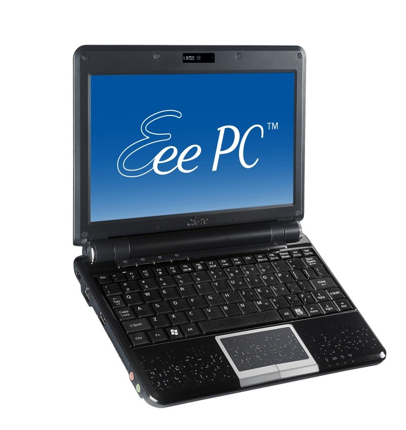

Vihdoin ja viimein sain käsiini kauan odottamani Asus Eee Pc 901 miniläppärin.\
Tämä posti on kirjoitettu sängyllä maaten Eee Pc 901:llä. Joten olen saanut tämän käyttökuntoon ja omia kuvia tulee myöhemmin. Sillä te ette halua kuitenkaan katsoa kännycami laatuisia kuvia.

Olen tässä nyt jokusen tunnin räplännyt tätä ja näppäimistöön tottuminen kestää hetkisen verran ja typoja tulee vieläkin, mutta harjoitus tekee mestarin.\
Yritin myöskin asentaa Ubuntua tähän Usb-tikulta mutta en saanut boottaamaan kumpaakaan tikkuani tältä koneelta saati pääkoneeltani. Joten kokeilu menee myöhemmäksi.

Ehkä isoin operaatio mitä olen tälle tehnyt on se, että vaihdoin Advanced desktoppiin eli kde työpöytäympäristöön. Sillä Easy mode oli turhan simppeli.

Tulen pistämään tähän Ubuntun ja siihen Ubuntuun tehty Eeelle sopiva kerneli.\
Tulen pistämään lisää kuvia ja juttua tästä koneesta kunhan saan käsiini digikameran.
