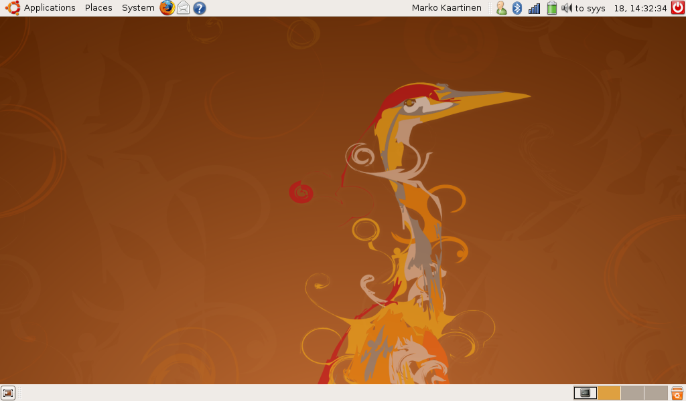

Kävin hankkimassa Prismasta 2 Gigan USB-tikun mallia Kingston DataTraveler 2 GB ja hintaa tälle tuli 9,90 € ja viiden vuoden takuulla.\
Ja eiliset tikulta boottamiseen liittyvät ongelmat katosivat ja pääsin asentamaan Ubuntua Eeelleni.

**Muokkaukset:**

- Kohdassa 6. korjattu virheellinen poisto komento.
- Lisätty kuinka asennetaan Caps-lock indikaattori

Eli ajattelin kertoa teille miten asensin Ubuntun omaan Eee Pc 901 läppäriin.\
Joten tämmönen simppeli tutoriaali tulee tässä.

## 1. Ubuntun lataus

Lataa Ubuntun uusin versio vaikka [tästä](http://www.ubuntu-fi.org/lataa.html).

## 2. Usb tikun valmistelu (tämä tehdään toisella koneella)

1.  Lataa [UNetbootin](http://unetbootin.sourceforge.net/), jonka avulla tehdään Usb tikustasi boottaava. Tarvitset mielellään 1 gigatavun kokoisen usb-tikun.
2.  Pistä usb-tikku koneeseesi kiinni ja avaan UNetbootin
3.  Valitse Distribution listasta Ubuntu ja versioksi 8.04
4.  Laita täppä kohtaan Diskimage ja etsi lataamasi Ubuntun .iso tiedosto
5.  Typeksi valitse USB Drive ja tarkasta vielä että Drive kohdassa on USB-tikkusi asema.
6.  Lopuksi paina OK ja odota, kun se pyytää boottaamaan, mutta **ÄLÄ** boottaa konettasi vaan lopeta UNetbootin.

## 3. Asentaminen

1.  Liitä usb-tikku Eee Pc 901 koneeseesi ja käynnistä kone
2.  Kun saat Asuksen logon eteesi, pitäisi tulla lähes heti kun boottaat koneen. Niin paina ESCiä ja saat eteesi boottivalinnat, valitse tästä USB-tikkusi.
3.  Listasta valitse Install, jolloin Ubuntun asennus alkaa. (mielestäni on täysin turha ladata ensin live ympäristö jonka jälkeen aloittaa asennus)
4.  Asentaminen on suhteellisen helppo, ja täytät kentät sitä mukaa kun ne tulee eteen. Ainut missä pitää kiinnittää huomiota on osiointi! Osioi itse! Eli valitse manuaalinen tapa osioida.
    1.  Osiointi ikkunassa näet 3 päätasoa ja joitain alatasoja.
    2.  Itselläni ylin taso oli 4 gigan kokoinen eli se nopea SSD levy. Tämän alatasot poistetaan ja luodaan yksi yhtenäinen osio ja mount pointiksi laittakaa /
    3.  Ja 16 gigainen taso on sitten se hitaampi SSD ja sille luodaan myös yksi alataso ja sen mount pointiksi tulee /home
    4.  SWAP osiosta se herjaa kun hyväksyt osioinnin ja SWAP OSIOTA **EI** LUODA.
5.  Sitten tulee yhteenveto asennuksesta ja valitse INSTALL.
6.  Nyt vain odotat.

## 4. Array.orgin Eee Pc:lle tehdyn kernelin asentaminen.

Itselläni ei ainakaan toiminut verkko kun olin asentanut Ubuntun tähän ja boottasin sen ensimmäisen kerran. Joten neuvon miten saat asennettua uuden Kernelin ilman verkkoa, tarvitset käyttöösi toisen koneen ja usb-tikkusi.

1.  Lataa seuraavat kaksi tiedostoa ja siirrä ne tikullesi
    1.  [linux-image-2.6.24-21-eeepc_2.6.24-21.39eeepc1_i386.deb](http://www.array.org/ubuntu/dists/hardy/eeepc/binary-i386/linux-image-2.6.24-21-eeepc_2.6.24-21.39eeepc1_i386.deb)
    2.  [linux-ubuntu-modules-2.6.24-21-eeepc_2.6.24-21.30eeepc4_i386.deb](http://www.array.org/ubuntu/dists/hardy/eeepc/binary-i386/linux-ubuntu-modules-2.6.24-21-eeepc_2.6.24-21.30eeepc4_i386.deb)
2.  Jos saat tikkuasi liitettäessä virheilmoituksen ettei tikun mounttaus onnistu niin tee päätteessä nämä toimenpiteet:
    1.  sudo gedit /etc/fstab
    2.  Poista tai kommentoi sieltä rivi: /dev/sdc1 /media/cdrom0 udf,iso9660 user,noauto,exec 0 0
        1.  Kommentointi tapahtuu laittamalla \# merkki rivin eteen
    3.  Nyt tikun liittäminen pitäisi onnistua
3.  Käyttäen terminaalia navigoi tikkusi juureen ja asenna kernel
    1.  Itselläni tikku mounttasi kohtaan /media joten *cd /media* päästää sinut kansioon missä tikku on
    2.  Tämän jälkeen komennolla *ls* näet kansion sisällön
    3.  Bongaa sieltä oma tikkusi ja komenna *cd tikkusi_nimi*
    4.  Asenna molemmat paketit yhtä aikaa ja tämä onnistuu ajamalla seuraava komento
        1.  *sudo dpkg -i linux-image-2.6.24-21-eeepc_2.6.24-21.39eeepc1_i386.deb linux-ubuntu-modules-2.6.24-21-eeepc_2.6.24-21.30eeepc4_i386.deb*
4.  Käynnistä kone uudelleen
5.  Kun boottivaiheessa se lataa GRUBia niin paina ESC, sinulla on jokunen sekunti aikaa tehdä tämä.\
    Tarkista onko eeepc kerneli valittuna, mikäli ei niin valitse se ja paina ENTER

## 5. Asennuslähteiden asennus

1.  Suorita seuraavat komennot terminaalissa
    1.  *wget http://www.array.org/ubuntu/array.list*
    2.  *sudo mv -v array.list /etc/apt/sources.list.d/*
    3.  *wget http://www.array.org/ubuntu/array-apt-key.asc*
    4.  *sudo apt-key add array-apt-key.asc*
    5.  *sudo apt-get update*

## 6. Asenna loput komponentit

1.  Terminaaliin kirjoita seuraava komento: *sudo apt-get install linux-eeepc linux-headers-eeepc*
2.  Vaihtoehtoisesti voit poistaa vanhan kernelin seuraavalla komennolla: *sudo apt-get remove linux-generic linux-image-generic linux-headers-generic linux-restricted-modules-generic*

**Ja that’s it olet asentanut Ubuntun ja kustomoidun kernelin.**

## Muokkauksia Ubuntuun vielä

1.  Automaattisesti moduulit lataukseen käynnistyksessä
    1.  *sudo gedit /etc/modules*
    2.  Lisää seuraavat rivit avattuun tiedostoon:\
        *pciehp pciehp_debug=1 pciehp_force=1\
        acpi-cpufreq*
    3.  Tallenna ja reboottaa
2.  FN + F\* napit toimimaan sekä pikanapit toimimaan
    1.  *wget http://www.informatik.uni-bremen.de/~elmurato/901/Ubuntu_ACPI_scripts-EeePC_901_1000.tar.gz*
    2.  *tar xfvz Ubuntu_ACPI_scripts-EeePC_901_1000.tar.gz*
    3.  *cd Ubuntu_ACPI_scripts-EeePC_901_1000*
    4.  *chmod +x install.sh*
    5.  *sudo ./install.sh*
    6.  Nyt napit toimivat seuraavalla tavalla:\
        **Ylimmät pikanäppäimet vasemmalta oikealle:**\
        Powersave mode with display off, Bluetooth on/off, Processor mode, Camera on/off\
        **FN + F\* napit:**\
        Fn+ F1 sleep, F2 wlan on/off, F3 F4 backlight, F5 not tested (display change), F7 mute, F8 volume down, F9 volume up.
3.  Caps,num ja scroll lock ilmaisin appletti
    1.  *sudo apt-get install lock-keys-applet*
    2.  Paina oikeall hiirennapilla yläpalkista ja valitse Lisää paneelin\
        Valitse listasta Lock keys applet ja paina lisää

No jos jotain tulee niin kysykää, kirjoitusvirheitäkin voi olla, mutta tämä opas on tehty Eee Pc 901 läppärillä ja käyttäen Ubuntu 8.04.1 käyttöjärjestelmää.

**Päivitystä:**\
Ubuntun 8.10 versiolle on tehty oma oppaansa:\
<http://wiki.ubuntu-fi.org/Asus_EEE_901_konfigurointi_(Intrepid_Ibex)>
