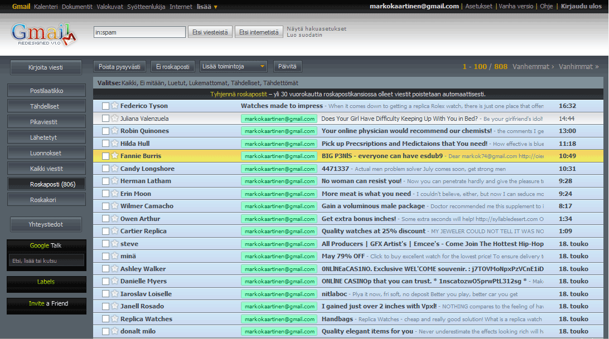

Törmäsin erittäin mielenkiintoiseen artikkeliin [Geek.comin](http://www.geek.com/gmail-getting-themes-soon/) kautta. Artikkelissa puhutaan siitä, että Gmailiin olisi teemoja tulossa pian. Tietty tämäkin on jo mahdollista erään Firefox pluggarin avulla.\
Alkuperäinen ohje löytyy [UserStylesistä](http://userstyles.org/styles/5867), mutta teille minä suomennan sen ja itse sain toimimaan kyseisen toiminnon vallan mainiosti.

**Itse ohje:**

1.  Asenna Stylish lisäosa (<https://addons.mozilla.org/fi/firefox/addon/2108>)
2.  Tämän jälkeen mene toiseen näistä osotteista:
    1.  <http://www.naverniouk.com/design/gmail/gmail.css>
    2.  <http://www.s-c-u-m.com/globex/gmail.css>
3.  Klikkaa oikealla hiirennapilla Stylish lisäosan kuvaketta (oikea alareuna).
4.  Valitse Lisää tämä tiedosto Stylishiin….
5.  Paina Tallenna nappia ja homma on siinä.

Stylishin avulla voi myös luoda omia tyylejä haluamalleen sivulle. Joten jos on innostusta ja halukkuutta niin eikun vaan luomaan tyylejä tämän lisärin avulla.

Ja tiedän, että tuo kuva on spämmi kansiosta, tämä siksi etten paljastaisi teille minun kirjeenvaihtoani :)
