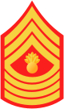

Olipa kerran taistelija nimeltä ZeTakes.\
Eräänä päivänä hän joutui keskellä taistelua nimeltä mainitsemattomassa maassa ja paikassa.\
Taistelun tuoksinnassa hän kuuli kilinää ympäriltään ja sillä hetkellä hän yritti juosta karkuun minkä kintuistaan pääsi, mutta turhaan sillä tämä kilinä oli kranaattisade.\
Pari askelta otettuaan granaatit räjähtelivät ZeTakesin ympärillä ja mitäpä muuta tästä voi seurata kuin kuolema.

Tämä oli ZeTakesin tarina. Lyhyt ja ytimekäs kertomus siitä miten hänelle kävi.\
Lepää rauhassa ZeTakes.

Kyseessä on tietenkin Call of Duty 4: Modern Warfare peli. Joka on tällä hetkellä minun pelatuin peli, kiitos aiemman [postaukseni](/2008/peleista-pelkat-serialit).\
Edellä kerrottu tarina on tosi, sillä olin äsken pelaamassa ja kuului kilinää kun granaatit tippuivat ympärilleni ja koitin juosta karkuun, mutta turhaan.\
Tämän viestin kirjoitushetkellä taistelijani ZeTakes on tasolla 24 eli Master Gunnery Sergeant II.

## Yleistä CoD 4:stä

> ***Call of Duty 4: Modern Warfare*** on Activisionin julkaisema FPS-peli, joka on Call of Duty -pelisarjan seitsemäs osa. Pelin kehitys aloitettiin jo ennen Call of Duty 3:n valmistumista, ja pelejä tehtiin päällekkäin useita kuukausia. Call of Duty 4 julkistettiin 25. huhtikuuta 2007, ja pelin teknisestä toteutuksesta vastaa Call of Duty 2:n tehnyt Infinity Ward. Peli julkaistiin Amerikassa 5. marraskuuta 2007 ja Euroopassa 9. marraskuuta PC:lle, Playstation 3:lle ja Xbox 360:lle.
>
> Syyskuun alusta lähtien Xbox Livessä Gold-tason jäsenyyden omistavat pelaajat pystyivät osallistumaan arvontoihin, joissa jaettiin pelin beta-kokeiluversioita.
>
> Peli sijoittuu lähitulevaisuuteen, toisin kuin aikaisemmat osat, jotka ovat sijoittuneet toiseen maailmansotaan. Pelin traileri ilmestyi 28. huhtikuuta 2007.

### Tarinan prologi

> John ”Soap” MacTavish osallistuu kapteeni Pricen johdolla Special Air Servicen iskuun virolaiselle rahtilaivalle Beringinsalmella, koska brittitiedustelulle annettu vihje kertoo, että laivan ruumassa olisi venäläisvalmisteinen ydinpommi. SAS-kommandot eliminoivat rahtilaivan miehistön ja siirtyvät ruumaan, josta löytyy tavarakontin sisälle kätketty ydinpommi. Venäläisten suihkuhävittäjien hyökkäys kuitenkin upottaa laivan, ja Special Air Servicen seuraava tehtävä siirtyy Venäjän maaperälle. Nimettömässä Lähi-idän arabimaassa sotilaskomentaja nimeltä Khaled Al-Asad syöksee vallasta presidentti Yasir Al-Fulanin ja teloittaa hänet suorassa televisiolähetyksessä. Yhdysvaltain mielestä Al-Asadin toiminta on vastuussa levottomuuksista Lähi-idässä, ja Yhdysvaltain merijalkaväelle annetaan käsky miehittää valtio.

Lähde: [Wikipedia](http://fi.wikipedia.org/wiki/Call_of_Duty_4:_Modern_Warfare)

Kaiken kaikkiaan aivan loistava peli ja itse suosittelen ja pidän tästä pelistä kuten olen maininnut muutamaan otteeseen.

Ja lisäyksenä tähän postaukseen, muutama kuva kyseisestä pelistä:




