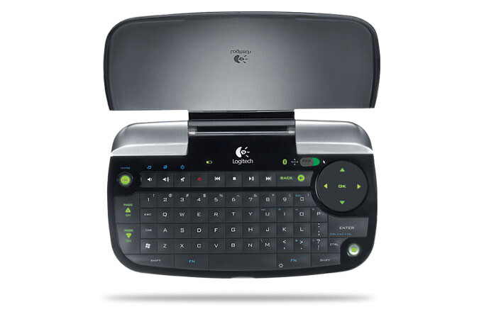
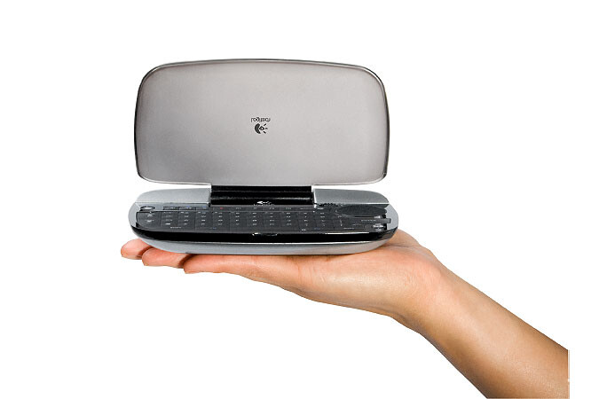

Sattuipa silmään erittäin mielenkiintoinen tuote, että on pakko blogata siitä tänne.\
Nimittäin Logitechin diNovo mini -näppäimistö jonka hinta on suomessa noin 120 euroa.

Koko ei todellakaan ole päätä huimaava ja tämä jos mikä on pientä. Nimittäin hieman kämmentä isompi ja näyttääkin vielä hyvältä.\
Koon puolesta sopisi olohuone-pc/media centeriin erittäin passelisti.

Hieman speksejä:

- 25 mm kaksois-toiminen ‘clickpad’ joka toimii joko hiirenä tai nelisuuntaisena ohjaimena
- 63 taustavalaistua näppäimistöä
- Tunnistaa ympäsristön valoisuuden ja säätää taustavaloa tarpeen mukaan säästääkseen paristoja.
- Erilliset Windows Media® Center näppäimet
- Toimintasäde 10 m
- Akun kesto noin 30 päivää
- Täysilataus noin 4 tunnissa
- Pikalautauksella (n. 10 min) 1 päivän toiminta-aika
