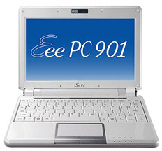
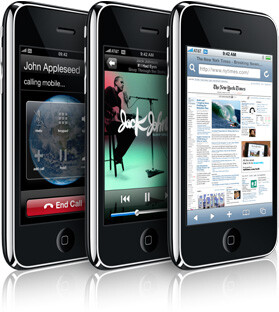

Nyt on se aika vuodesta jolloin erään Marko nimisen nisäkkään gadgetti kuume on pahimmillaan.\
Nimittäin olen iskenyt silmäni kahteen erittäin mielenkiintoiseen ja mielestäni hyvään härpäkkeeseen/leluun.\
Tässä viestissä aion jotenkin kertoa niistä, tai sitten vain länttään kuvat teille ja voitte ottaa itse selvää, mutta se jääköön nähtäväksi. Riippuu miten tämä viesti nyt etenee.

## Asus Eee PC 901

Elikkäs olen hankkimassa uutta kannettavaa nykyisen [Acer Aspire 3103 WLMi](https://cdn.markokaartinen.net/uploads/2008/08/img_0006.png):n tilalle. Ja mitäs Acerilleni käy sitten? No sen myyn äidilleni joka etsii kannettavaa ja on suostunut ostamaan sen kunhan 901 tulee Suomen markkinoilla.

Sitten voisi kertoilla hieman spekseistä:

- Intel Atom N270 (1,6 GHz)
- Muisti: 1 Gt DDR2 (266 MHz)
- Kiintolevy: SSD 20GB (Linux)
- Näytön koko 8,9”
- Käyttis: Xandros Linux
- WLAN: 802.11 n
- Bluetooth: On
- Paino: 1.1 kg

Tulen kommentoimaan ja kertomaan kokemuksiani kyseistä kannettavasta kunhan saan hankittua sen ja koitan ottaa kuvia siitä sitten myös.

Lisää infoa kyseisestä koneesta saatte Asuksen saitilta: <http://eeepc.asus.com/fi/901.htm>

## iPhone 3G

Nykyinen kännykkäni alkaa myös todennäköisesti vedellä viimesiä henkosiaan raitista maalaisilmaa taskussani. Joten olen miettinyt uutta puhelintakin ja tässä on tullut julkisuuteen Applen uusi iPhone 3G ja lievästi sanottuna haluaisin sen itselleni.

Mutta ongelmana on se, että sitä kauppaa Sonera ja se on vielä operaattorilukittu ja minulla on Elisan kytky joka on voimassa vielä aivan liian pitkän ajan. Joten minulla on pari vaihtoehtoa, odottaa joko, että Elisa alkaa myymään iPhonea tai joku purkaa lukituksen.

Mutta tässä hieman infoa iPhone 3G:stä:

- 3,5 tuuman (lävistäjä) laajakuvainen Multi-Touch-näyttö
- 480 x 320 pikselin tarkkuus (163 ppi)
- Tuki useamman kielen ja merkistön samanaikaiselle esittämiselle näytöllä
- Pituus: 116 mm
- Leveys: 62 mm
- Paksuus: 12 mm
- Paino: 133 g
- UMTS/HSDPA (850, 1900, 2100 MHz)
- GSM/EDGE (850, 900, 1800, 1900 MHz)
- Wi-Fi (802.11b/g)
- Bluetooth 2.0 + EDR
- 8 Gt tai 16 Gt flash-muisti
- Musta tai valkoinen (vain 16 Gt malli)

Tarkat speksit ja muuta tietoa iLuurista: <http://www.apple.com/fi/iphone/>

Tässäpä tämä tällä kertaa, jotain muuta ensi kerralla.
