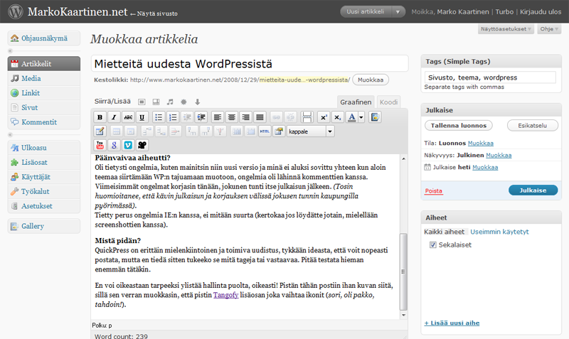

Eli käytössäni on siis WordPress 2.7, joka on tähän asti ollut aivan loistava alusta sivuilleni tai no 2.7 version myötä muuttui hallintapaneelin ulkoasu (mielestäni parempaan suuntaan!) sekä teeman yhteensovittaminen 2.7 versioon oli oma haasteensa.

**Mutta mihin on tultu?**\
No helkutti komian näköinenhän tämä on! Vaikka itse sen sanonkin.\
Työstin tätä layouttia ja testailin WP:n 2.7 versiota teiltä piilossa ja pistin sivuston huoltoon noin viikko sitten ja nyt sivusto alkaa olla kuosissa, todo listalla on enää kosmeettisia säätöjä sekä pientä sisällön muokkausta, mutta päällisin puolin homma toimii.

Karsin pluginien määrää aika roimasti ja samoin turhaa sisältöä pois, esimerkiksi Leffat & Sarjat osio on kokonaan heivattu pois, koska en kokenut sitä tarpeelliseksi.\
Plugineita karsin, koska epäilen niiden määrän aiheuttaneen sivuston hitauden (ainakin osasyynä).

**Päänvaivaa aiheutti?**\
Oli tietysti ongelmia, kuten mainitsin niin uusi versio ja minä ei aluksi sovittu yhteen kun aloin teemaa siirtämään WP:n tajuamaan muotoon, ongelmia oli lähinnä kommenttien kanssa. Viimeisimmät ongelmat korjasin tänään, jokunen tunti itse julkaisun jälkeen. *(Tosin huomioitanee, että kävin julkaisun ja korjauksen välissä jokusen tunnin kaupungilla pyörimässä)*.\
Tietty perus ongelmia IE:n kanssa, ei mitään suurta (kertokaa jos löydätte jotain, mielellään screenshottien kanssa).

**Mistä pidän?**\
QuickPress on erittäin mielenkiintoinen ja toimiva uudistus, tykkään ideasta, että voit nopeasti postata, mutta en tiedä sitten tukeeko se mitä tageja tai vastaavaa. Pitää testata hieman enemmän tätäkin.

En voi oikeastaan tarpeeksi ylistää hallinta puolta, oikeasti! Pistän tähän postiin ihan kuvan siitä, sillä sen verran muokkasin, että pistin [Tangofy](http://wordpress.org/extend/plugins/tangofy/) lisäosan joka vaihtaa ikonit (*sori, oli pakko, tahdoin!*). Ja ennen kuin kysytte niin [TinyMCE Advanced](http://wordpress.org/extend/plugins/tinymce-advanced/) lisäosaa on käytetty tekstieditorin muokkaukseen. Katsokaa samantien kaikki lisäosat [INFO](/tietoa) -sivulta.

**Mitä pitää siis vielä tehdä?**\
Tällä hetkellä on pari asiaa mitä pitäisi saada tänne sivustolle, mutta en ole vielä saanut aikaiseksi tehdä niitä. ToDo-lista tällä hetkellä on:

- Info-sivun, etusivun ja CV:n sisällön tarkastus
- CV:n siirto samalle pohjalle
- Hakupalkki sivustolle
- Headeriin ”kiva” juttu (olkoon ylläri)
- Jonkinlainen captcha -kiusaus systeemi vieraille (rekisteröitykää!)
- Sitten jotain muutakin on tehtävänä, mutta en listaa niitä.

Tämmöistä tällä kertaa, katsotaas jos bloggaisin jostain muustakin kunhan saan jotain edes noista tehtyä huomisen puolella.

Sen verran pitää vielä muokata tätä postausta, että pitää kiittää [Arkimediaa](http://www.arkimedia.fi/tiedotteet/wordpress-27-saatavilla-suomeksi/) suomenkielisen käännöksen tekemisestä!

*Kirjottaja tietää itse, että tämä blogaus voi olla sekava ja teksti ei ole mitään maailman parhainta tekstiä, joten tämä asia on loppuun käsitelty (toivottavasti)*.
