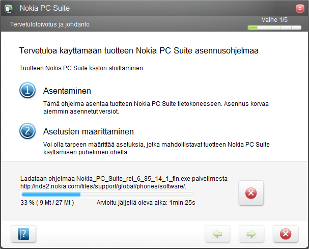

\
En voinut vastustaa kiusausta kirjoittaa tästä. Sillä otin joitain kuvia uudesta koneestani josta kirjoitan tämän päivän aikana vielä lisää.\
Niin otin ne kuvat kännykällä ja eipä tässä koneessa vielä PC Suitea ollut, joten päätin asentaa sen.

Latasin Nokian sivuilta asennuspaketin ja kas kummaa, se ilmoitti, että uusin versio on saatavilla!\
Oletin että uusin versio on se minkä latasin juuri… eipä ollut!

Mikä ihme tämäkin homma nyt on? Ensin käyttäjä lataa noin 20 megatavun asennustiedoston ja sitten ladataan 27 megatavun päivitys heti perään.

Ei näin Nokia, ei todellakaan näin…
