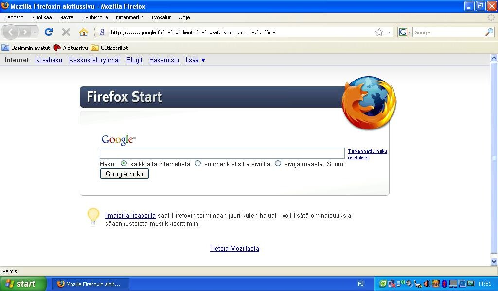
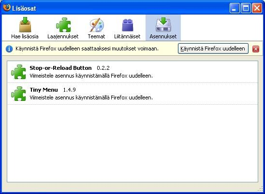
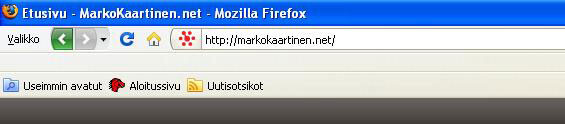
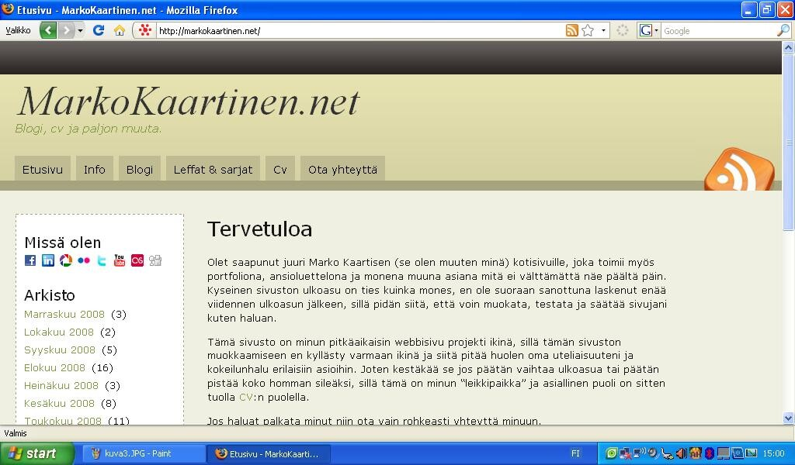
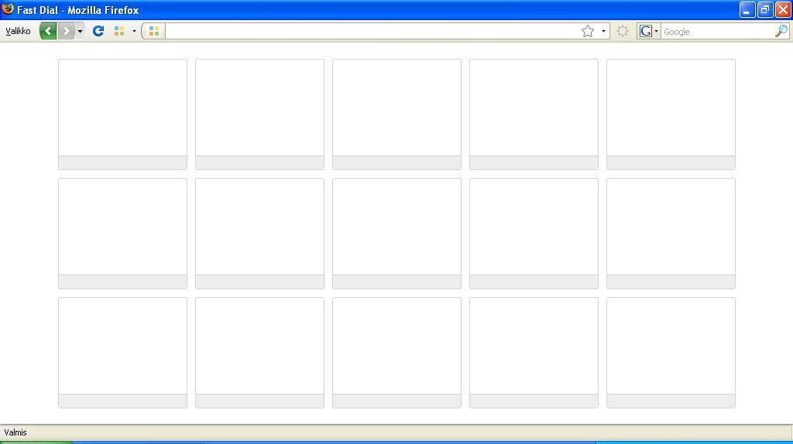

Lupailin teille opasta tästä aiheesta joten tässä se on.

Oletuksena Firefox näyttää seuraavalta:\

\
Tarkoituksena on luoda hieman lisää tilaa sivun näkymiselle ja se on erittäin simppeli operaatio ja seuraavien ohjeiden avulla se onnistuu.

Aloitetaan asentamalla kaksi lisäosaa:

- [Stop-or-Reload Button](https://addons.mozilla.org/fi/firefox/addon/313)
- [Tiny Menu](https://addons.mozilla.org/fi/firefox/addon/1455)

Tämän jälkeen käynnistä Firefox uudestaan.\
Käynnistyksen jälkeen muokataan työkalupalkkeja, joka tapahtuu seuraavan polun kautta:\
**View (Näytä) -\> Toolbars (Työkalupalkit) -\> Customize (Muokkaa)**

Tämän jälkeen vedä kaikki mitä halut, aivan ylimpään palkkiin, jolloin Firefox näyttäisi tältä:\

Seuraavaksi poistamme ylimääräiset työkalupalkit, mene **View (Näytä) -\> Toolbars (Työkalupalkit)** ja poista täpät molemmista.\
Jonka jälkeen Firefox näyttää tältä:\

## Ylimääräistä

Itse löysin vielä yhden loistavan lisäosan nimeltä [Fast Dial](https://addons.mozilla.org/en-US/firefox/addon/5721).\
Jos asennat sen ja haluat Fast Dialin aukeavan kotisivunasi niin määritä kotisivuksi **chrome://fastdial/content/fastdial.html**

