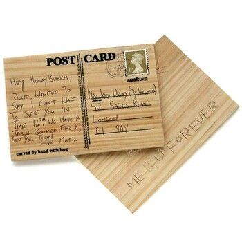

Internet on tosissaan ihmeellinen paikka sillä löysin sieltä erittäin mielen kiiintoisen konseptin.\
Nimittäin postikortit, jotka on tehty puusta. Niihin voit itse kaiverta oman tekstisi.

Tietty jos sinussa on yhtään taitoa niin voit tehdä nämä itsekin vaikkapa balsapuusta, mutta nämä ovat kyllä mielenkiintoinen ja ainakin omaperäinen ajatus.

Vinkkinä teille jotka joskus korttia lähettää minulle. Jos haluat yllättää niin puu on pop.

Puupostikortit löydetty osoitteesta <http://www.hilavitkutin.com/2008/05/15/kaiverra-postikortti-puuhun/>
