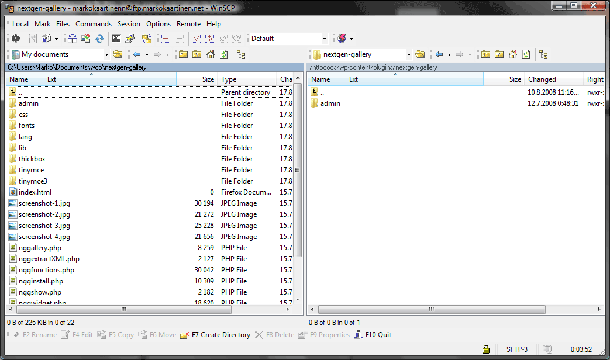

Kun lisäosaan tulee uusi versio niin se näkyy pallona hallintapaneelin oikeassa yläkulmassa, lisäosat painikkeen vieressä.\
Sen jälkeen mennään ja katsotaan mikä lisäosa vaatii päivitystä ja päivitellään se joko automaattisesti tai manuaalisesti.\
Eikö muuten kuulosta kivalta toi automaattinen päivitys lisäosien kohdalla?\
Ei se ole aina niin kiva kun luulisi. Nimittäin eilen illalla bongasin, että Nextgen gallery ei ole toiminnassa vaikka sen pitäisi ja samoin Postratings ei ole toiminnassa.\
No aloin nyt selvittelemään asiaa ja huomasin, että kyseisten lisäosien kansio on mutta sisältöä ei ole kokonaan siellä.

Tulin siihen lopputulokseen, että kun olen päivittänyt lisäosaa automaattisesti niin siinä on mennyt jotain pieleen ja se on kadottanut tiedostot.

Eli siis SUOSITTELEN lataamaan uuden lisäosan kun se tulee ja MANUAALISESTI päivittämään sen. Näin vältyt siitä, että ei lisäosat katoile sivuiltasi.
