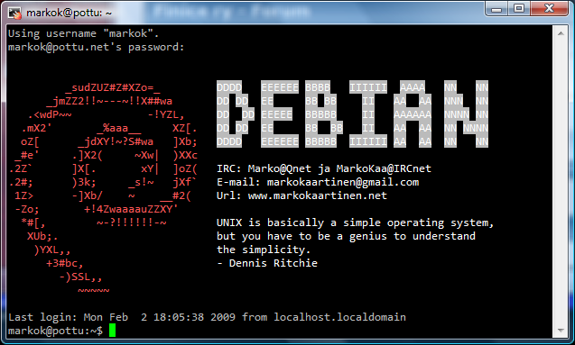

Sain tänään idean muokata hieman Debian serverini motd tiedostoa, eli tiedostoa joka näyttää ”message of the day” viestin kun esimerkiksi ssh:lla kirjautuu palvelimelle.\
Sehän on hieman mälsä aluksi joten päätin muokata sitä hieman hienommaksi ja no kerronpa tässä mitä tein ja miksi ja lopuksi saatte vielä kuvan minkälainen siitä lopulta sitten tulikaan.

Eli aloitetaan asentamalla linux_logo niminen paketti komennolla ***apt-get install linuxlogo*** (tietysti roottina).

Tämän jälkeen voit komentaa linux_logo, jotta näät millainen se tällä hetkellä on.

Sitten kun ja jos haluat kustomoida sitä niin komenna roottina ***nano /etc/linux_logo.conf*** jolloin aukeaa nanossa tekstitiedosto.

Itselläni on seuraava rivi ensimmäisenä ja olen varsin tyytyväinen kyseiseen lopputulokseen:\
***-L 4 -u -k -y -s -F ”IRC: Marko@Qnet ja MarkoKaa@IRCnet\nE-mail: osoitteeni\nUrl: www.markokaartinen.net\n\nUNIX is basically a simple operating system,\nbut you have to be a genius to understand\nthe simplicity.\n- Dennis Ritchie”***

Eli koko pitkä pötkö on samalla rivillä, ensimmäisenä kyseisessä konffi tiedostossa. Olen poistanut oman e-mailin erimerkistä.\
\n toimii rivinvaihtona.

Tämän jälkeen tallenna **ctrl + o** näppäin yhdistelmällä ja sulje **ctrl + x** yhdistelmällä.

***linux_logo*** komennolla voit katsoa miltä se näyttää.

Seuraavalla komennolla siirretään lopputulos *motd* tiedostoon: **linux_logo \> /etc/motd** (roottina)

Oma tulokseni on seuraavanlainen:\

