Kun uusi lay on julkaistu niin on aika myös hieman tutkia menneisyyttäkin.\
Nimittäin eilen löysin pari vanhaa layouttia ja tänään etsiskelin lisää niitä ja löysinkin pari lisää.

Tässäpä teille listaus siitä mitä olen joskus tehnyt.


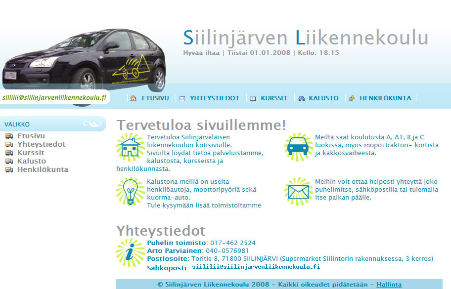
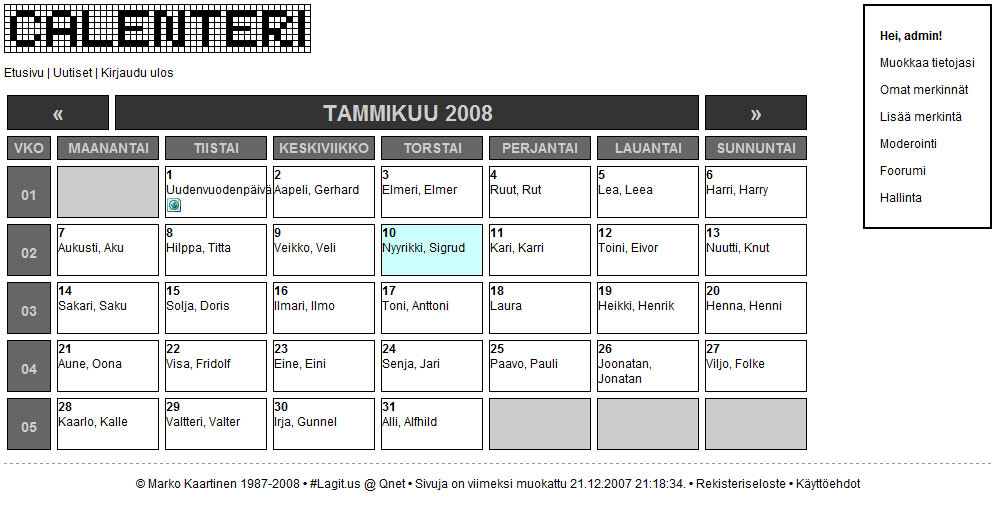
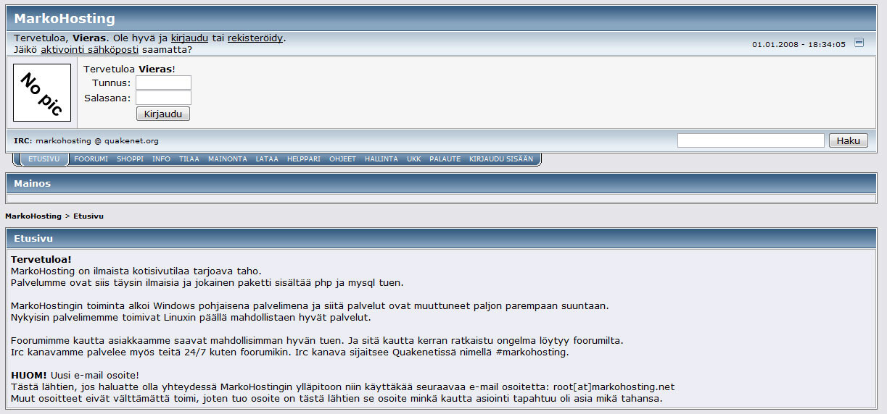
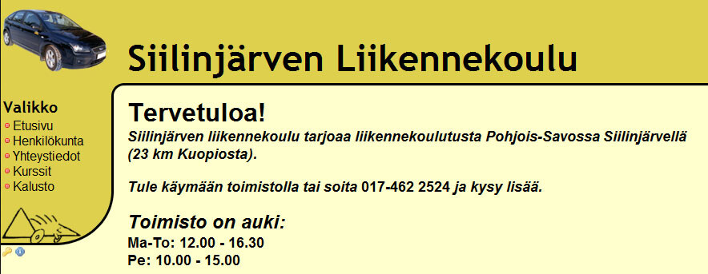
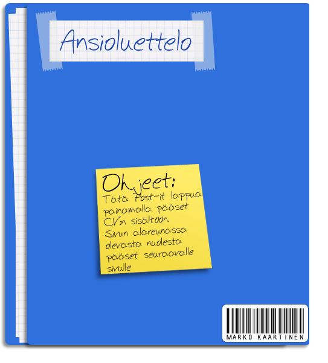
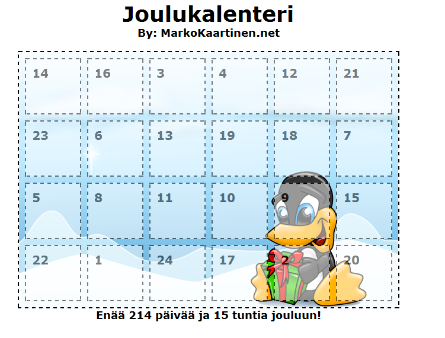

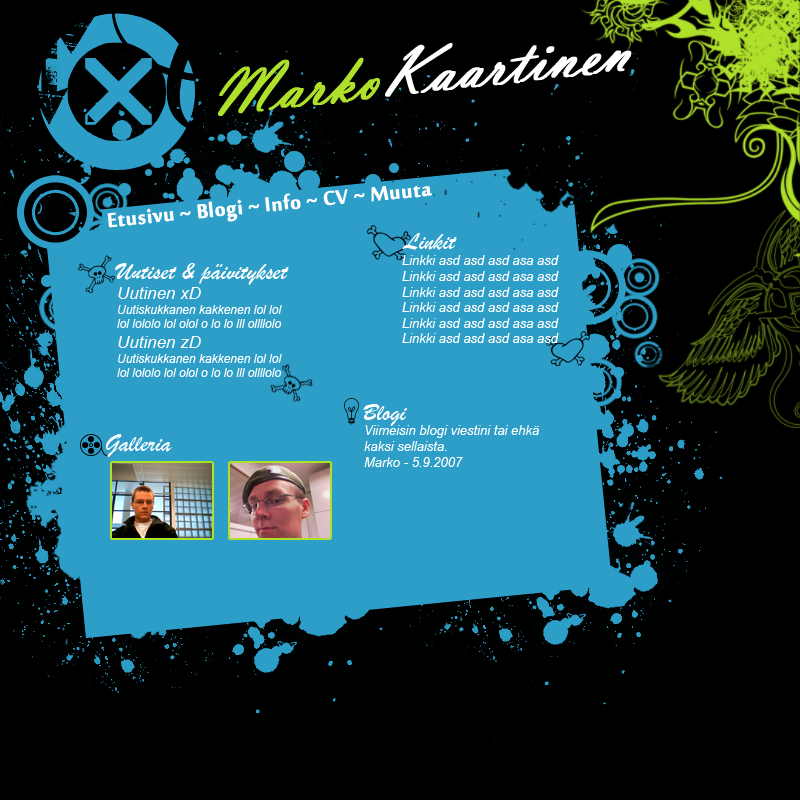
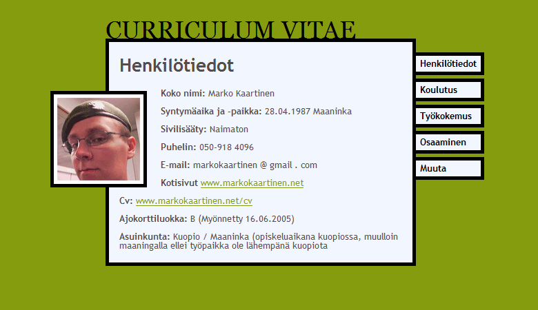
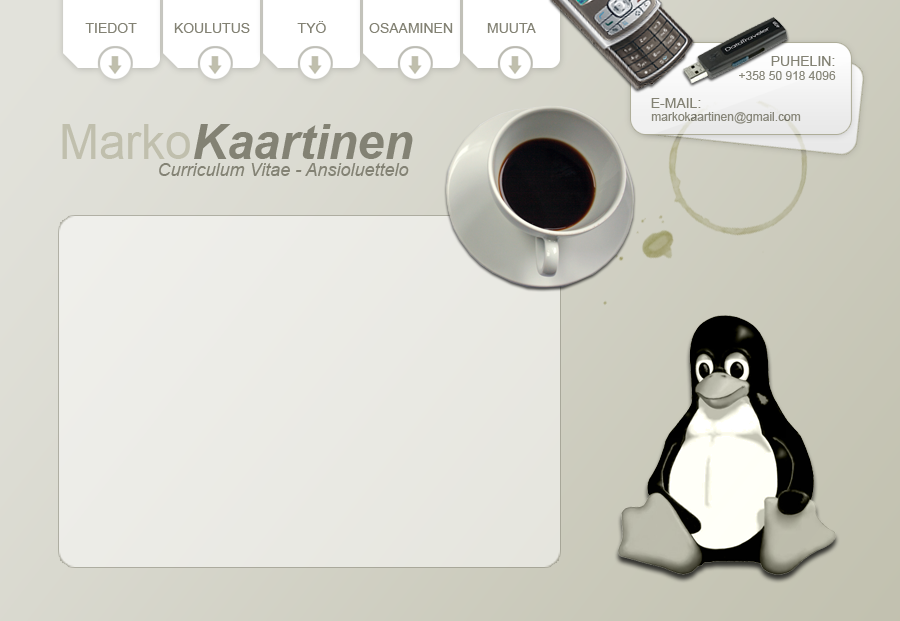
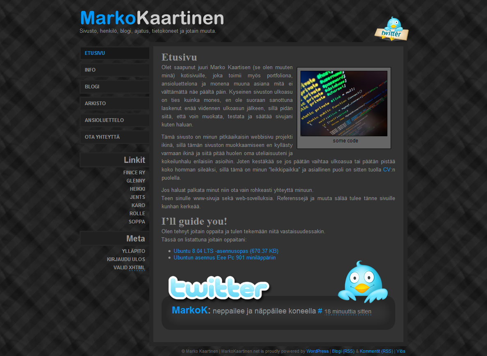
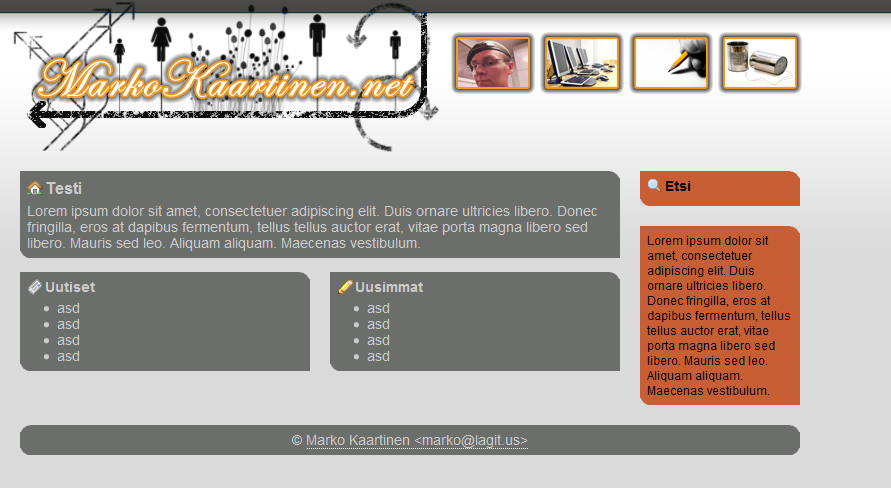
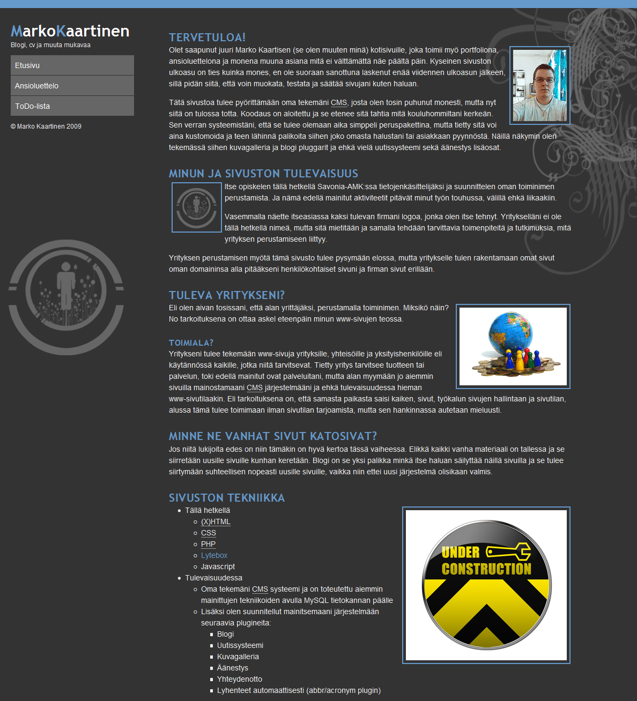
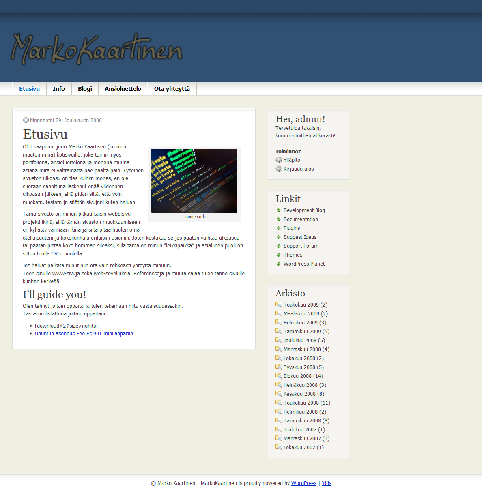
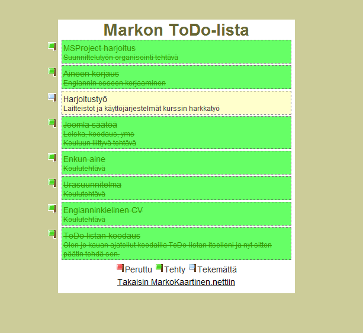
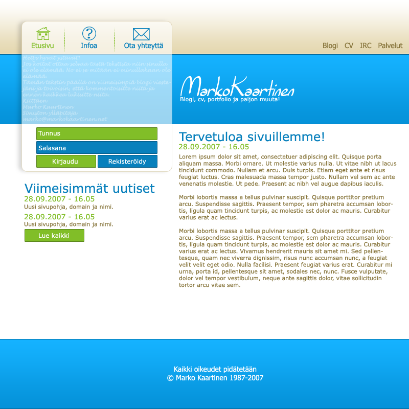
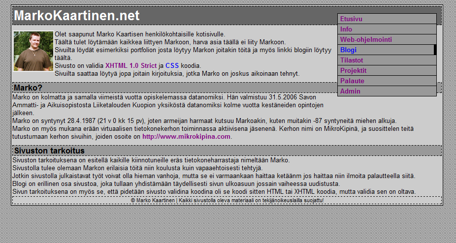
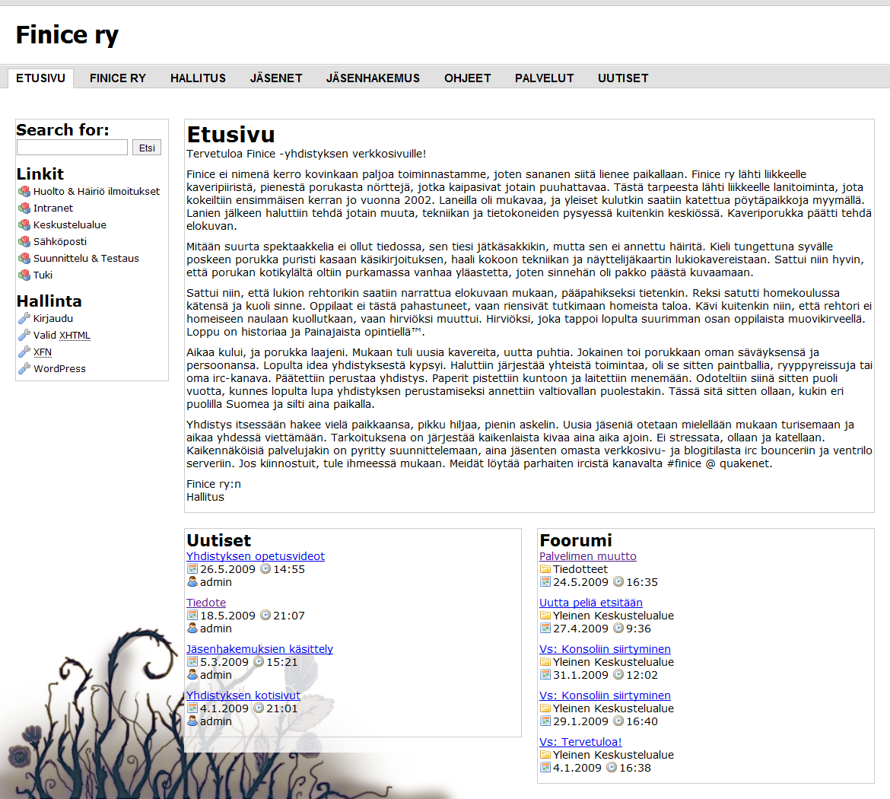

