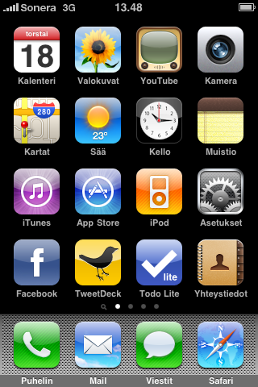

Kuten osa tietää minulla on iPhone 3G ja en ole kirjoitellut mitään sen jännempia kirjoituksia kyseisestä vekottimesta. Mutta viime viikolla oli jo tarkoitus kirjoitella tämä, tosin juhannus tuli ja hieman rokotti kirjoittelua…

Eli artikkelin ideana on hieman valottaa minun näkökulmaa luurista ja sen ohjelmista. Tämä on todennäköisesti ensimmäinen osa kaksiosaisesta kirjoituksesta ja kuvia löytyy. Ohjelmien järjestys ei riipu mistään sen ihmeellisestä, lähinnä siitä missä järjestyksessä on kuvat koneella.

## **Yleistä**

iPhonehan on omppu logolla varustettu puhelin ja mielestäni se on hyvä puhelin, sanoivat omppu vastustajat mitä tahansa. Ei en omista muita omppu logolla varustettuja vekottimia. Mutta OSX on vähintäänkin mielenkiintoinen käyttöjärjestelmä.

Uuden 3.0 päivityksen myötä iPhone 3G sai tukun uusia ominaisuuksia ja parannuksia. Mutta voiko sillä soittaa? Voi! Minä vahvistan sen! SILLÄ VOI SOITTAA! (ehh…) Luuri sai myös koko puhelimen kattavan hakusivun (Spotlight nimeltään ellen väärin muista)

Luurihan on prkl loistava käyttääkkin, käyttöliittymä toimii ja vaikka nappeja on puhelimessa vain pari niin silti, loistava käyttää! Ja voin kyllä samaan syssyyn kehua näppistäkin (kyllä kosketusnäppistä kehun).

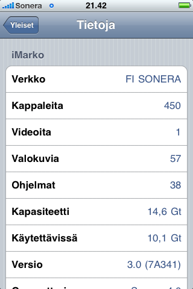

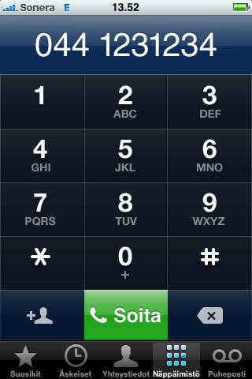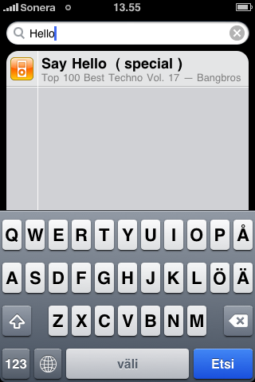

## **Kartat**

Itse pidän iPhonen kartoista, osittain siksi, että ne ovat Googlen karttojen pohjalla, mutta myös siksi että se toimii. Ajaessa en ole testannut karttojen ominaisuuksia, kuten reittiopastusta ja sen semmoista. Mutta testasin sitä miten hyvin se pysyy mukana kun auto liikkuu 80 km/h ja avataan kartat sovellus. Hetken se etsi minua, mutta kun se löysi niin sitten se oli yllättävän hyvin mukana.

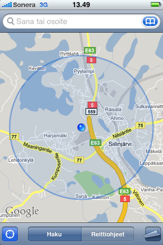

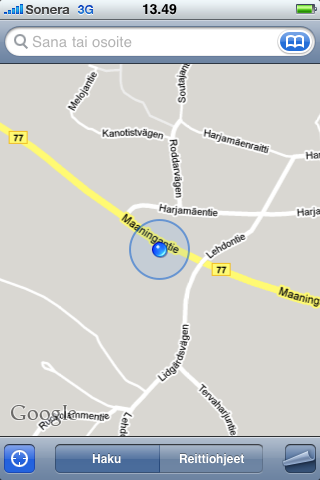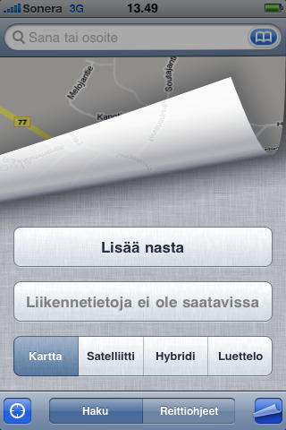

## **Kalenteri**

Kalenteri on mielestäni hyvä, itse pidän. Verrattuna entisen puhelimeni (Nokia N80) kalenteriin tämä pieksää sen 10-0. Ja kun sain synkattua sen Google kalenterin kanssa niin tämä on vallan mainiota.

Ainut mitä kaipaisin kalenteriin olisi viikkonumerot, tosin tämän haluan yleensä jokaiseen kalenteriini, mutta tämän onnistuin kiertämään synkkaamalla Google kalenteriin viikonnumerot iCal muodossa, jolloin Maanantaina on merkintä jossa näkyy viikon numero. Patentti? kyllä, mutta toimii -\> Marko = tyytyväinen.

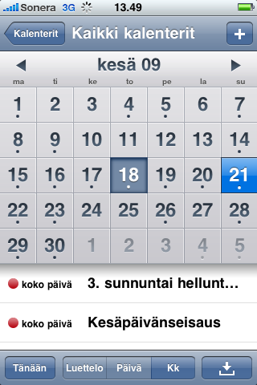

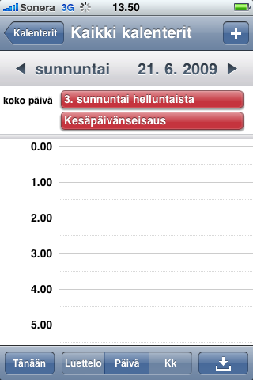

## **Facebook & Twitter**

Kirjoittelin aiemmin tästä aiheesta [artikkelin](/2009/twitter-vs-facebook) joten en edes ala siitä aiheesta huutelemaan sen enempää. Mutta Facebookille on oma appsi tähän touhuun, joka on oikeastaan erittäin hyvä. Twitterille olen käyttänyt pariakin appsia, mutta nytten on käytössä TweetDeck.

Varsinkin Twitterin kanssa pidän TwitPicistä, sillä samalla kun olen Twittaamassa, voin heittää kuvan siihen ja se ilmenee linkkinä Tweetissä ja menee TwitPiciin. Loistavaa! Eikö vain?

Kun taas Facebookkiin en ole kuin pari kertaa heittänyt samantapaisesti random kuvan kännyn kautta, ei vaan iske…

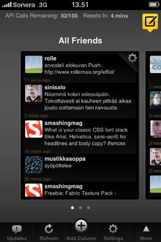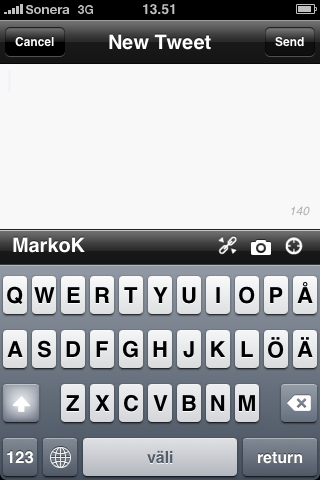

## **Viestit**

Koska iPhone tukee 3.0 päivityksen myötä myös MMS viestejä niin pitää sekin mainita, sekä copy-paste feature on tullut samaten 3.0 päivityksessä.

Itse en niin välitä MMS-viesteistä. Olenkohan viimeisen vuoden aikana ehkä kaksi mms-viestiä pistänyt joista toinen on varmasti ollut tämä iPhonen mms-featuren testiviesti. Eli hyödyllinen ominaisuus minulle? Ei!

Copy-pastella taas näen potentiaalia. Sillä se on mielestäni toteutettu hyvin ja toimivasti ja perhana… MINÄKIN osaan käyttää sitä! :)

3.0 päivityksessä näppäimistöön (suomenkieliseen) tuli myös skandit, hyvä asia? En ole vielä aivan varma, sillä kerkesin tottua skandittomaan näppikseen, mutta plussaa siitä myös, että nyt vaakatasoinen näppis on käytössä joka sovelluksessa? No ainakin viesteissä.

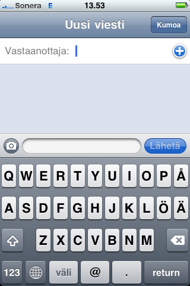

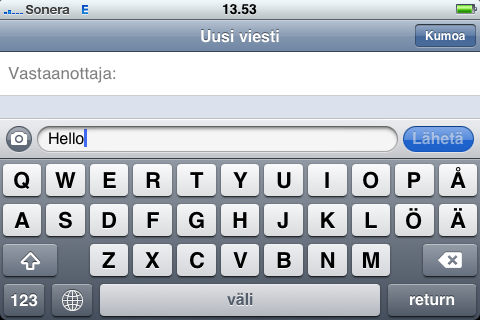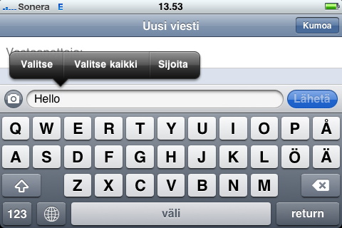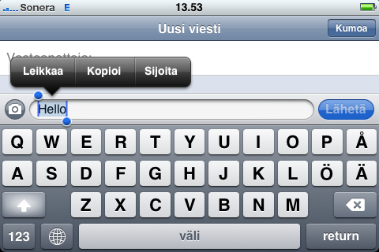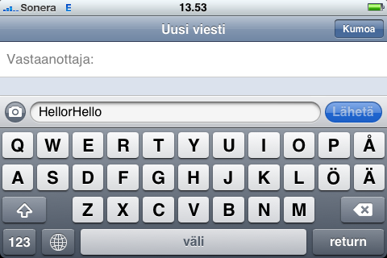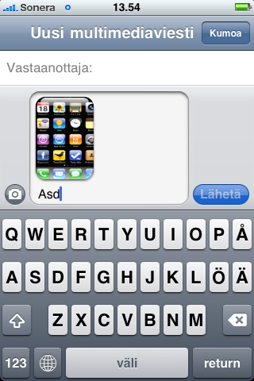

## **Loppusanat?**

Vai, että pitäisi vielä jollain jännällä? tavalla summata tätäkin vekotinta. Kuten sanoin tämä on ensimmäinen osa joten voitte odottaa samantapaista postausta lähiaikoina. Toivoisin teiltä sen verran osallistumista (jos joku nyt luki tämän o.O), että heittäkää tonne kommenttilootaan mitä softaa haluisitte nähdä (mikäli se ei maksa miljoonia niin testaan!) tai mikäli ette halua kommentoida tänne niin heittäkää vaikka [Twitteriin](http://twitter.com/MarkoK) tai ihan minne vaan kunhan se tavoittaa minut o.O

Tällästä tällä kertaa, tosin pelejäkin voisi heittää sitten toisessa osassa, sillä niitäkin löytyy!
