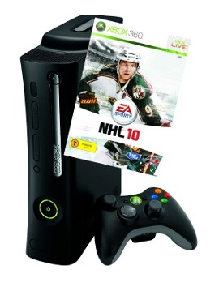

Tarkkaavaisimmat ovat huomanneet Twitterin ja Twitpicin (ja ehkä Facebookin) kautta, että olen hankkinut Xbox 360 pelikonsolin. Hankinta on ollut jo pitkään mielessä ja nyt se tuli viimein hankittua. Ja sanon jo nyt tämän: PS3 hehkuttajat voivat hehkuttaa jossain muualla! Mutta itse asiaan, eli ellei joku nyt tiedä niin Xboxi on Mikkisoftan konsoli ja kyseessä on minun mielestä hyvä konsoli sanoitte mitä tahansa ja olen ollut tyytyväinen hankintaan vaikka olenkin vasta kerennyt pelata sillä yhden illan.

Ja tuli hankittua seuraavanlainen setti:

- Xbox 360 konsoli (musta)
- 120 Gt kiintolevyllä
- Langaton ohjain
- Laturi + akku ohjaimeen
- NHL 2010 peli

Eli kyseessä on Xbox 360 Elite malli ja ne joita kiinnostaa niin tarkemmat speksit löytyy varmasti googlella. Ja mukanahan tuli yhden kuukauden verran live aikaa.

Tuleeko pelaamiseni kokonaan siirtymään boxille? En usko, sillä PC-pelaaja olen ollut ja CoD-sarja tulee olemaan aina parasta PC:llä sekä hiiri ja näppis on sen verta tuttu ympäristö, että siitä ei täysin luovuta pelaamisen kannalta. Mutta uusimman CoD MW2 pc-versio voi olla suht paskottu ainakin nettipelin puolelta, että se tulee myös boxille hankittua. Myös senkin takia, että pari kaveria hankkii sen myös.

Olen aina pitänyt Xboxissa yhdestä asiasta – nimittäin ohjaimesta. Sen olenkin hankkinut aiemmin PC käyttöön ja nyt sen saa kakkosohjaimeksi boxiin. Hienoa ellen sanoisi, nyt onnistuu NHL 2010 pelaaminen samalta sohvalta (ja muidenkin pelien sitten tulevaisuudessa).

Tämmönen lyhyt rykäsy tällä kertaa – jatketaan pelien ihmeellisessä maailmassa taas jossain vaiheessa.
