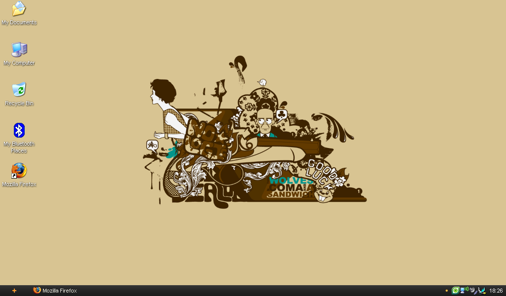

O hai!! En ole pariin kuukauteen kirjoitellutkaan tänne ja päätin, että nyt on katkaistava tämä blogaamattomuuden putki.\
Tämän blogauksen tarkoitus on hieman kerrata parin kuukauden tapahtumia eli edellisen postauksen jälkeisiä säätöjä/hankintoja ([Lapselle leluja](/2009/lapselle-leluja)).

## Leluja ja dataromua

Aloitetaan näistä leluista ensimmäisenä! Eli olen hankkinut tuon iPhonen, kyllä luitte oikein Applen iPhone 16gig tuli hankittua tässä reilu kuukausi taaksepäin ja olen ollut erittäin tyytyväinen kyseiseen puhelimeen ja odottelen 3.0 versiota jo sormet syyhyten! En ole kokenut tarvetta jailbreikata puhelintani, sillä se ei tuo minulle mitään mitä minä tahtoisin siihen.\
Kamerakin tuli hankittua kuten mainitsin jo ja siihen myös 4 gigaisen muistikortin. Olen tähänkin ollut tyytyväinen ja kuvanlaatu ja ominaisuudet on minun kaltaiselle kuvaajalle aivan tarpeeksi. Joten en todellakaan kadu sitä et päädyin normaaliin digikameraan enkä digijärkkäriin. Samassa paketissa tuli kamera, kaksi akkua, laturi akuille ja kotelo joten minun mielestäni erittäin kattava ja hyvä setti!

Olen myöskin tehnyt itselleni erittäin älykkään/tyhmän havainnon sillä asentelin taas vaihteeksi omaan Eee 901 miniläppäriin Windows XP:n ja tuunailin sitä hieman ja päädyin lopputulokseen, että se on yksinkertaisesti minulle paras vaihtoehto Eeehen!\
Päädyin tähän ratkaisuun, koska XP on nopea, pienikokoinen ja se yksinkertaisesti toimii Eee 901:llä loistavasti minun mielestäni. Ja mikä parasta akkukesto on sen 5-6 tuntia, jolloin kone kestää sen koulupäivän verran vaikka ei aina pääsisikään pistokkeen ääreen ahtamaan lisää virtaa koneelle.

Sitten hieman lisää hankintoja, pistin tilaukseen uuden prosessorin [tietokoneeseeni](/2008/uusi-koneeni). Prosessori on mallia Intel Core 2 Quad Q8200 2.33GHz ja tilasin samalla 1 teratavun kiintolevyn koneeseeni. Muuten tuosta alkuperäisestä kone ei ole muuttunut paitsi seuraavat on hankittu: muistia 2 gigaa lisää, näppäimistö vaihdettu Logitech Waveen ja hiiri vaihdettu Logitech MX Revolution langattomaan laser hiireen. Ja ettei ihan unohdu niin kaiuttimetkin on hankittu ja nekin on yllättäen Logitechin Z-3e 2.1 kaiuttimet.

## Elämä on laiffii

Ja tässä vaiheessa alkaa se osuus jonka pitäisi jollain tavalla keskittyä minun elämään (ai mulla on semmonen?).\
Kuten jo mainittua leluilla on tullut leikittyä ja kappas kummaa kun menin reilu viikko sitten vanhenemaankin. Olen nykyään jo 22-vuotias opiskelija (kyllä opiskelen vielä tietotekniikkaa).\
Ai niin vappu! Kyllä juuri se opiskelijoiden ja työläisten juhla, jolloin ne joilla on valkoinen vappuhattu lukiosta voi sen laittaa päähänsä (ja minähän en tämmöistä omista!). Itsehän liikuin vappuna aniilinpunaisissa haalareissa Kuopion keskustan tuntumassa ja kyllä tulihan sitä jotain maisteltuakin.

Entäs sitten? Kesä edessä ja tukkaa ei ole paljoa päässä. Tosin kesä menee koodaillessa erästä websovellusta eräälle firmalle, joten tekemistä ei puutu!

**HYVÄÄ TULEVAA KESÄÄ KAIKILLE!!**
