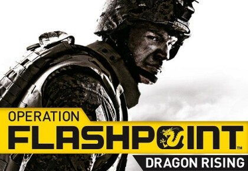
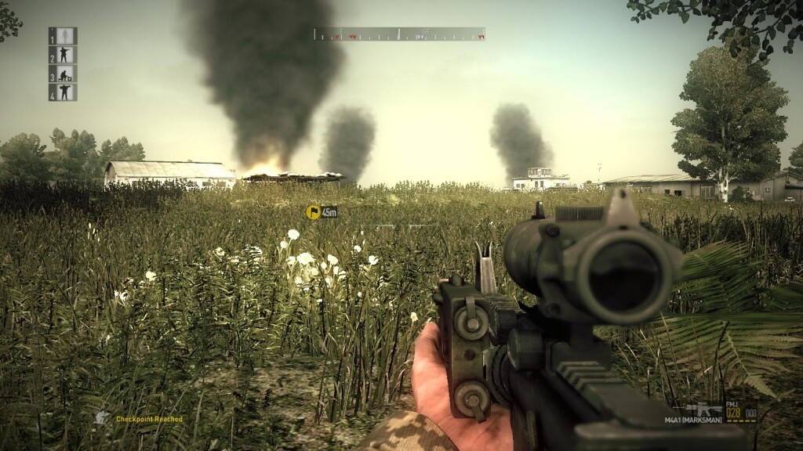
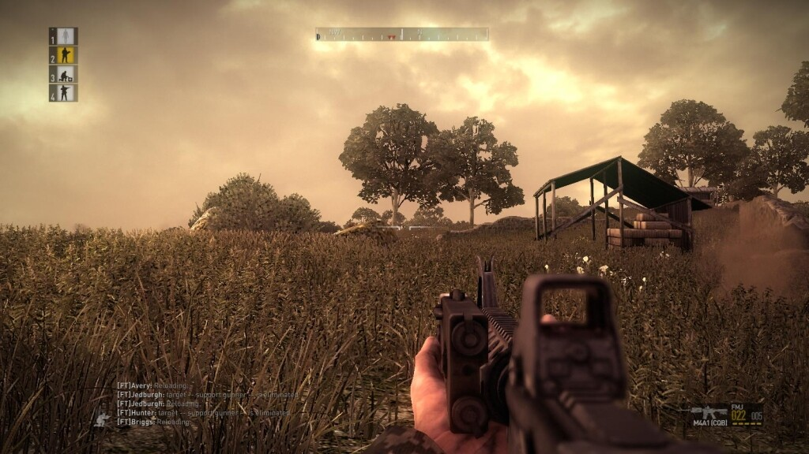
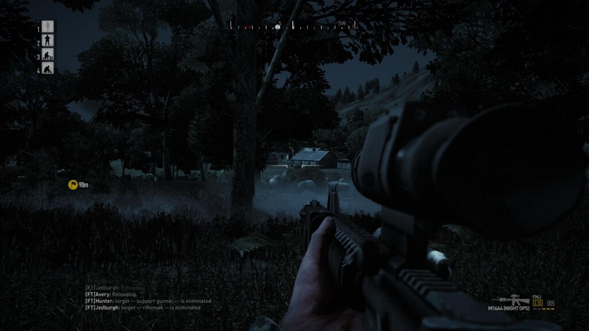

Tässä on peli jota olen jonkin aikaa jo odottanut ja nostattanut omaa innostustani katselemalla trailereita ja shotteja. Ok, peli on ollut minulla jo pari viikkoa (kai) ja sitä on tullut pelattua suhteellisen satunnaisesti ja ehkä vähemmän kuin olisin halunnut erilaisten muiden kiireiden takia. Mutta olen kuitenkin jonkinlaisen vaikutelman saanut pelistä ja tähän mennessä olen pitänyt siitä. Ja minähän kun en mikään maailman paras kirjoittaja ole saati sitten peliarvostelija niin no… tuloksen tiedätte.

Ensinnäkään en ala mitään pirun laitteistovaatimuksia yms. listaamaan tähän sillä ne te löydätte esim. [Wikipediasta](http://en.wikipedia.org/wiki/Operation_Flashpoint_Dragon_Rising). Mutta itse asiaan. Pelihän kyykyttää joissain tilanteissa vaikka pelaankin normaalilla vaikeusasteella, joka ei sinänsä ole huono asia sillä tässä painottuu se, että PIDÄ SE PÄÄ ALHAALLA! Ja tietysti kun juokset kukkulalle niin APC pistää sarjan ja itse otat iskua ja kun huudat mediciä niin idiootti tekoälyn ohjastama tiimikaveri tulee viereen idlaamaan…

Omalla koneellanihan Flashpointti toimii hyvin, ei minkäänlaista tökkimistä ole tullut vielä vastaan ja ALT-TABaaminen winkkariin luonnistuu jopa kivasti (ok… piti mainita… kaikissa ei onnistu nimittäin). Ja pidänkö pelistä? No kyllä! PST-miehen vaistot heräsivät kun kädessä oli sinko ja vastassa pari APC:tä… Voi sitä ilon tunnetta kun nouset nurmikosta ja paukautat APC:tä singolla kylkeen (tätä ennen kuolin pari kertaa kun nostin sitä päätä -.- ja tilanteessa oli tietysti vastassa myös jalkaväkeä tulittamassa meitä…).

Äänipuolen pojille ja tytöille menee isot kehut sillä enpä ole ihan äsken törmännyt peliin missä huoneessa ammuttaessa tiedät ja kuulet ampuvasi huoneessa. Muutenkin aseiden äänet kuulostaa siltä miltä niiden pitääkin ja kun sinua tulitetaan niin kuulet myös sen kun panokset hakkaa viereistä seinää/maata/mitä tahansa. Erittäin hienoa ellen sanoisi!

Co-oppina peliä on myös loistava pelata, silloin kaverisi ja sinä olette samassa tiimissä ja tähän kun yhdistää ventin/ts:n niin alkaa olla jo enemmän tunnelmaakin pelissä kun kaveri huutaa korvaan ”SUOJAA PRKL”. Ja mikäli alkaa sooloilemaan tai no… toinen päättää tehdä jotain ja sattuu olemaan ryhmänjohtaja niin tekoälypellet seuraa sitä ja huomaat olevasi yksin talon seinustalla kun viholliset tulee edestä ja takaa ja kuolet lopulta siihen kun takaa tulee vihollinen ja pistää sarjan… Eli kommunikaatio on avain tässäkin taas… Mutta noh… näitä sattuu.

Kaiken kaikkiaan loistava peli kyseessä ja pitäisi keretä pelaamaan enemmänkin tätä. Ja tietysti koittaa vaikeimpia vaikeusasteita, mutta kunhan saisi nyt tuon kampanjan läpi tuolla millä sen aloitti.

