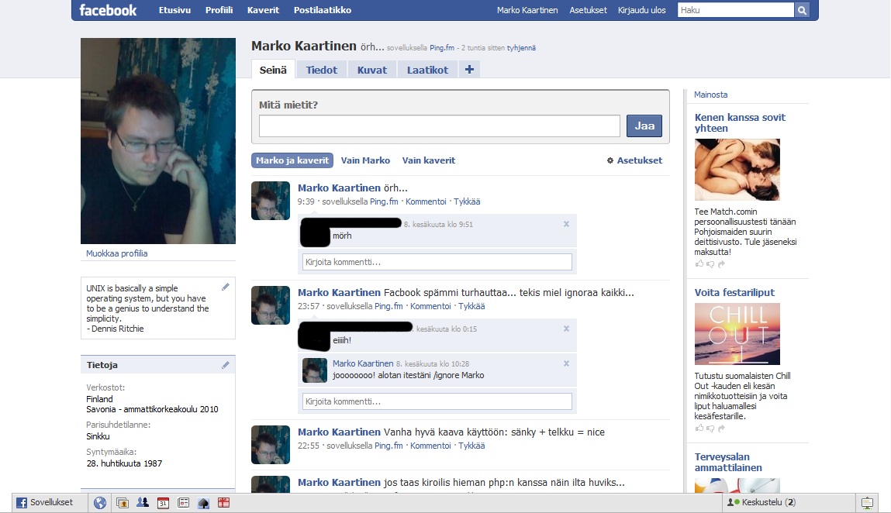
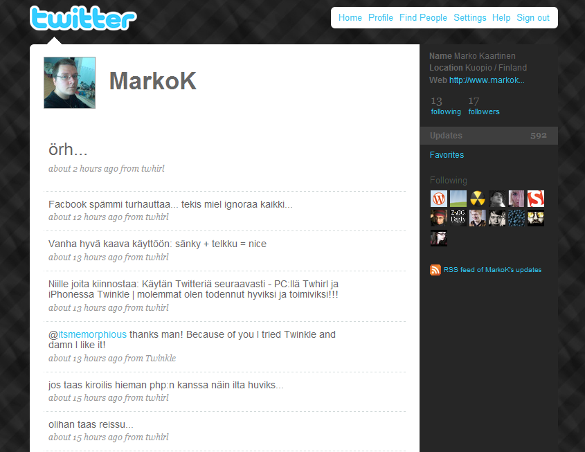

Uskon, että lähes jokainen on kuullut näistä kahdesta palvelusta joita aion nyt vertailla jollain tapaa tässä kirjoituksessa. Nimittäin Twitter ja Facebook ovat molemmat suhteellisen tunnettuja ja suosittuja palveluista ja yllättäen itsekin olen molemmissa.

Voisin aloittaa ensinnäkin kertomalla mitä ko. palvelut on sillä kummatkinhan on sosiaaliseen mediaan liittyviä palveluita. Ja samalla taitaa tulla pientä kommenttia ko. palvelustakin.

## Facebook

Facebook on yhteisö, jonne rekisteröitymällä voi luoda oman profiilin ja blogin ja ties mitä härpäkettä. Kuten kaikissa palveluissa Facebookissakin pitää varoa mitä julkaisee sillä pomo voi olla nurkan takana vaanimassa, tai sitten yksinkertaisesti estää ulkopuolisten pääsyn profiiliin.\
Voit julkaista Facebookissa melkein mitä vain, pitää blogia, heittää kuvia yms. En edes tiedä mitä kaikkea sinne voi heittää, voisin melkein sanoa, että kaikkea lain määräämissä rajoissa. *(korjatkaa pliis joku jos olen väärässä)*

Jostain kumman syystä ihmisille on tullut tarve ja halu tehdä kyselyitä Facebookissa ja itse olen estänyt KAIKKI kyselyt jotka tulee profiiliini ja niitä alkaa olla suhteellisen PITKÄ lista jo. Vaikka moni ihminen on valittanut minulle noista kyselyistä niin silti itse tekevät ja julkaisevat niitä profiilissaan… Miksi? En todellakaan tiedä…

Facebookissakin on keskustelu ominaisuus, joka on mielestäni osittain hieman turha sillä itse en oikein lämpene noille selaimen pohjalla käytettäville chateille ja ties mille, joten en oikeastaan käytä koko ominaisuutta.

Appsit… eli sovellukset. Niitä on pitkä lista ja kuka vain voi tehdä oman joten kai tämän osittain voi plussaksi laskea, mutta suurin osa appseista on turhia ja hyödyttömiä.

Ulkoasu… oh dear lord… Siis älkää käsittäkö väärin, värit ja muut on ihan jees, mutta itse olen käyttänyt Greasemonkeytä poistamaan vasemmalla olleen palkin sekä kohokohdat ja Sponsorit palkin oikealta, miksi? No siksi koska ne on TURHIA! Ja tietty on kivempi katsoa sitä.

Toimivuus? ööö joo toimii, mutta joskus se bugaa kympillä, tulee mitä mielenkiintosempia ilmotuksia ja lopputuloksena alkaa vaan suoraan sanottuna vituttamaan koko palvelu.

## Twitter

Twitter taas on mikroblogipalvelu, joka mahdollistaa käyttäjän lähettää tekstipohjaisia päivityksiä, tosin maximissaan 140 merkkiä pitkiä. Yksinkertaisuudessaan Twitter on 140 merkkisten päivitysten julkasupalvelu eli pirunnäppärä tapa heittää jotain linkkiä/pientä juttua.\
Twitteristä voit myös vastailla/merkitä tähdellä toisten tweettejä. Myös eri sovelluksissa on ns. retweet mahdollisuus eli lähettää toisen tweet eteenpäin.

Itse tykkään todella paljon Twitteristä, varsinkin iPhonen kanssa Twitter on loistava väline pikaiseen ”blogaukseen”. Varsinkin kun nykyiset Twitter sovellukset tukevat Twitpic kuvapalvelua jolloin saa näppärästi otettua kännykällä kuvan ja pistettyä suoraan nettiin ja Twitterin kautta julkaista se.

Tosin tänäpäivänä käytän Twitteriä oikeastaan Facebookin status julkausujen päivittämiseenkin eli se toimii seuraavalla tavalla: PC:llä päivitän Twitteriä Twhirl sovelluksen kautta jossa on tuki Ping.fm:lle joka taas päivittää saman statuksen Facebookin, tällöin minä voin jättää Facebookin kokonaan pois tästä prosessista ja käydä vain katsomassa Facebookista kommentit tai jotain…

Twitterin ulkoasua voit kustomoida itsekin, lähinnä värejä ja teemaa voit vaihdella. Tosin eipä muuta tarvitsekaan, koska kyseessä on erittäin simppeli ulkoasu muutenkin ja erittäin pätevä. Ei mitään ylimääräistä, enkä oikeastaan kaipaakkaan siihen mitään, koska käytän sovelluksien kautta Twitteriä, enkä niiden sivujen kautta.

Toimivuus? No Twitter toimii todella hyvin. En ole törmännyt vielä bugeihin. Eli se siis vaan toimii!

## Yhteenveto

| <strong>Plussat</strong> | <strong>Miinukset</strong> |
|---|---|
| <strong>+</strong> Ulkoasun värit ja selkeys <strong>+</strong> Greasemonkeyn avulla poistetut palkit <strong>+</strong> Mahdollisuus tehdä omia appseja <strong>+</strong> Tykkään-nappula <strong>+</strong> Mikroblogaus/status updatet <strong>+</strong> Siellä tapaa vanhoja tuttuja | <strong>–</strong> Kyselyt… <strong>–</strong> Turhat ulkoasun palkit <strong>–</strong> Bugit <strong>–</strong> Muutokset jotka vaan tapahtuu.. <strong>–</strong> SPÄMMI |

 

| <strong>Plussat</strong> | <strong>Miinukset</strong> |
|---|---|
| <strong>+</strong> Kevyt <strong>+</strong> Toimiva <strong>+</strong> Tekee mitä lupaa <strong>+</strong> Ehdoton kaveri iPhonelle <strong>+</strong> Monet eri softat tälle <strong>+</strong> Kuvajulkaisu Twitpicin kautta <strong>+</strong> Twitter bird &lt;3 | <strong>–</strong> Vain 140 merkkiä |

Mitä voi tästä päätellä? No ainakin sen, että Twitteri voittaa Facebookin. Ainakin minun mielestäni. Pitäisikö siis Facebook tili poistaa kokonaan? Ööö en taida kuitenkaan, sillä Facebook menee siinä samalla, mainitun Ping.fm sovelluksen avulla.

Minut bongaa Twitterissä nimimerkillä MarkoK.

**Linkit:**

- [Twitter](http://twitter.com/)
- [Facebook](http://ping.fm/)
- [Ping.fm](http://ping.fm/)
- [@MarkoK](http://twitter.com/MarkoK)

**Kommentoikaa, kertokaa omat mielipiteet!**
