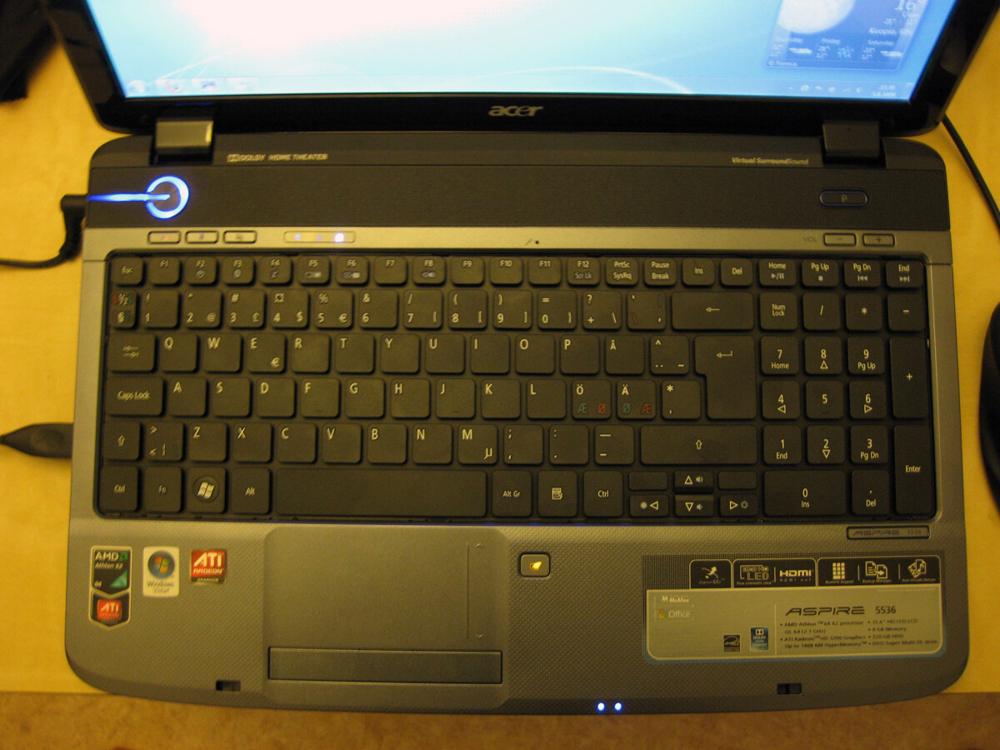
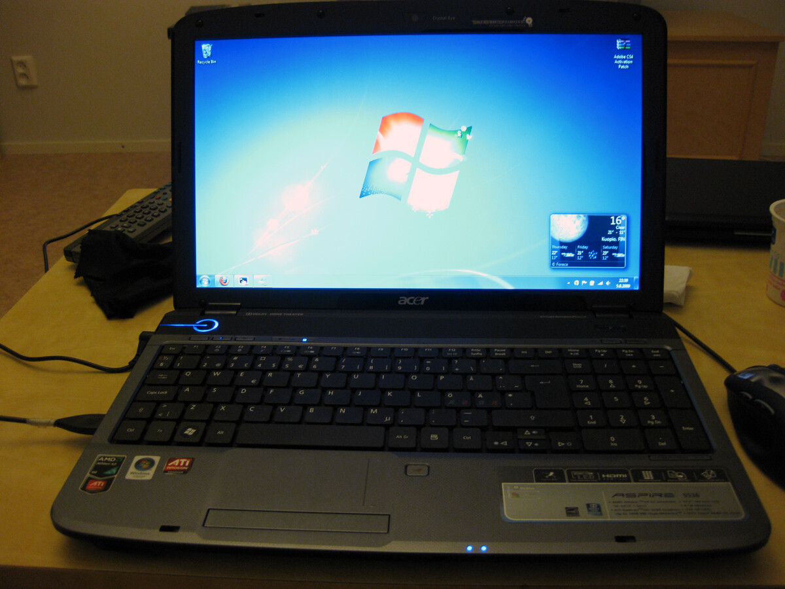
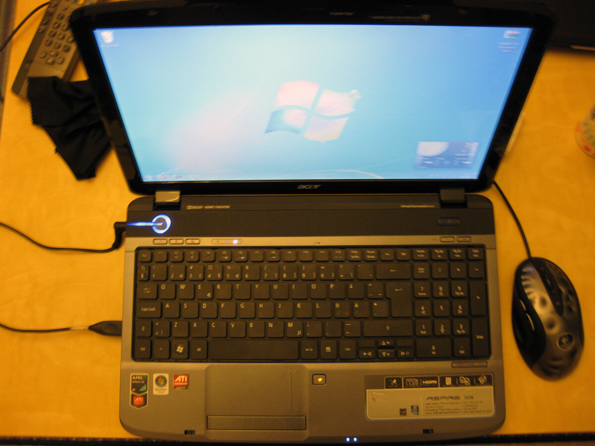

Olen ollut jo jonkin aikaa aikeissa ostaa itselleni työkoneeksi hieman isomman läppärin kuin Eee Pc:n sillä no eihän sillä Eeen näppiksellä mitään koodia aleta vääntää. Tai no ei ainakaan kunnolla ja tuon kokoisella näytöllä ei oikein saa tarpeeksi tilaa ja en ainakaan itse pysty sillä työskentelemään täysipainotteisesti.

No asetin budjetiksi 500 euroa ja lähdin eilen Giganttiin etsimään läppäriä. Olin tutkinut etukäteen Acerin koneita ja lähdin etsimään konetta etukäteen tutkimieni tietojen perusteella. No kappas kun sieltä löytyikin Acerin kone joka vielä hinnallaan alittaa budjetin 11 eurolla. Eli eikun paranee ja kävi vielä perhana tuurikin kun oli viimeinen kappale mitä oli varastossa, joten nappasin koneen kainaloon.

Ja tässä vaiheessa teitä oletettavasti kiinnostaa mimmonen kone sieltä lähti ja millä spekseillä, hinnan saatte itse laskea edellisestä stoorista. Mutta tässä tulee speksit koneesta Acer Aspire 5536:

- Prosessori: AMD Athlon X2 QL62 suoritin
- Keskusmuisti: 4Gt
- Muistipaikkojen määrä: 2
- Kiintolevy: 320Gt
- Kiintolevyn nopeus: 5400 rpm (SATA)
- Äänikortti: integroitu
- Näytönohjain: ATI Mobility Radeon HD3200
- TV-ulostlo: HDMI
- Verkkokortti: kyllä
- WLAN: kyllä
- Tallentava DVD asema: kyllä
- Muistikortinlukija: kyllä 5-in-1
- USB 2.0 : 4 kpl
- Käyttöjärjestelmä: Windows Vista Home Premium
- Lisälaitteet: 15,6 WXGA Crystal Brite
- Takuu: 1 vuosi
- Lisätiedot: Erillinen numeronäppäimistö

Ja ette arvaakkaan mitä tein ensimmäisenä! No heivasin tuon Vistan pois sillä eka bootti kesti tuskasen kauan ennen kuin pääsin edes työpöydälle. Tällä hetkellä koneessa hyrrää Windows 7 ja toimii kerrassaan mainiosti. Ja tähän loppuun vielä pari kuvaa koneesta, ok tiedän kuvakulma ei paljoa muutu, mutta koitan kuvailla tätä konetta paremmin kunhan jaksan ja viitsin.

