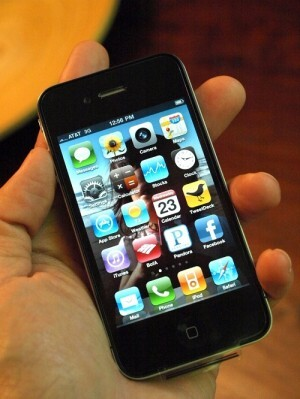

SoMe = Sosiaalinen media, näin tämäkin on tuotu teidän tietoon (jos ette siis jo tietänyt).

Oli sinulla sitten Nokia, HTC, Samsung, Apple tai mikä vaan puhelin jonka voi luokitella älypuhelimeksi niin on erittäin todennäköistä, että siihen saa jonkinlaisen sosiaalisen median sovelluksen laitettua. Itse en voi kirjoittaa muusta näkökulmasta kuin Applen iPhonen, sillä en ole käyttänyt muiden puhelimien SoMe sovelluksia. Jos joku teistä on niin voi tehdä oman kirjoituksen tai sitten kommentteihin laittaa mielipiteensä (toki [RantSite.net](http://rantsite.net/) on myös varteen otettava vaihtoehto).

### Mitä sovelluksia?

Aktiivisesti käytän puhelimellani Twitteriä ja Facebookkia. Joskus harvemmin tulee Foursquarea käytettyä. Myös Flickr ja Tumblr. sovellukset ovat iPhonessani ja näitä tulee satunnaisesti käytettyä. Ja mainitsenpa vielä, että WordPressillekin löytyy oma sovellus jonka kautta voin seurata blogin kommentointia ja vastailla – sekä luoda jopa uusia kirjoituksia ja sivuja.

### Helppoa ja yksinkertaista!

Kun puhelin on taskussa ja sieltä löytyy Twitter ja Facebook, on väistämätöntä olla katsomatta niitä tilaisuuden tullen. Puhelinta tuleekin katsottua jokusen kerran kun jonottaa jossain tai odottaa jotain. Se, että saat parilla napin painalluksella uuden tilapäivityksen Twitteriin ja Facebookiin ilman tietokonetta, houkuttelee käyttämään sovelluksia yhä enemmän.

Tosin tulee muistaa se tosi asia, että on voi ottaa kantaa miten tämä on esim. Nokian luureissa toteutettu. Mutta ainakin iPhonella ei paljo helpompaa voisi olla. Välillä tuntuu myös, että iPhone sovellus toimii paljon paremmin kuin nettiselaimella käytettävä versio – näin ainakin Facebookin kohdalla.

### Addiktio?

Noh… joo ja ei. Siitä tulee lähinnä tapa ja saat suhteellisen nopeasti informaatiota peleistä ja tarjouksista Twitterin kautta. Sekä tietty se, että näet mitä muut tekevät puhelimen kautta.

### Korvaako älypuhelin tietokoneen?

Vaikka älypuhelinta sanotaan myös kämmentietokoneeksi – en usko, että puhelin tulee korvaamaan tietokonetta (ainakaan itselläni). Vaikka puhelinkin kykenee pelaamiseen tänä päivänä, ei se pärjää tietokoneelle siinä asiassa. Eikä myöskään pärjää tietokoneen suorituskyvylle ja sille tosiasialle, että voit tehdä enemmän isommalla näytöllä ja kunnon näppäimistöllä ja hiirellä.
