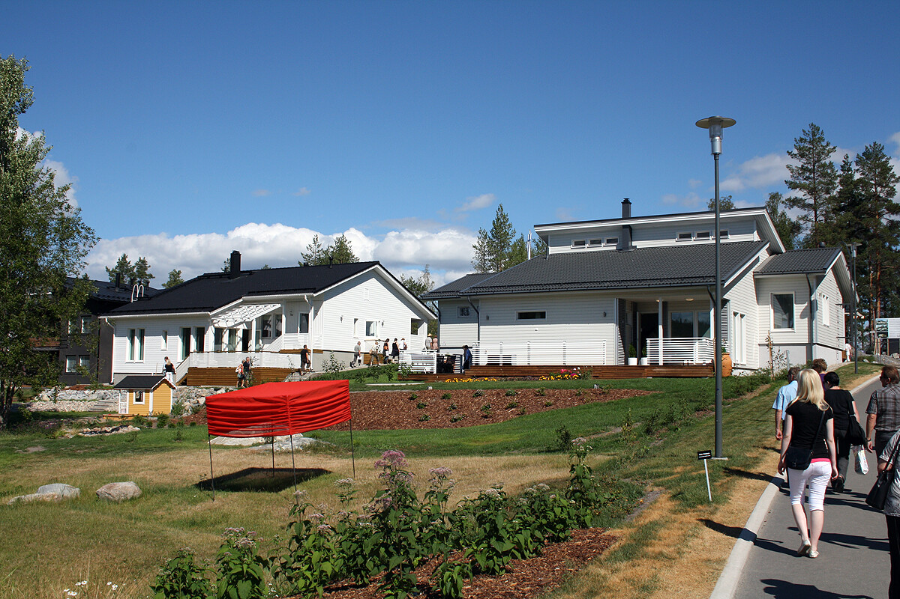
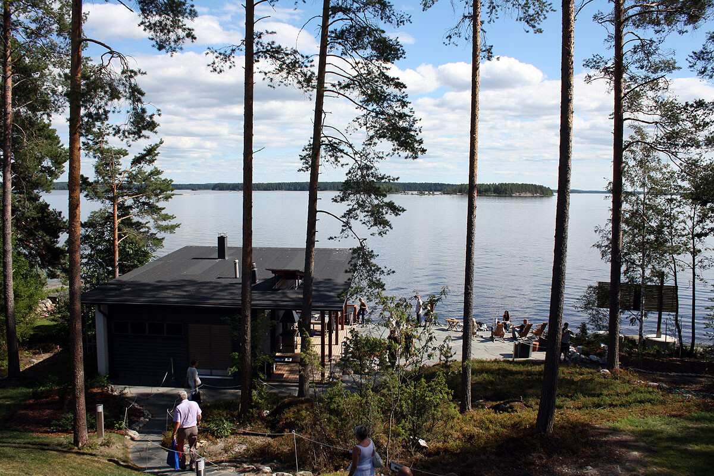
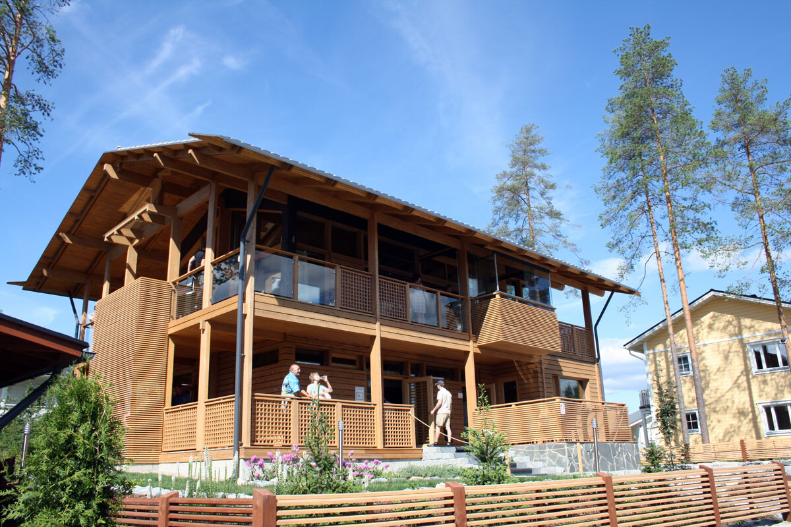

Kävin viime perjantaina viettämässä jokusen tunnin Kuopion asuntomessuilla. Harvemmin tulee tilaisuus lähteä töllistelemään taloja tämänkaltaiseen tapahtumaan. Oli muuten ensimmäinen kerta asuntomessuilla!

Onhan se mielenkiintoista käväistä talossa, jonka hintalapussa komeili 850 000 euroa. Voin kyllä sanoa, että oli komia ja vieläpä hyvällä paikalla!

Aloinkin siellä pohtimaan, että kuka asuntomessuilta loppuunsa talon haluaa? Sillä nyt nähtyäni sen paikan niin siellä on taloa vieri vieressä. Eli ei pahemmin sitä omaa rauhaa vaikka asuisitkin omakotitalossa. Sekä omaa pihaa ei kaikissa taloissa ollut nimeksikään.\
Myös se, että parhaimmillaan asuntomessuilla on käynyt yli 7 000 kävijää päivässä ([SavonSanomat](http://www.savonsanomat.fi/teemat/asuntomessut/messu_uutiset/asuntomessuilla-t%C3%A4n%C3%A4%C3%A4n-enn%C3%A4tysyleis%C3%B6/587623)) – näiden ihmisten on pakko jättää jonkinlaista jälkeä taloon/rakenteisiin/materiaaleihin/yms. Ja onko kiva itse mennä taloon asumaan jota on pällistellyt tuhansia ihmisiä?

