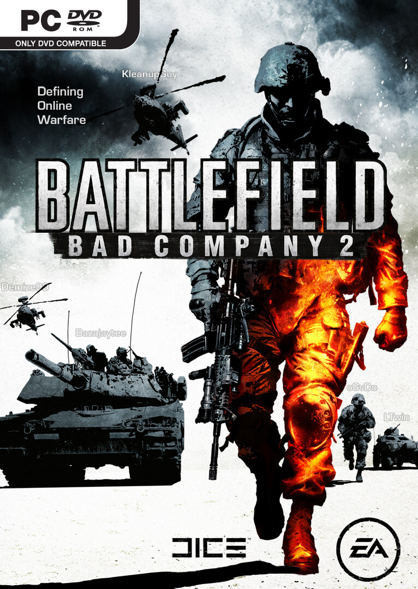

BattleField sarja saa jatko ja tiedän, että suurin osa teistä tiesikin jo tämän! Mutta en ole kirjoitellut tästä aiemmin tänne, joten tässä tulee omia ajatuksia kyseisestä pelistä.

Itsehän ennakkotilasin Bad Company 2:n tossa joulun aikoihin ja täten sain viime viikolla beta koodin ja olen päässyt pelailemaan betaa. Aluksihan se bugasi palvelimen valinnassa, mutta tähän tuli korjaus onneksi nopeasti (kiitos!) ja mitä tänään pelasin (pitkästä aikaa) niin se toimi oikeastaan aika kivasti.\
Joitain ongelmia on juu, mutta kyseessä on vasta BETA! Ja kerrottakoon vielä tähän väliin, että pelihän julkaistaan maaliskuun alussa!

> ‘Play It Your Way’ experiment and refine your ideal combat style with 4 character classes (medic, assault, recon and engineer), 15000+ kit variations, 46 weapons (200 different customization opportunities), 15 gadgets and 13 character specializations.

Näin luki Bad Companyn sivuilta saatavassa fan kitissä olleessa Multiplayer fact sheetissä, eli pyssyjä ja variaatioita on! Eli pelattavaa ja unlokattavaa riittää myös tässäkin pelissä.

Kyseinen beta versio jo kilpailee CoD MW2:n kanssa siitä kumpaa pelaan, sillä nämä ovat kaksi peliä mitä olen viime aikoina työn/koulun ohessa pelaillut, joten beta vaikuttaa jo erittäin lupaavalta. Ainut vain, että tuo mappi tulee olemaan puhki kuluttu siihen mennessä kuin varsinainen peli julkaistaan.

Ja tämän videon kautta odottelemaan julkaisua!



Ja extrana vielä yksi!

> What starts out as another routine recon mission for B-Company soon takes a deadlier direction when they discover evidence of a new Russian super-weapon. With U.S. and Russian forces mobilizing their mission escalates into a frantic race against time to stave off a new World War.


