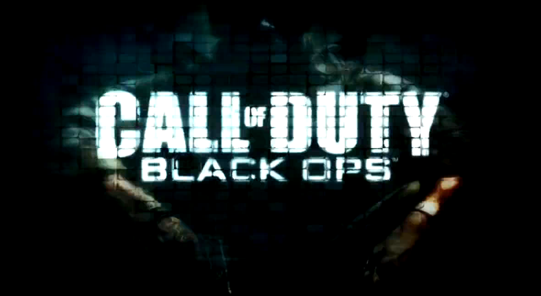

On kulunut melkein kuukausi kun uusin CoDy julkaistiin. Olen pelannut sitä siitä asti ja tullut siihen tulokseen, että se on minunlaiselleni CoD -fanille juurikin sitä mitä tarvitsin!

No tuossahan se tuli lyhyesti, mutta ehkäpä tehdään tästä hieman pitempi artikkeli kuin 1kpl kuvia ja pari lausetta. Käydään siis läpi pelin kaksi tai no oikeastaan kolme eri osaa: yksinpeli, moninpeli ja ZOMBIT!

## Yksinpeli

Vaikka yksinpelillä voisi olla pituutta hieman lisää niin lyhyesti sanottuna se on hyvä! Putkijuoksuahan siinä on, mutta silti tämä vastaa kuin katsoisi action leffaa. Koko komeus oli ohi noin kuudessa tunnissa ja kyllähän sieltäkin niitä hieman kyseenalaisia kohtauksia löytyi (kuten oli odotettavissakin).

Tarkkuuskivääriä (sniperiä) et tule oikeastaan tarvitsemaan ollenkaan (tai no hyvin vähän) – sillä matkat on pieniä ja tulet olemaan ”iholla” lähes koko ajan. Itse pidän tämänkaltaisesta hektisestä ”mätöstä” joten itse en kokenut tätä häiritseväksi. Tietysti on ihan kiva ampua varsijousella vihollisia – myös niillä ei räjähtävillä nuolilla!

Yksinpelin tuomio lyhyesti: 5-6h hektistä taistelua erilaisissa ympäristöissä – tartu hiireen (siis aseeseen) ja anna mennä!

## Moninpeli

Moninpelihän on se Call of Dutyn parasta antia ja sitä tulee pelattua huomattavasti paljon enemmän kuin yksinpeliä. Moninpeliin on tullut takaisin Dedicated palvelimet, joten niitä voi itsekin hankkia ja hallita (rahaa vastaan tietty, kyllä minulla on yksi kappale CoD servuja testissä).

Ehkä isoimpia eroavaisuuksia aikaisempiin Call of Duty peleihin on se, että nyt on käytössä CoD pointsit eli CoDyn oma valuutta. Tällä valuutalla voit ostaa aseita (kun olet ensin unlokannut ne saamalla kokemusta) ja aseisiin lisäosia. Oikeastaan kaikki kustomointi on ostettavissa CoDyn valuutalla.

Toinen hyvä ja suhteellisen hyvä uudistus on se ettei killstreakkien tapot kasvata killstreakkia (hämmentävääkö?). Eli killstreakkeja saa ainoastaan tappamalla itse muita (granaateilla, claymoreilla, aseilla yms.), mutta ei killstreakkien avulla (koirat, chopperit yms).

Theater mode (eli teatteri moodi) on uutuutena tullut myös Call of Duty sarjaan. Eli aina kun pelaat niin sinun pelisi tallennetaan ja tämän jälkeen voit pelissä katsoa ja koostaa oman pelivideosi. Tämän jälkeen sen saa renderöityä ja laitettua vaikka YouTubeen. Hieno ominaisuus kerrassaan, tämmöistä en olekaan ennen käyttänyt ja se vähä mitä käytin niin se toimi hyvin.

## Zombit

Zombit tekivät paluun Call of Dutyyn! World at Warista tutut zombit jäivät kotiin MW2:ssa, mutta ne ovat täällä taas. Hieno pelimuoto ja tällä kertaa voit pelata jollain seuraavista hahmoista: John F. Kennedy, Richard Nixon, Robert McNamara ja Fidel Castro. Näillä on tietysti lausahduksia, joita he sanovat pelaamisen aikana.

Tätä pelimuotoa on tullut pelattua ihan liian vähän – tähän pitää tulla muutos! Loisto pelimuoto – zombien ampuminen toimii aina!

## Loppusanat

Call of Duty: Black Ops on tällä hetkellä eniten pelaamani peli. Näin käy aina kun uusi CoD tulee markkinoille (seuraavaa odotellessa…). Itse suosittelen tämän hankkimista (näin sanoo CoD fani…).

**Nähdään taistelukentillä!**
