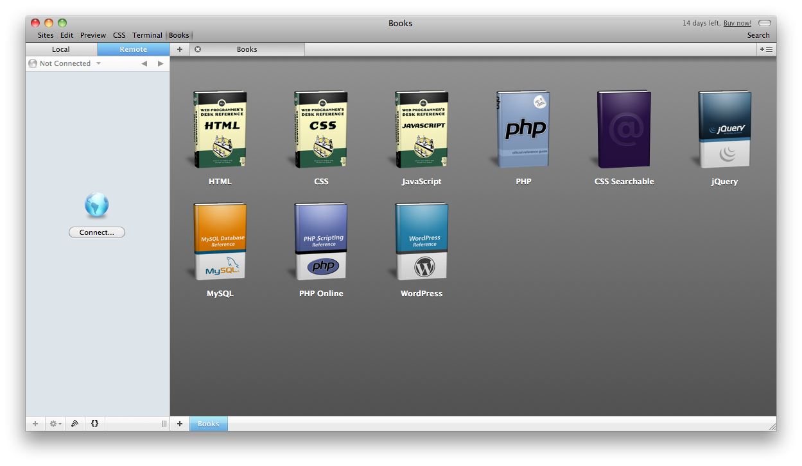
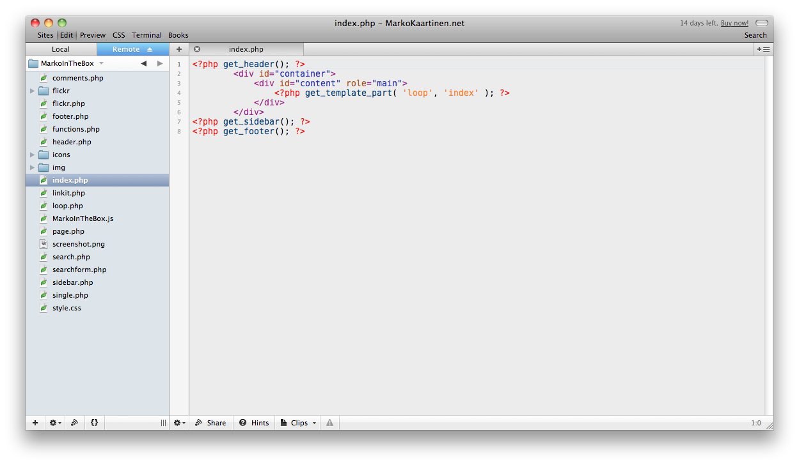
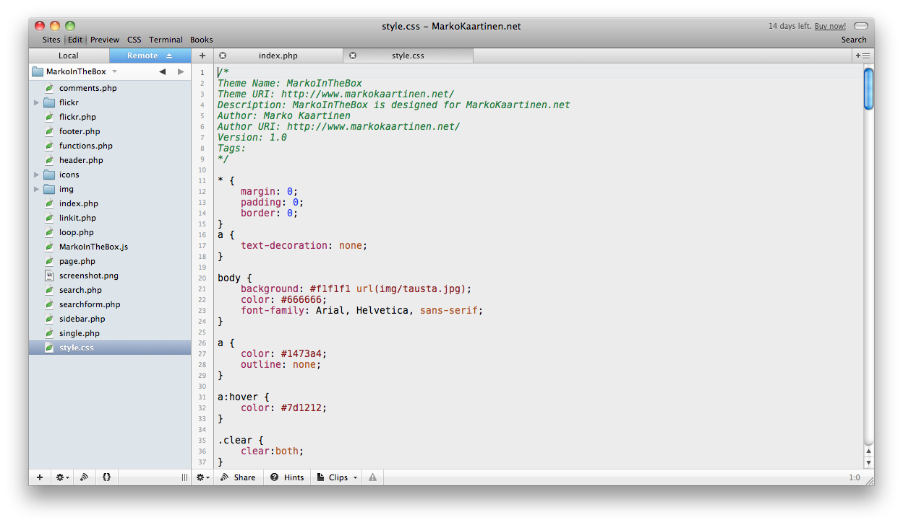

Kun mäkkimaailmaan siirryin ja webbipuolen koodari kun olen niin tietysti pitää etsiä sovellus tähänkin touhuun. Tutkiskelin hieman Googlen avustuksella vaihtoehtoja ja päädyin koittamaan Coda nimistä sovellusta.

Olin jo vakuuttunut erittäin lyhyen ajan jälkeen tästä ohjelmasta. Minulla on tosin vielä vajaa 14 päivää aikaa käyttää ohjelmaa ilmaiseksi kunnes on tehtävä päätös. Ostanko tämän 99 dollaria maksavan ohjelman vai etsinkö jostain vastaavan. Jos tiedät mistä saisin tämän halvalla niin kerro ihmeessä!

Sovellus on minulle sopivan simppelin oloinen, mutta taustalla on paljon asioita mihin en ole vielä kerennyt tutustumaan (oon käyttäny vasta muutaman tunnin!). Olen ollut lähinnä yhteydessä toisella palvelimella oleviin tiedostoihin eli muokannut esimerkiksi MarkoKaartinen.nettiä.

Jos olet mäkin käyttäjä ja koodailet niin suosittelen ehdottomasti tätä sovellusta, vaikka olenkin käyttänyt tätä näinkin vähän aikaa! Heittäkäähän oma mielipide, jos olette käyttänyt Codaa!
