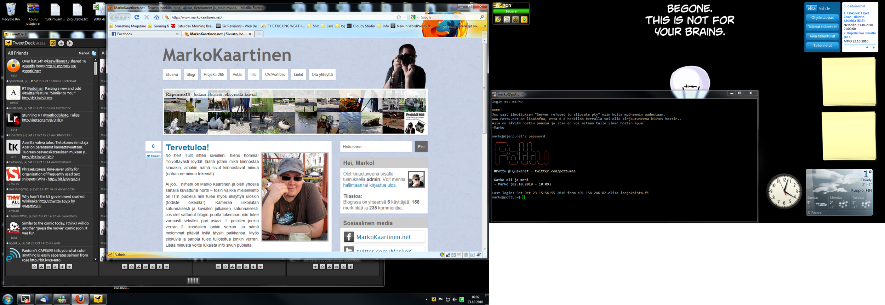

[Rolle](http://www.rollemaa.org/arkisto/2010/10/esittele-tyopoytasi/) meni tekemään tästä meemin joten lähdetään mukaan! Ohjeet tähän ovat tässä:

> Jos olet bloggaaja ja satut lukemaan tätä, saat luvan julkaista nykyisen työpöytäsi (yksikössä tai monikossa) kera kuvankaappauksen, ja kertoa samalla hieman ohjelmista joita kuvankaappauksessa näkyy.

Olen jo aiemmin postannut minun [tietokonepisteeni](/2009/tietokonneita) ja tässä tulee vastaus tuohon meemiin minkä jo esittelin teille.

Eli kyseessähän on kahden näytön setuppi ja aloitetaan vasemmasta näytöstä (joka on se isompikin). Sieltä löytyy Tweetdeck sovellus takaa (se harmaa joka näkyy osittain) sekä Firefox selain. Tällä näytöllä pyöritän lähes kaikkia sovelluksia mitä tulee käytettyä, sekä pelit pyörii tällä näytöllä.

Sitten se oikeanpuoleinen näyttö. Sieltä löytyy yleensä keskustelupuoli eli tuossa näkyykin Putty, jonka kautta käytän Irssiä. Tuolla näytöllä pyörii yleensä myös Messenger keskusteluikkuna. Pari gadgettiakin on eksynyt tuonne näytölle. Kello on lähinnä sen takia, kun pelatessa ei Windowsin omaa kelloa näe niin tuosta saa sitten ajan. Sää gadget löytyy, pari muistilappua sekä Elisa Viihde ja Norton gadgetit.

Minulta löytyy myös pari läppäriä, joiden kuvia en kokenut tarpeelliseksi tähän laittaa. Isompana läppärinä on [Acer](/2009/uusi-vekotin-saapui-taloon) ja pienempänä läppärinä toimii Lenovo.
