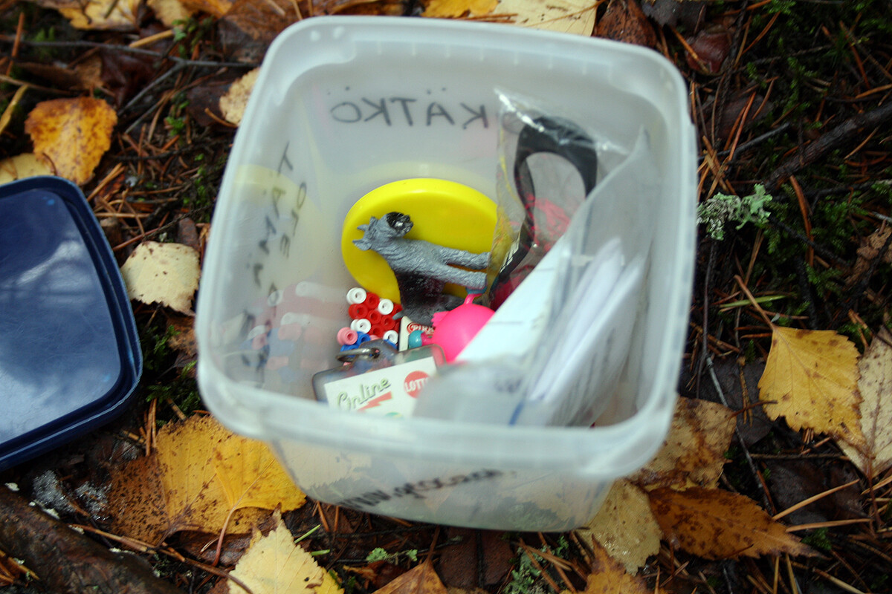
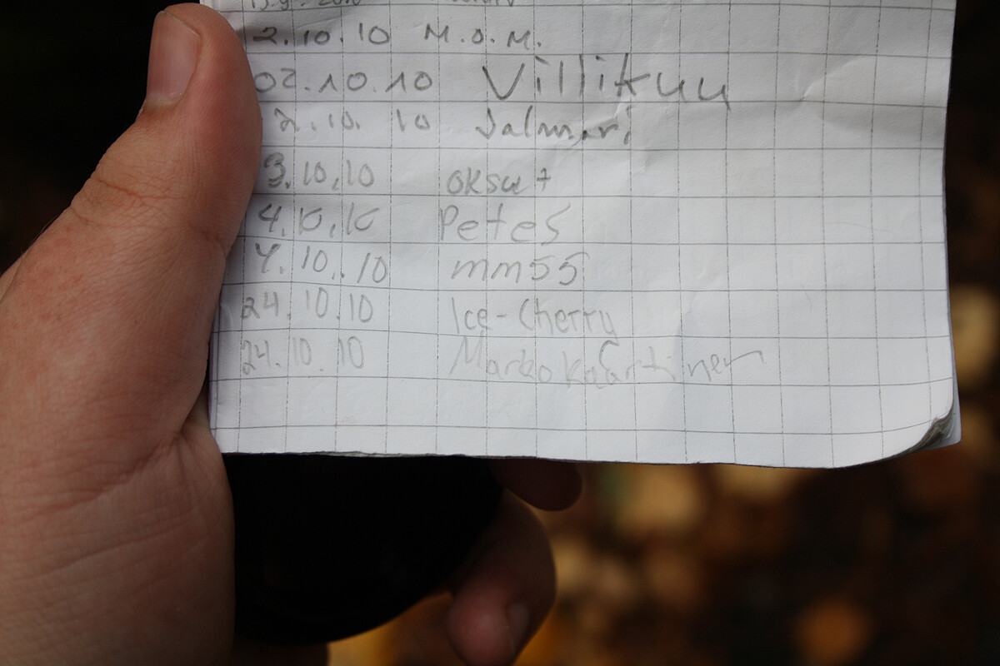

Eli suomeksi väännettynä geokätköily. Tuli tänään koitettua tuotakin ja saldona oli 2 löydettyä kätköä ja yksi jäi löytämättä (välineenä tietysti iPhone 4, mikäs muukaan?). Mitäs tämä geokätkeily on? Tämänkin tiedon palasen teille tarjoaa suuri ja mahtava [Wikipedia](http://fi.wikipedia.org/wiki/Geok%C3%A4tk%C3%B6ily). (kiittäkäämme siis sitä!)

> Geokätköily (engl. geocaching) on ulkoiluharrastus, jossa piilotetaan ja etsitään geokätköiksi kutsuttuja rasioita. Useimmiten kätkön sijainti määritetään GPS-paikannuslaitteen avulla, mutta laitteen käyttö ei ole välttämätöntä. Geokätkön koordinaatit tai muut tarpeelliset tiedot kätkön löytämiseksi ilmoitetaan kätkökuvauksessa, joka julkaistaan harrastuksen Internet-sivustolla. Kun harrastaja on löytänyt kätkön, hän voi merkitä eli logata löytönsä kätkön Internet-sivulle.

Näin erittäin lyhyen kokeilun päätteeksi voin kyllä suositella ja pitää käydä toi yksi kätkö bongaamassa mitä ei vielä löytynyt. Aloittaminen ei nyt ole vaikeaa, sen kun luo tunnukset [Geocaching.com](http://www.geocaching.com/) saitille ja katsoo lähimmät kätköt ja lähtee etsimään! Tietty jos on luuri joka ymmärtää koordinaatteja tai sille on jopa geokätköilyyn tarkoitettu sovellus niin tämähän helpottaa jo kummasti toimintaa!
