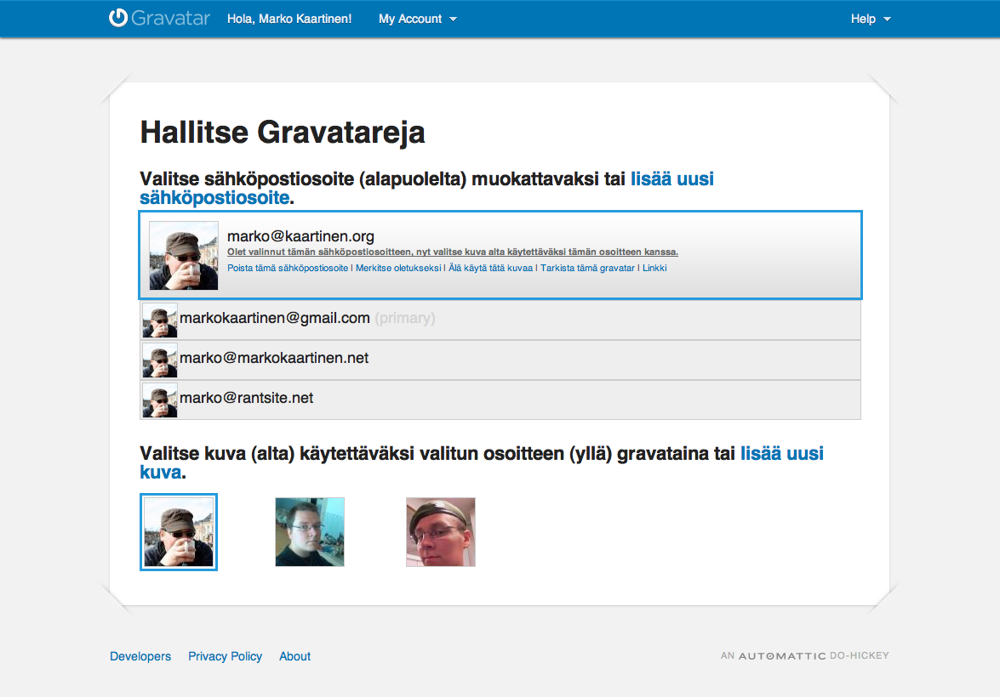

Monet blogit ja julkaisujärjestelmät käyttävät Gravataria nykyään. Lähinnä siksi, koska se on helppo tapa sallia avatarit myös niille käyttäjille joilla ei ole omaa tunnusta sivustolla.

Gravatar nimittäin toimii niin, että kun esimerkiksi kommentoija jättää sivulle kommentin ja silloin hänen on syötettävä sähköposti. Tällöin blogi hakee avatarin kommentoijalle Gravatarin kautta. Itselläni WordPress hakee ensin Gravatarista ja sen jälkeen avatar luodaan MonsterID:n kautta ja tällöinkin sähköpostin perusteella.

Gravatarin luominenkaan ei ole vaikeaa! Menet vain [**Gravatar.com**](http://fi.gravatar.com/) sivustolle ja painat **Hanki Gravatarisi tänään** -painiketta. Syötä sähköpostisi ja sen jälkeen pitäisi tulla sähköpostiisi salasana. Kirjaudu sisään ja laita kuva sähköpostiosoitteellesi.

Voit laittaa myös useita sähköposteja saman tilin alle ja voit myös muuttaa avatariasi sähköpostille. Alla on kuvankaappaus omasta Gravatar.com hallintasivusta. Siitä voitte nähdä kolme avataria jota olen käyttänyt ja pari sähköpostiosoitetta joille on asetettu avatar.

Suosittelen lämpimästi kyseistä palvelua ja tällöin saat MarkoKaartinen.netin kommentointiinkin oman avatarisi käyttöön!
