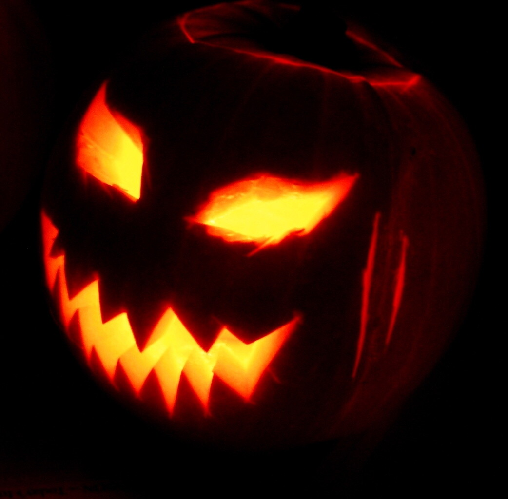

Tänä viikonloppuna on varmaan Halloween juhlia siellä sun täällä. Lähinnä jenkeissä on tämä juhla suosittu. Suomeen tämä on tuomalla tuotu ja se tuntuu vaan turhalta krääsän myymiseltä. Itse en näe siinä juhlassa yhtään mitään järkeä täällä pohjolassa. En ole suoraan sanottuna kertaakaan juhlinut Halloweeniä oikeastaan millään tavalla.

Koska [Wikipedia](http://fi.wikipedia.org/wiki/Halloween) on mielestäni oiva tiedon lähde niin se saa selittää Halloweenistä hieman lisää teille.

> Halloween on anglosaksisissa maissa pyhäinpäivän aattona lokakuun viimeisenä päivänä 31.10. vietettävä juhlapäivä, alkuaan muinaisten kelttien talven alkamisen päivä, jolloin vainajahenkien uskottiin liikkuvan. Nimi on lyhenne englannin sanoista ”All Hallows’ Eve” eli pyhäinpäivän aatto.
>
> Halloweeniä on vietetty Euroopassa vanhastaan kelttiläisen perinteen vaikuttamissa anglosaksisissa maissa, kuten Englannissa, Skotlannissa ja Irlannissa. Esimerkiksi Suomessa juhla tunnetaan kuitenkin ennen muuta amerikkalaisessa muodossaan. Yhdysvaltoihin juhlan toivat irlantilaiset ja skotlantilaiset siirtolaiset, ja se on nykyisin Yhdysvalloissa joulun jälkeen suosituin juhla.

Minua kiinnostaa tulevana viikonloppuna enemmän se, että kelloa pitää muistaa siirtää! Ja muistakaahan, että sitä siirretään nimen omaan taaksepäin! Eli tällä kertaa saadaan yksi ilmainen tunti nukkumista varten!
