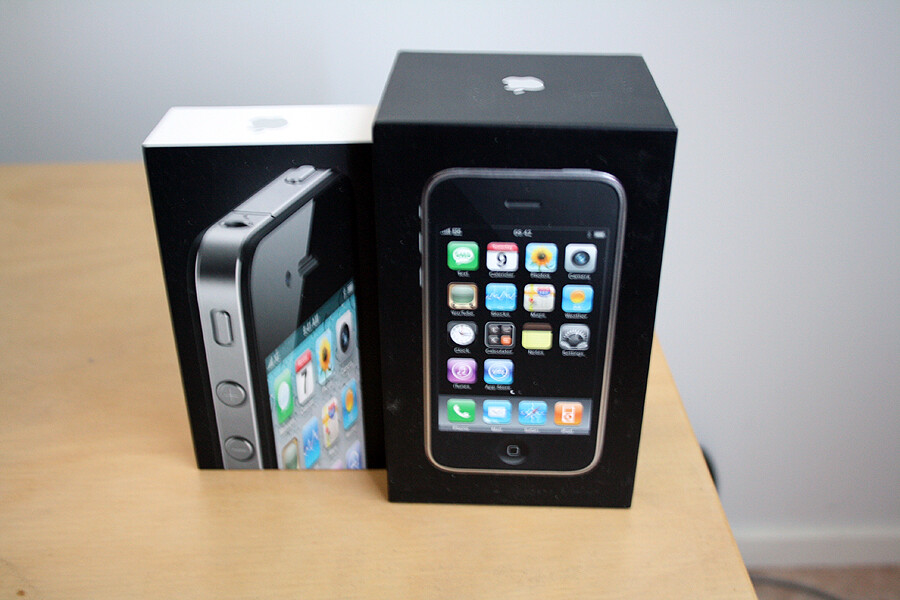
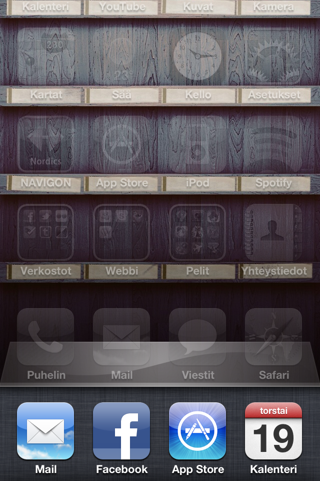
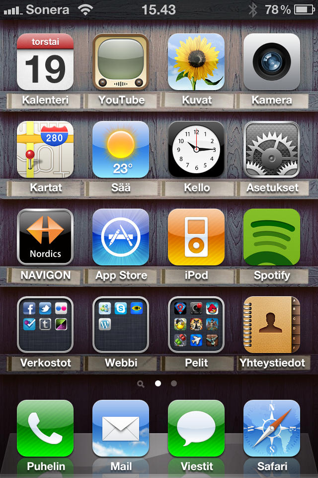
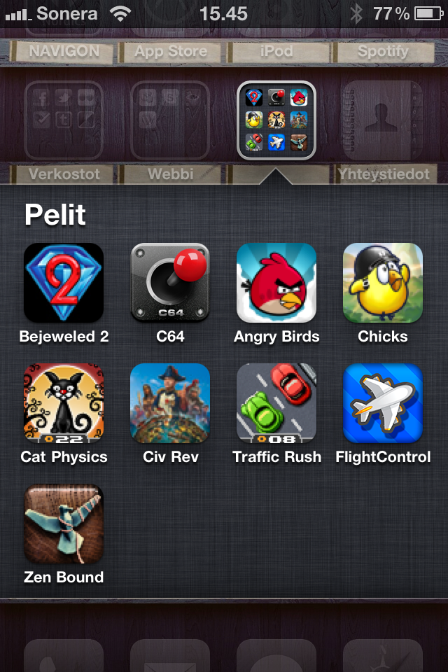

Jatketaan tätä linjaa nyt hetken vielä ([aikaisemmet artikkelit](/avainsana/iphone-4)). Eli olen nyt pari viikkoa käyttänyt iPhone 4:sta ja olen ollut tyytyväinen siihen ja varsinkin siirtymä 3G:stä neloseen oli huomattava parannus.

Mitä nyt ensimmäisenä oli mielessä kun paketti tuli haettua postista? ”Täh, näin pieni paketti?!” Nimittäin ero 3G:n pakettiin oli huomattava sillä se oli yli kaksi kertaa pienempi!\
Paketin aukaistuaan löytyi sieltä perus setti eli pikaopas, Apple tarroja, laturi (joka on myös pienentynyt!), perus usb piuha, perus Apple kuulokkeet (joista en niin välitä) sekä tietty itse iPhone 4.

Kooltaan iPhone 4 ei eroa paljoa 3G:stä, lähinnä ohuempi ja muotoilu on muuttunut huomattavasti nelosessa. Itse pidän tästä muotoilusta ja 3G ei tunnu enää samalta sen jälkeen kun nelosta on käpistellyt ja käyttänyt.\
Näyttö! Se on 3G malliin verrattuna paljon parempi ja tarkempi. Myös akun kesto ja itse puhelimen toimivuus parani silmissä. Seuraavan kappaleen jälkeen olevista kuvista voitte todeta näytön resoluution kasvaneen ja laadun olevan hyvä!

Nelonen toi myös minun käyttöön moniajon ja se toimii oikeastaan huomaamatta kun ohjelma jää taustalle hyrräämään. Sen saa näppärästi sieltä auki ja käyttö jatkuu siitä mihin jäit.\
iOS:n uusin nelos versio toi myös kansiot käyttöön iPhoneen, joka on mielestäni aivan loistava asia! Nyt ei ole monella ruudulla ohjelmia vaan ne saa loogisesti kansioihin.

Jos hieman pelaamisesta puhuisin vielä. iPhone 3G:llä tuli pelattua hieman alkuaikoina, mutta nyt nelosella pelaaminen on ollut suhteellisen hauskaa taas. Angry Birds on ollut erittäin koukuttava peli! (loppu kentät kesken)\
Hyvä alusta tällekkin touhulle!

Ja sitten se paljon mediahuomiota saanut ”kuoleman ote”. Okei, tätä piti testata heti kun sain puhelimen aktivoitua ja palkit oli täynnä. Aluksi ei meinannut mitään eroa tulla, mutta kun hetken odotti niin tippui palkit pari pykälää alaspäin. Mutta mitäpä kuvittelit kun pidät sitä antennin kohdalta kiinni?

Viikon aikana ei ole kertaakaan puhelu katkennut, ei tippunut pois verkosta, eikä ollut muutenkaan ongelmia puhelimen kanssa.
