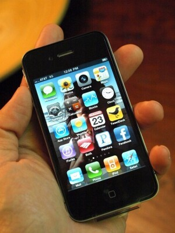

Heitetään oma lusikka soppaan tästäkin vekottimesta. Tosin hieman myöhässä tulee tämä kirjoitelma tänne, koska perjantainahan tämäkin soppa alkoi.

Ensin pieni ihmettely siitä miksi Sonera ei alkuperäisten sivuston infojen mukaan tehnyt minkäänlaista ennakkotilausta ko. vekottimelle. Sillä tämä on osasyynä mielestäni Soneralla olleisiin ongelmiin iPhonen myynnin aloittamisessa.

Eli ennakkotilausta ei ollut ja torstaina tuli tieto, että perjantaina alkaa myynti klo 9.00 netissä ja aspassa ja liikkeissä. Tosin 7.00 sai ennalta ilmoitetuista liikkeistä iPhone 4 32 gigasen käteen. Tosin erän suuruus oli 10-25kpl, että siinä sitten ihmiset jonottivat.

Itse en lähtenyt tohon jonottamiseen vaan tahdoin 16 gigasen mallin ko. puhelimesta, joten päätin koittaa verkkokaupan kautta klo 9.00 tai aspasta. Noh verkkokauppahan ei toiminut/pätki/tahmas yhdeksän aikaan ja päädyin soittamaan aspaan.\
Ensin jonotin suoraan myyntiin – no dice… Sitten päätin koittaa normiaspaan ja uhkasi jo 20min jonotuksella, mutta 2min päästä puheluun vastattiin ja homma oli bueno – uusi iPhone 4 16 giganen tilattu.

**Mutta** sitten alkoikin se mitä en olisi halunnut tapahtuvan. Nimittäin aspan lupaamaa tilausvahvistusta ei näkynyt, noh päätin olla kärsivällinen ja odotella. Soneran Facebook sivuilla tuli infoa, että tilausvahvistukset tulevat viiveellä. Noh illalla aloin pohtia, että 12 aikaan tilanneet saivat jo seurantakoodin postille ja minulla ei edes tilausvahvistusta…\
Soitin aspaan uudelleen ja jonotin sen 17 minuuttia ja tilaukseni oli mennyt läpi, mutta tilausvahvistusta ei ollut tullut. Noh sanottiin, että kyllä se tulee sieltä.\
Tilausvahvistus tuli klo 20.28 sähköpostiini ja Soneran Omilla sivuilla näkyi myös iPhone 4. Olin tähän tyytyväinen hetken aikaa ja nyt päässäni pyörii välistä, että millonkahan oikein puhelimen saan. Sillä aspa jolle illalla soitin ei osannut sanoa ja sanoi toimitusajaksi hyvällä tuurilla ensi viikon loppu puolta. Saas nähdä, maanantaina voi joutua iltasella aspaan soittamaan ja kyselemään tilannetta…

Mieltäni ei yhtäänä helpota se mitä olen lukenut Soneran Facebook sivulta, kun osalle ei ole tullut edes tilausvahvistusta… Ja osa puolen päivän aikoihin tilanneet voivat seurata jo luuriaan ja maanantaina saavat sen käteen. Miksi minulla ei voi olla hyvä tuuri kerrankin?\
Toisaalta kiire ei ole, mutta 3G:lle on jo ottaja tiedossa joka on kärsimättömämpi kuin minä ;) Tietty tahtoisin sen niin pian kuin mahdollista sillä laskutus alkoi juoksemaan heti kun tilasin sen puhelimen.

Saatte seurata nyt Markon, Soneran ja iPhone 4 tarinaa. Toivotaan onnellista loppua! (tietysti kuvaa, mielipidettä ja muuta tulee tänne kunhan iPhone 4 on kätösissäni)
