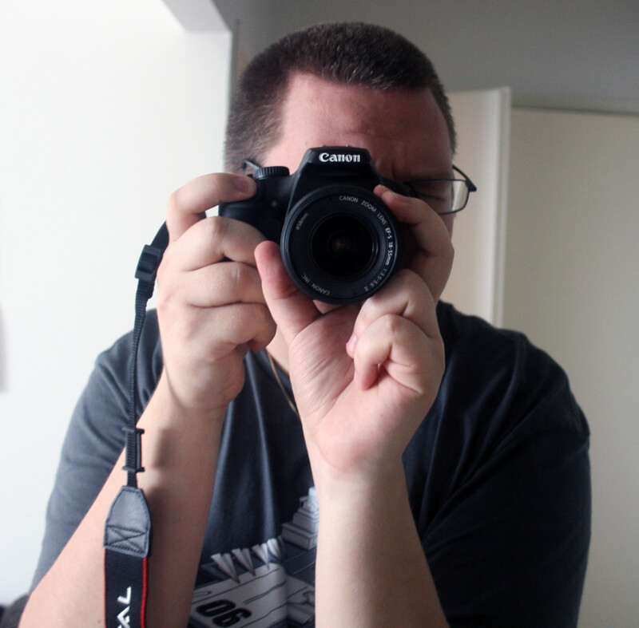
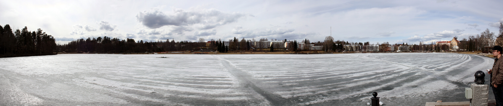
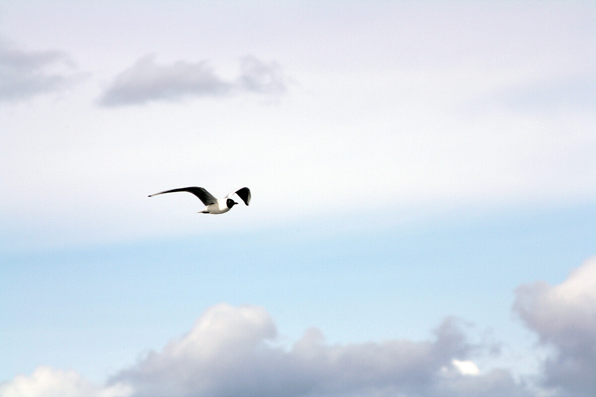

Tein vihdoin sen mitä olen pitkään halunnut tehdä, ostin nimittäin digijärkkärin. Kaupasta tarttui kouraan Canon EOS 1000D + Canon EFS 18-55mm + Canon Zoom Lens EF 75-300mm setti ja sillä on nyt parisen viikkoa tullut kuvailtua enemmän ja vähemmän.

Jos hieman kertoisi kyseisestä kamerasta jotain tai no speksithän ne pitää tähän laittaa:

- 10,1 megapikselin CMOS-kenno
- Jopa 3 kuvaa/s
- 7 pisteen automaattitarkennus
- Itsepuhdistuva kuvakenno
- 2,5 tuuman nestekidenäyttö elävällä etsinkuvalla
- DIGIC III -prosessori
- SD-/SDHC-kortti
- Kuvatyylien prosessointi
- Pienikokoinen, kevyt
- Yhteensopiva EF-/EF-S-objektiivien ja EX Speedlite -salamalaitteiden kanssa

Ja jos lisää infoa haluatte niin suunnatkaas [Canonin sivuille](http://www.canon.fi/For_Home/Product_Finder/Cameras/Digital_SLR/EOS_1000D/).

Ja nyt jos hieman itse kuvaamisesta. Tein ratkaisun, että heitän ottamani kuvat Flickr palveluun. Syynä se, että sinne saa ne näppärästi ja siellä on kaikki haluamani ominaisuudet mitä palvelulta haluan. Tänne blogin puolelle tulen joitain kuvia heittämään silloin tällöin, mutta parhaiten saatte kuvia kun seuraatte minua Flickrissä. Flickr profiilini on osoitteessa <http://www.flickr.com/people/markokaartinen/>.

Ja lopuksi haluan jakaa kanssanne ottamani panoraama kuvan Kuopiosta Valkeisen lammelta.\

Ja heitetään vielä yksi ylimääräinenkin.\

