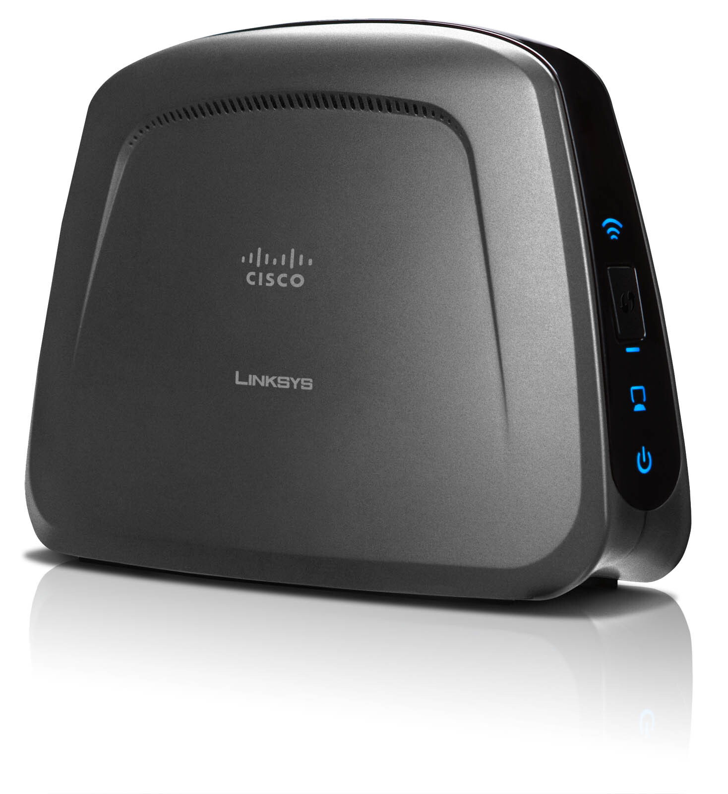

Tällä hetkellä asunnossani menee yksi häiritsevä verkkopiuha ylitse muiden. Nimittäin makkarista olohuoneeseen menee verkkopiuha, koska makkarissa on modeemi ja olohuoneeseen digiboxi ja Xbox tarvitsevat verkkoa.

Aloin pohtimaan miten pääsisin eroon tuosta yhdestä verkkopiuhasta. Kyselin hieman kavereilta ja tutuilta miten tämä voisi onnistua. Sitten sain pari vinkkiä enemmän tee-se-itse tapaisiin ratkaisuihin, mutta itseäni kiinnosti lähinnä out-of-the-box ratkaisu. Joten katslin verkkokauppa.comia ja löysin [Linksys WET610N](http://www.verkkokauppa.com/popups/prodinfo.php?id=40897) langattoman sillan mahdollistavan boxin.

Luulisi tuonkin boxin siirtonopeuden riittävän digiboxilla ja Xboxille, sillä ei niiden netin tarve loppuunsa niin päätä huimaava ole, että pitäisi olla piuha. Modeemiakaan kun ei saa viritettyä oikein mitenkään lähemmäksi noita, kun puhelinpistoke on vaan makkarissa ja eteisessä.

Itselläni ei ole mitään kokemuksia kyseisestä laitteesta, jos sinulla on niin kerro toki! Tai jos sinulla on ehdotus miten saisin ratkaistua ongelman muuten niin voi toki kertoa!
