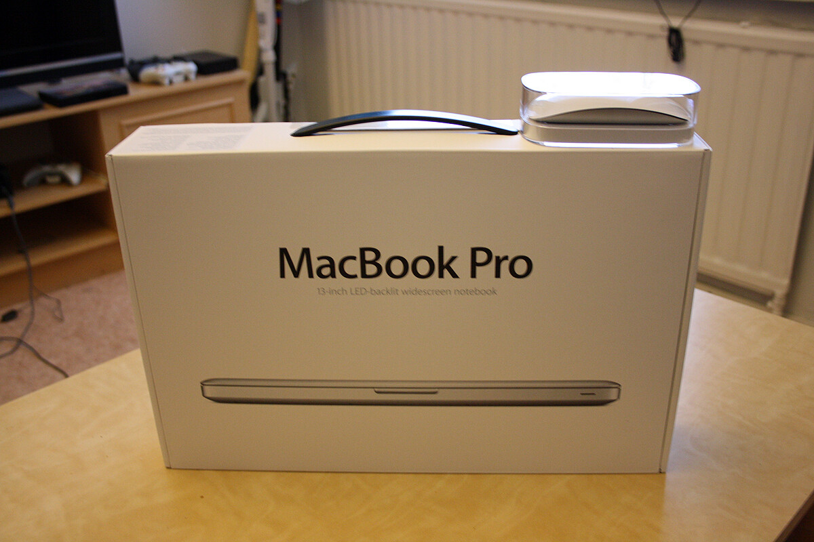
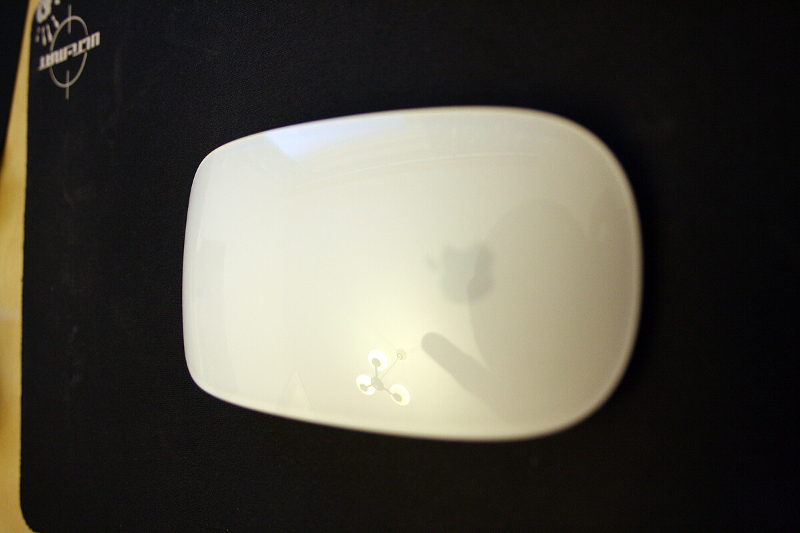
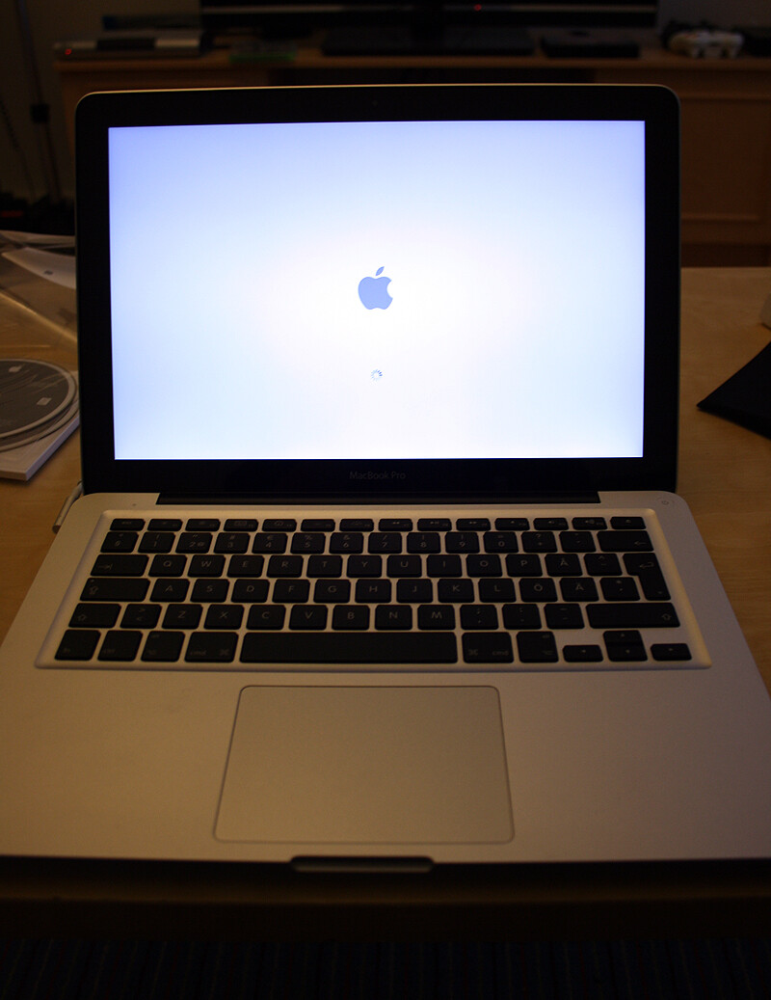
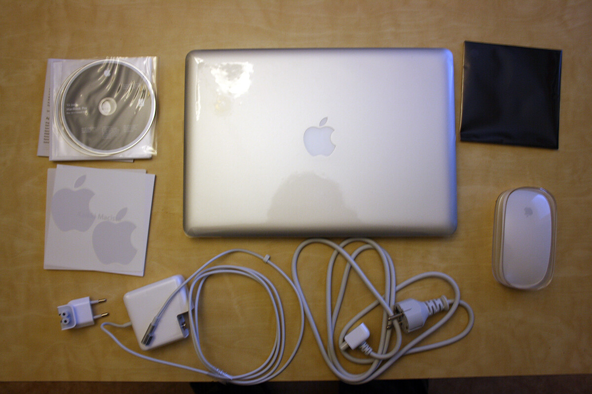

Kappas mitä kaupasta tarttui käteen tänään. Tuli nimittäin hankittua MacBook Pro sekä sille kaveriksi Magic Mouse. Käsittelen tässä artikkelissa näitä molempia vekottimia. Lähinnä ensituntuma niistä sillä käyttöä ei ole paljoa kerennyt tulla vielä näille.

### Magic Mouse

Aloitetaan siitä pienemmästä vekottimesta, eli Magic Mousesta. Hiirihän on muotoilultaan ja designiltään pelkkää Applea. Pakkaus tulee omppumaisella tyylillä yksinkertaisesti, mutta toimivasti.

Itseäni hiiri ei kauheasti miellyttänyt – nätti paketti, mutta sen tuntuma ei ole ihan minun makuuni. Hiirelle piti asentaa erillinen ohjelma, jotta sain sen tarpeeksi ”nopeaksi” ja tämän jälkeen tuntuma oli vielä hieman hakusessa. Ehkä jonkinlaiset tarrat hiiren pohjaan olisi paikallaan, tällöin saisin hieman haluamaani liukkautta siihenki vekottimeen.

Oli hiiressä hyvääkin, sen innovaatio jo siinä että pystyit liikuttamalla sormea hiiren pinnalla scrollaamaan sivua oli hieno ratkaisu. Myös touchpadilla olevat eteen ja taaksepäin pyyhkäisyt toimivat. Erittäin mielenkiintoinen hiiri loppujen lopuksi. Harmi että sen tuntuma ei ole ihan sitä mitä hain (jospa ne tarrat pohjaan auttaisivat?) (jos on vinkkejä niin saa kertoa!)

### MacBook Pro

Ja sitten se itse pääpahis. Aloitetaan siinäkin pakkauksesta. Applemaisesti pakkaus on pelkistetty, mutta paras läppärin pakkaus minkä olen ikään nähnyt ja osasinkin odottaa jotain tämänkaltaista paketointia Applelta.

Käyttöönotto oli taas helpointa maailmassa. Minun piti vain ottaa muovit pois, kytkeä pistoko seinään ja avata kone. Siinä se oli, pari tietoa kuten missä olet ja netti ja tunnukset ja homma on pulkassa. Ei mennyt varmaan viittä minuuttia kauempaa kun olin jo ihmettelemässä mäkkiä.

Muotoilu koneessa on simppeliä ja kun koko homma on periaatteessa yhtä ja samaa palikkaa ei kuulu mitään nitinää eikä natinaa. Liitännät on hyvin sijoiteltu eikä mitään ole suoraan edessä jolloin sohvakäytössä mikään ei tule painamaan.\
Koneen ilmanvaihto on ovelasti piilotettu näytön saranan kohdalle jolloin ei ilmanvaihto pääse estymään kun normaalisti koneissa on pohjassa ilmanvaihto, jolloin sohvakäytössä ne on tukossa. Sekä tämä on pirun hiljainen, en kuule tätä konetta normikäytössä lähes ollenkaan.

Pakko mainita laturistakin jotain. Ensinnäkin koneeseen tulevassa liittimessä on magneetti joka napsahtaa paikalleen kun sen laittaa. Matkakäyttöä varten laturin ”mötikässä” on nipsut (tjs) johon voit laittaa johdon ja kaksi päätä siihen ”mötikkään”. Toinen pää on normaali johto joka menee pistokkeeseen ja toinen vaihtopää on sitten pelkkä pistoke jolloin sen ”mötikän” saa suoraan pistokkeeseen. Näppärää…

Akkukestosta on pakko antaa jo kehuja. Sillä olen käyttänyt tätä konetta jo jonkin aikaa ilman akkua ja välillä oli myös lepotilassa. Ohjelmia on päällä, asentelin ohjelmia, tein vaikka sun mitä kuvan muokkauksesta nettisurffaukseen. Nyt akkua on jälellä 42% ja tulee tän mukaan kestämään vajaa kolme tuntia vielä. Tämmösistä lukemiin saatoin päästä normi pc läppärillä jos kuun asento oli oikea ja silloinkin täysi akku riitti max kolmeksi tunniksi.

Näppäimistö tässä on loistava. Vaikka omassa läppärissäni oli hyvä näppis, tässä on vielä parempi. Ei ihmekään kun muut valmistajat matkivat ompun näppistä.\
Touchpadi on iso ja hyvä. En ole vielä vastaavaan touchpadiin törmännyt. Ja nyt hypätään siihen mäkin yhden napin dilemmaan. Kyllä touchpadi on oikeastaan yksi iso nappi eli voit klikata sitä mistä kohti tahansa ja se ottaa sen napin painallukseksi. Jos klikkaat kahdella sormella sitä, se lasketaan oikeaksi painikkeeksi. Eli kyllä tässä on vasen ja oikea nappi.

Entäs sitten se käyttöjärjestelmä, se MacOSX. Eli tämä oli itselleni ensimmäinen hyppy MacOSX:n maailmaan ja en ole kyllä katunut sitä. Tämä on tosiaankin helppo käyttää ja looginenkin vielä. Pientä ihmettelyä on välillä ollut, mutta ei voi kun kehua. Tulen tähän syventymään lisää toisessa blogipostauksessa, kunhan olen käyttänyt tätä enemmän.

Muutama asia pitää ainakin tutkiskella tässä. Ainakin kuvankaappauksien ottaminen, joitain näppisongelmia ssh+irssi kombinaatiossa ja jotain pientä.

**Jos teillä on antaa vinkkiä niin antaa tulla!** Lisää tästä vekottimesta myöhemmin, kuhan käytän tätä lisää!
