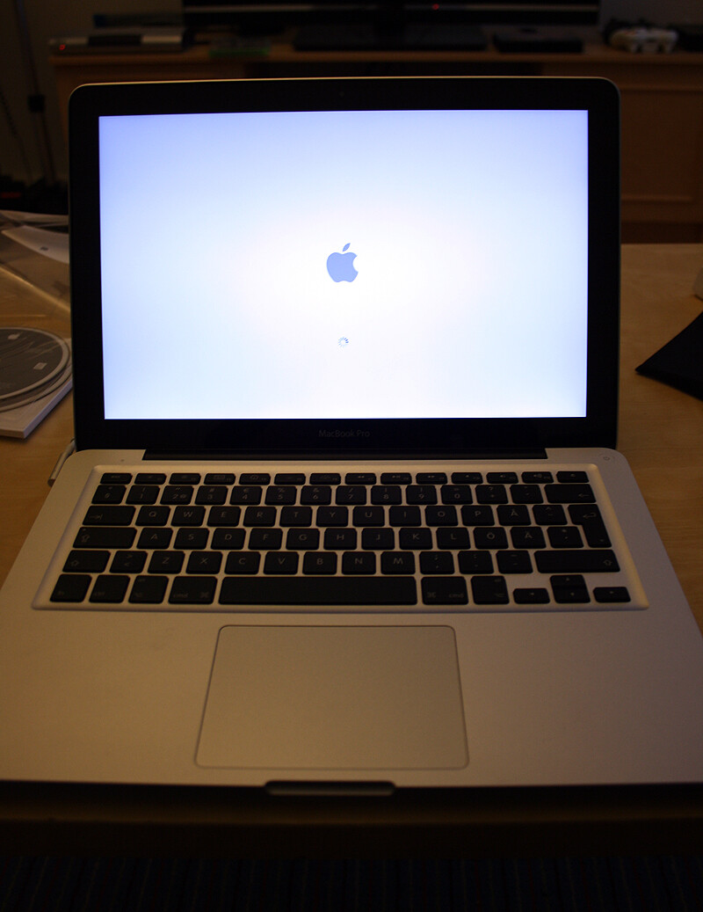
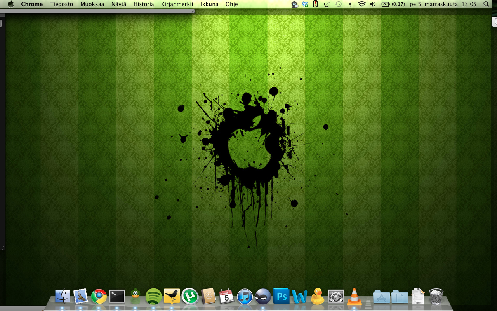

Olen käyttänyt MacBookkiani nyt viikon verran ja ajattelin jakaa teille hieman mielipiteitätni ja kommettejani tästä vekottimesta. Eli käytössäni on ollut halvin näistä 13 tuumasista MacBook Pro malleista ja lyhyesti sanottuna olen ollut erittäin tyytyväinen tähän koneeseen.

## Akkukesto

Akkukesto oli yksi hankintasyistä ja tällä hetkellä kun sovelluksia on auki useita ja käytän monenlaista sovellusta yhtäaikaa (selainta, tweetdeck, mail, photoshop, spotify, yms). Niin ei voikaan olettaa, että päästään siihen täyteen 10 tuntiin mitä spekseissä luvataan. Olen päässyt omalla käytölläni kuitenkin kuuden tunnin paremmalle puolelle! Olen tyytyväinen tähänkin, sillä aikaisemmat läppärini pääsivät 2-3h paikkeille jos sinnekkään. Tietysti voisin päästä pitemmälle jos pienentäisin näytön kirkkautta enemmän akulla ollessa ja näppäimistön valoja, mutta olen jotenkin koukuttunut näppiksen valoihin (ainakin illalla).

## Mac OS X

Tämä käyttöjärjestelmä oli minulle aivan uusi tuttavuus. Tai no sillä tavalla uusi etten ollut käyttänyt tätä aikaisemmin. Siirtymä Windows maailmasta oli suhteellisen kivuton sillä tämä on suhteellisen helppokäyttöinen. Alussa oli tietenkin pari ongelmaa esim. softan asennuksen kanssa, mutta sekin opittiin hyvin nopeasti.

Käyttöjärjestelmässä on hyviä oivalluksia, kuten dock on erittäin näppärä. Samoin se, että ylhäällä oleva valikkopalkki (liekö oikea termi mutta kutsun sitä nyt sillä) on ovela kun se vaihtuu jokaisen aktiivisena olevan ohjelman mukaan sisällöltään sen ohjelman tarpeita vastaavaksi.

Olen oikeastaan vielä tutkimassa tätä käyttöjärjestelmää, joten paljon on varmaan vielä piilossa. Tosin vaikuttaa erittäin hyvältä viritykseltä ja tätä tullaan vielä käyttämään hyvinkin paljon.

## MacBook Pro

Käsittelen tässä nyt tätä laitetta itsessään eli vähän sitä sun tätä tästä vekottimesta. Voisin aloittaa vaikka rungosta. Tämä on Applen sivujen mukaan ollut yksi alumiini blokki alussa ja siitä työstetty koneeksi. En ole huomannut minkäänlaista nitinää/natinaa kuten aikaisemmissa koneissani on ollut.

Näppäimistö on tässä laitteessa loistava. Pidän tämänkaltaisesta näppiksestä, jossa on hieman väliä. En ihmettele miksi muut läppärivalmistajat matkivat Applea näissä. Minulle oli myös hieno ominaisuus se, että näppiksessä on taustavalot! En ole ennen tiennyt, että niitä tarvitsisin. Nyt taas pidän niitäkin päällä oikeastaan koko ajan.

Touchpad on myös loistava! Pinta-ala siinä on iso joten tilaa liikkua on, sekä parhaimmillaan tarvitset neljä sormea, että saat tehtyä toimintoja helposti. Käytän touchpadia oikeastaan ennemmin kuin hiirtä paitsi jos kyse on pelaamisesta tällä vekottimella (jooo minecraft toimii!).

Liitännöistä voisin hieman nurista. Tahtoisin, että USB portteja olisi pari lisää – ne nimittäin tulee loppumaan kun hiiri on yhdessä ja mokkula toisessa. Onneksi on olemassa USB-hubi, joka pitää hankkia mahdollisimman pian tähän.

Melkein unohdin mainita sen, että tämähän on pirun hiljainen kannettava! Entinen kone huusi kun vietävä, kun sitä käytti. Se ei normaalikäytössäkään ollut näin hiljainen kuin tämä on ollut äänekkäimmillään.

Jotain todennäköisesti unohdin mainita, jos näin kävi niin uusi blogipostaus siitä sitten. Mutta todennäköisesti tästä tulette kuulemaan vielä lisääkin! Ja jos on kysymyksiä tästä vekottimesta niin antaa palaa!
