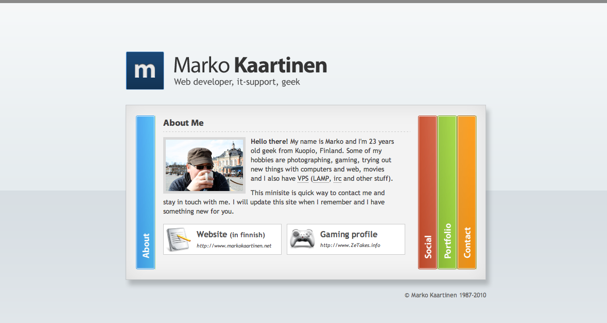

Ajattelin nyt julkaista tämän minisaitin täälläkin hieman paremmin kuin tuolla linkillä sivupalkissa.

Eli kyseessä on [MarkoKaartinen.info](http://markokaartinen.info) domainissa sijaitseva minisaitti englanniksi. Ja aiheena on kukas muu, kuin minä. Minisaitin tarkoituksena on olla  käyntikorttina ja toimia englanninkielisenä esittelysivuna.

Minisaitille olen laittanut neljä eri osiota. **About me** -osio kertoo minusta lyhyesti ja sieltä on linkit MarkoKaartinen.nettiin ja ZeTakes.info sivustolle (joka on kesken). **Social** -osiossa on sosiaalisen median linkit. **Portfolio** -osiosta löytyy työnäytteitäni kahdessa osassa: **Photography** -osassa on ottamiani kuvia ja **Websites** -osassa on tekemiäni sivupohjia (lisää osia tulee tännekkin). **Contact** -osiossa on taas yhteystietoni, jos jollain on tarve ottaa yhteyttä – sekä vcardin saa ladattua tästä kohtaa.

Kaikki palaute on tervetullutta!
