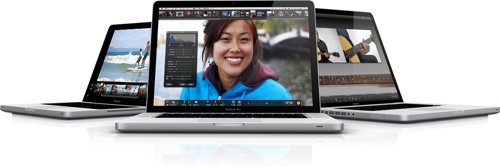

Ja tästä artikkelista tulee leima kavereilta. Leimahan on ”Apple fanboy” – aivan sama tuleeko. Mutta olen nyt jo jonkin aikaa pohtinut Macbook Pron hankkimista (ei en ole vielä hankkinut). Sain jo kuittailua kun iPhone 3G tupsahti taskuun, ei se vaiakuttanut siihen että se oli paras puhelin mitä minulla on ollut (ennen iPhone 4:sta tietty).

Mielessä on erityisemmin MacBook Pro ja noista malleista kukkarolle kävisi tuo 13 tuuman 2.4GHz prossulla oleva malli. Ja pohdiskelin kyllä normi MacBookkiakin, mutta ajattelin että näin  saisin vähä pitemmälle ajalle koneen. Rahaa ei vielä ole hankkia, tosin osamaksukin voisi olla yksi vaihtoehto.

Ai miksikö mäkki? Noh, minulla on ollut PC ties kuinka kauan ja siinä on pyöritetty Windowsia ja Linuxia millon mitenkin. Tässähän on jäänyt mäkki kokeilematta kokonaan. En ala teille speksejä tässä luettelemaan, mutta ne voitte tutkia Applen omiltakin [sivuilta](http://www.apple.com/fi/macbookpro/specs.html).

Haluaisinkin nyt mielipiteen niiltä, joilla on jo mäkki. Kehut/haukut, ihan mitä vaan! Antaa tulla vain!!
