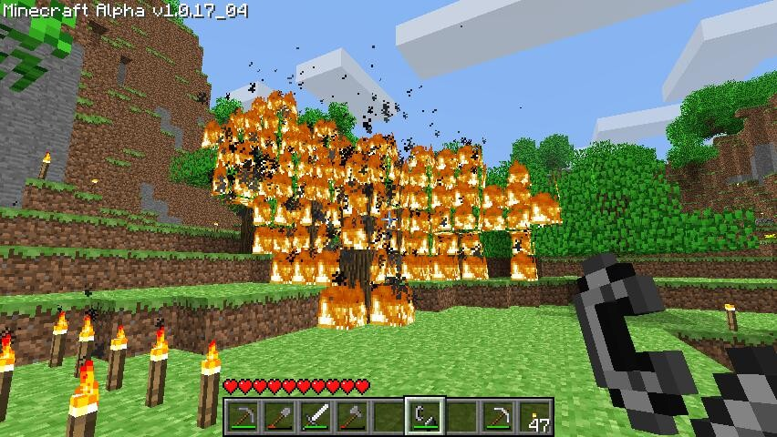
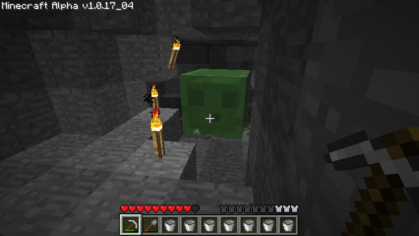
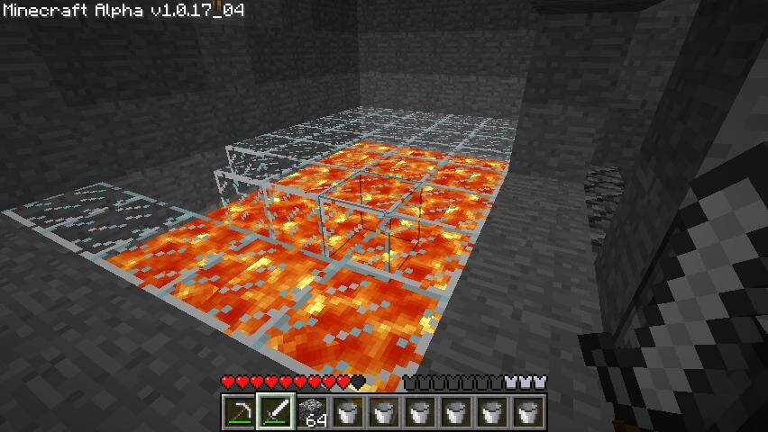
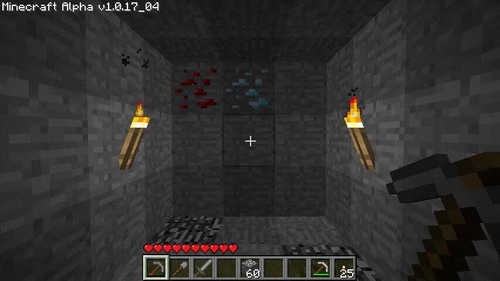
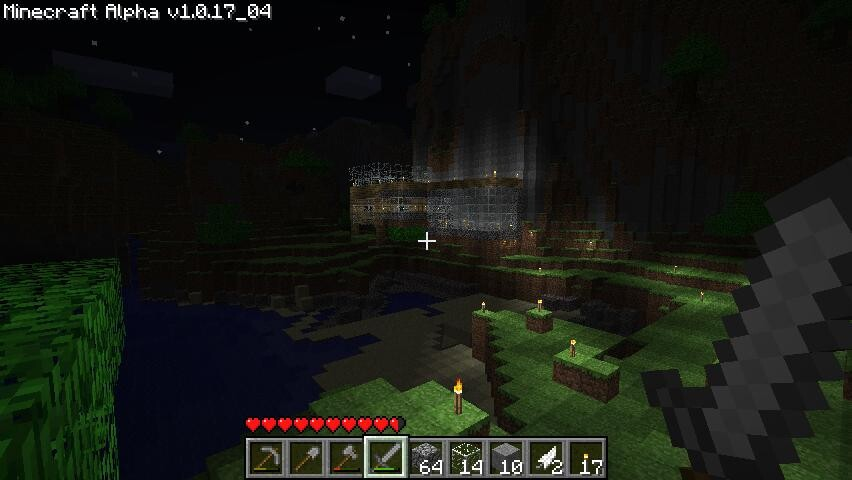

Koska sivupohjaa ei näy vieläkään niin pitää kertoa sen myöhästymiseen syykin. Kyseessä on peli nimeltä Minecraft. Löysin pelin uudestaan viikko sitten, aiemmin olin pelannut ilmaista rakentelu versiota selaimella ja nyt löysin Youtubesta videoita kyseisestä pelistä ja se oli sitten menoa se.

Kyseessä on siis Markus ”Notch” Perrsonin kehittämä **erittäin** addiktoiva hiekkalaatikkopeli. Pelin satunnaisesti generoima maailma on **ISO!** ja siellä voi pelaaja tehdä mitä lystää. Haluatko rakennella linnoja, tehdä järjettömiä rakennuksia, kaivaa tai jotain muuta? Mielikuvitus on oikeastaan rajana (tosin peli on Alpha vaiheessa, joten ihan kaikkea mitä halajat ei välttämättä voi tehdä).\
Pelissä on myös vihollisia, jotka spawnaavat öisin avoimille alueille ja jos kaivoksia satut kaivamaan niin varo pimeitä luolia! Voit rakennella erilaisia työkaluja, aseita, suojia ja materiaaleja. Tuli tuossa rakenneltua laava lattiaakin.

Kaivoksien tekeminen on melkein välttämätöntä, mikäli haluat löytää resursseja kuten timanttia, hiiltä, rautaa ja redstonea.\
Itse olen rakennellut omaan ensimmäiseen maailmaani kaksi kaivosta.\
Ensimmäinen menee viistossa täysin pohjaan asti ja jatkuu siitä tunnelina pohjaa pitkin. Sieltä tuli löydettyä hyvin resursseja ja törmäsin siellä laavaankin ensimmäisen kerran.\
Toinen kaivos menee pystysuoraan pohjaan asti ja jatkuu taas vaakasuoraan tunnelina, kunnes nousee viistossa maan päälle. Tämä kaivos tulee eri paikassa ylös kuin oma tukikohtani, joten sinne toisen tukikohdan rakentaminen on oma projektinsa.

Ajattelitte varmaan ensimmäisenä kun näitte kuvan tästä pelistä, että ”HYI HELKUTTI MITKÄ GRAFIIKAT”. Tietty pelissä on hieman ”vanhahtavat” grafiikat, varsinkin siltä aluksi tuntuu kun on tottunut hienoihin grafiikkoihin. Mutta peli on äärimmäisen addiktoiva ja grafiikasta viis se toimii suhteellisen hyvin vaikka onkin Alpha vaiheessa.

Suosittelen itse peliä kaikille ja tällä hetkellä olen saanut pari ihmistä innostumaan tästä pelistä ja toivottavasti saisin muitakin innostumaan tämän kirjoituksen myötä.

Mainittakoon vielä, että pelistä on olemassa moninpeli versio, mutta se on vielä suhteellisen buginen. En ole kunnolla testannut moninpeli serveriä vielä, mutta tulen testailemaan sitä enemmänkin.

Käykää kurkkaamassa Minecraftin sivuja osoitteesta [www.minecraft.net](http://www.minecraft.net/) ja lopuksi teille vielä video eilisestä löydöstä kaivoksessa.


