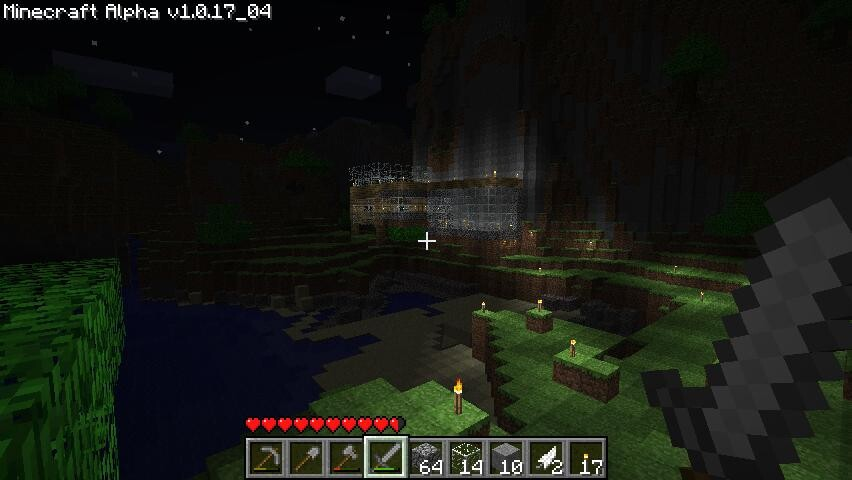

Kirjoitettuani artikkelin Minecraftista [aiemmin](/2010/minecraft). On sivustolle eksynyt päivittäin kävijöitä hakusanalla minecraft. Tämä nyt kertoo minulle jo tietämäni asian, eli sen että Minecraft on noussut erittäin suosituksia ja useampikin media on kiinnittänyt huomiota siihen.

Olen ollut pari viikkoa irti Minecraftista sillä en ole saanut aikaiseksi pelata oikein mitään, yksi peli on työn alla, mutta ei siitä sen enempää. Katsellaan jos jotain Minecraft postausta tulisi myöhemmin, jossa olisi hieman omasta pelistäni tai jotain.

Viime aikoina on ollut Notchilla (pelin tekijällä) ongelmia paypalin [kanssa](http://notch.tumblr.com/post/1096322756/working-on-a-friday-update-crying-over-paypal). Notch on myös pykäämässä firmaa pystyyn ja tämän eteneminen kiinnostaa ainakin allekirjoittanutta, mielenkiintoista nähdä mitä tästä seuraa. Minecraft on nimittäin hyvä ja addiktoiva peli, sekä sen tulevaisuus näyttää lupaavalta kun Alpha vaiheessa peliä on myyty jo huikea määrä! Seuratkaahan muuten Notchin [blogia](http://notch.tumblr.com/) ja [Twitteriä](http://twitter.com/xnotch) jos Minecraft kiinnostaa!

Loppuun vielä viime kirjoituksessani postaamani video!


