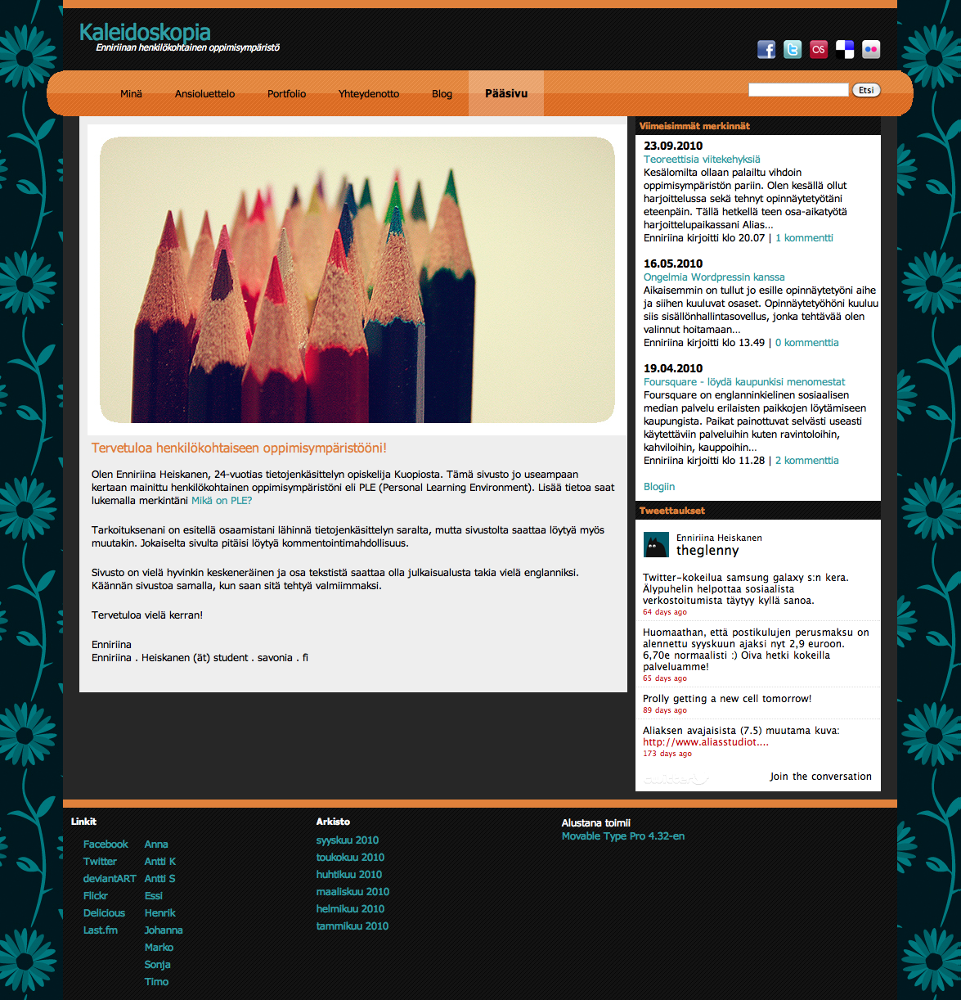
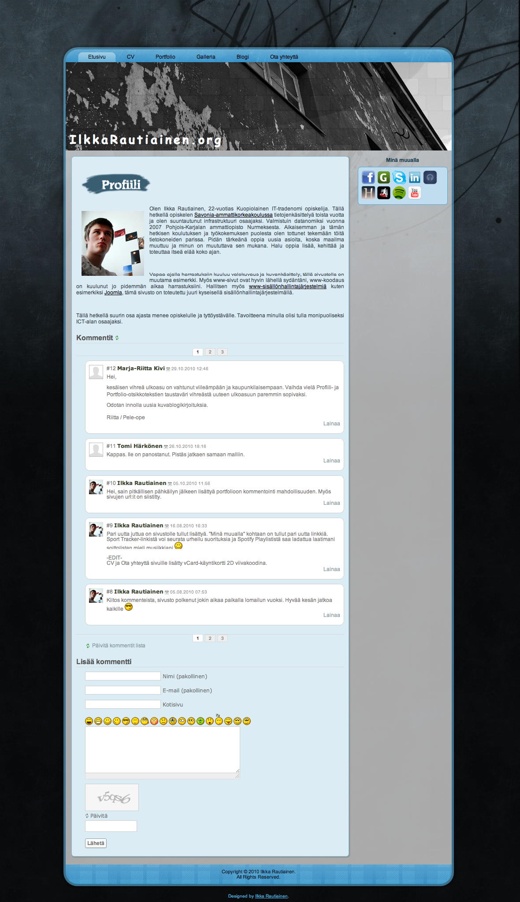
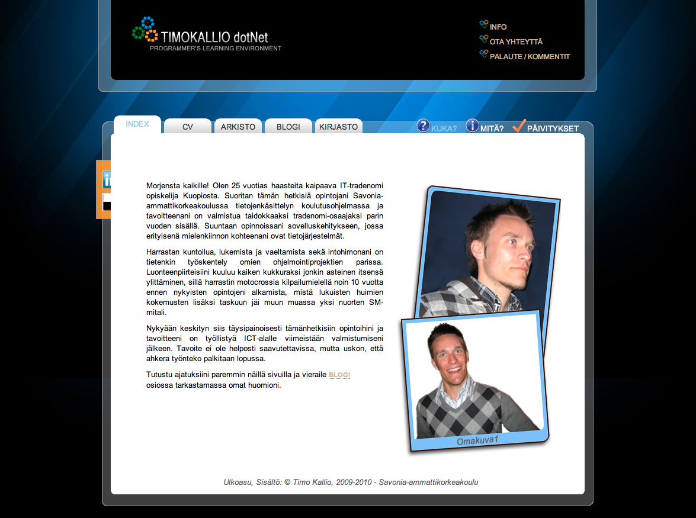

Tämä kirjoitus olisi kyllä pitänyt kirjoittaa jo paljon aikaisemmin. Tajusin tämän kun kirjoitin [Seuraamiani blogeja](/2010/seuraamiani-blogeja) postausta. Parempi myöhään kuin ei milloinkaan! Olen nähnyt muitakin PeLEjä kuin nämä, mutta osa niistä on salaisia ja sisään pääsee vain tunnuksella ja salasanalla, joten niitä ei tässä voida julkaista.

Nämä samat blogit mitä tässä esittelen löytyy PeLEn omasta blogistakin osoitteesta <http://plepele.wordpress.com/>\
Saatte sieltä myös lisäinfoa koko projektista.

## [Enniriina](http://www.kaleidoskopia.fi/)

Enniriina on kasannut oman PeLEsä Movable Typen päälle ja löytyy [Kaleidoskopia.fi](http://www.kaleidoskopia.fi/) domainin takaa.

## [Ilkka](http://www.ilkkarautiainen.org/)

Ilkan PeLE pyörii Joomlan päällä ja vaihtoi äskeittäin ulkoasuakin. Voitte löytää osoitteesta [IlkkaRautiainen.org](http://www.ilkkarautiainen.org/)

## [Timo](http://www.timokallio.net/)

Timolla taas osa on itse tehtyä ilmeisesti ja blogia pyörittää WordPress. [TimoKallio.net](http://www.timokallio.net) on osoite mistä hänet voitte löytää.
