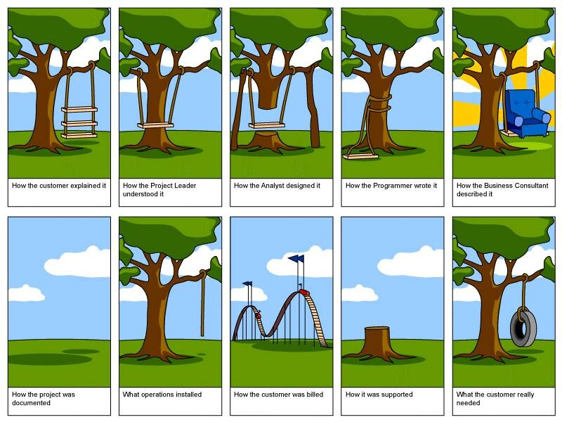

Jokainen joka on jossain vaiheessa opiskellut/ollut tekemisissä ohjelmistosuunnittelussa on varmasti nähnyt tämän seuraavan kuvan jossain yhteydessä.

Käydääs kuvan vaiheet läpi. Kuvassahan on selostettuna projektin eri vaiheet.

- Asiakas selosti haluavansa keinun kolmella laudalla
- Projektin johtaja taas sai aivan eri käsityksen asiakkaan tarpeista
- Ja sehän suunniteltiin aivan päin mäntyä (heh heh)
- Ohjelmointikin oli vähän sinne päin
- Ja hommahan kuvailtiin konsultin puolesta laiskanlinnaksi keinun päällä o_O
- Dokumentoinnista oli vain maininta jossain muistion kulmassa
- Asennettiin vain yksi köysi (jotain näkyy uupuvan joo)
- Laskutushan on aina kunnossa ja yläkanttiin!
- Tuki oli… no se oli jonkinlainen
- Ja loppujen lopuksi asiakas halusi vain rengaskeinun

Käykäähän tämä läpi huumorilla. Tietty tässä kuvassa on myös totuuttakin takana. Toivottavasti tämä piristi päivääsi!
