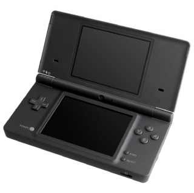
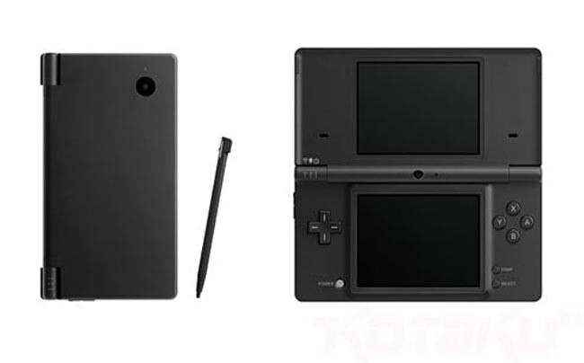

Vaikka tämä laite on ollut minulla jo kauan niin en ole kirjoittanut siitä tänne. En ainakaan omaa artikkelia ole sille omistanut. Joten tässä tulee se artikkeli joka olisi pitänyt kirjoittaa jo kauan sitten.

DSihän on Nintendon valmistama käsikonsoli ja se on oikeastaan parannettu versio alkuperäisestä DS:stä ja DS litestä. Kokoahan tällä laitteella ei ole paljoa mitään (leveys 137 mm, pituus 74,9 mm, korkeus 18,9 mm) ja painokaan ei päätä huimaa (214 grammaa). Näyttöjä on parikin kappaletta – toinen on kosketusnäyttö ja toinen ns. normaali näyttö. Molemmilla näytöillä on kokoa 3.25 tuumaa.

Pelailu tällä laitteella on yhtä hupia! Itselläni on joitain pelejä ja aika kuluu kyllä rattoisasti kun jäät oikein koukkuun tämän kanssa. Tällä hetkellä on pelailun alla Super Scribblenauts ja tämän kanssa tuleekin vietettyä seuraavat tylsät hetket.

Jos edes olet miettinyt tämän hankintaa – HANKI se. Itse pidän tästä pelikoneesta sekä suosittelen lämpimästi tätä kaikille!
