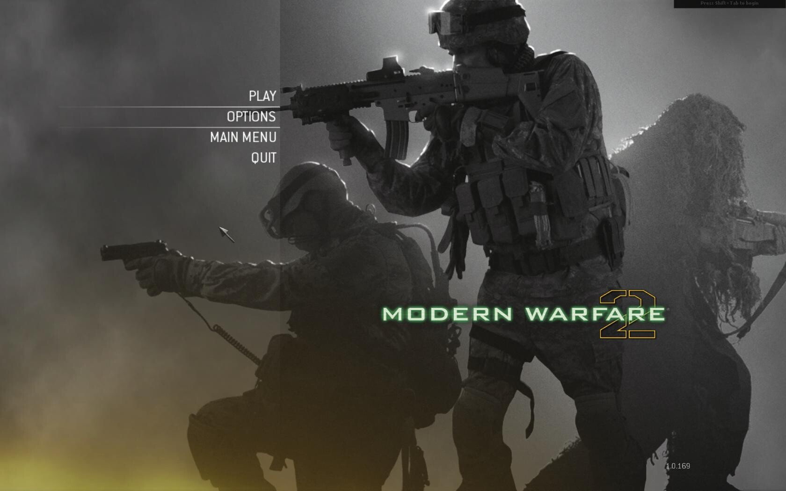

Pitkästä aikaa jotain CoD MW2:sta tännekkin. Tarkoituksena olisi siis jakaa joitain ajatuksia/”saavutuksia” tai jotain vastaavaa tässä postauksessa.

Aloitetaan aina niin hienosta aiheesta kuin huijarit. Nämä pelien pohjasakka ja inhotuimmat jäsenet. Olen törmännyt pelatessani jokusen kerran niin aimbottien käyttäjiin kuin muihin vastaaviin huijareihin. Törkeimpiä huijauksia on huijata itselle pisteitä.\
Tähän liittyen törmäsin eräs päivä pelatessani huijariin, joka pisti koijauksen päälle kaikille pelaajille. Nimittäin aluksi peli alkoi normaalisti ja kun satuin tappamaan kyseessä olevan huijarin Intervention tarkkuuskiväärillä, niin mappi latautui uusiksi ja peli ei ollut enää entisensä. Gravity katosi lähes kokonaan, eli pelaajat pomppivat luonnottoman korkealle; sekä loppumattomat panokset aseisiin ja aseisiin kiinnitetyistä kranaatin heittimistä tuli automaattiaseiden tapaisia. Ehkä helpoin, että vilasette seuraavaa videota.



Samanlaista kommenttia kuului kuulokkeiden toisesta päästä kuin tuossakin videossa eli ”mitä ihmettä tämä on…”. Tuon jälkeen ei enää kovinkaan kauaa kyseistä roundia pelattu. Tuollaisessa menee suoraan sanottuna maku, ei mitään järkeä koko touhussa.

Huijareista päästään sopivasti boostaajiin. Eli pelaajiin jotka hankkii tappoja esim. kokoontumalla paikkaan X kaverin kanssa ja tappamalla kaveriaan sen 25 kertaa saa nuken. Tässäkään nyt ole yhtään mitään järkeä! Killstreakit pitää saada pelaamalla eikä boostaamalla! Joten jos huomaat tyyppien boostaavan toisiaan, PILAA SE! Ala jahtaamaan niitä ja koita pilata koko homma!

Noin, nämä kun sai kirjoitettua niin voisin mainita vielä loppuun, että Spec Ops on mitä loistavinta viihdettä kaverin kanssa! Tosin olisi ollut hauska pelata yksinpelikin Co-oppina läpi. Ja joskus on tulossa videoo joistain Spec Ops tehtävistä.
