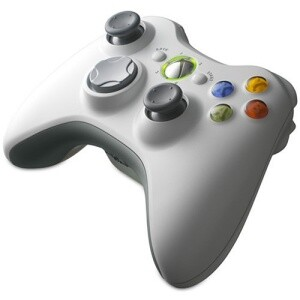
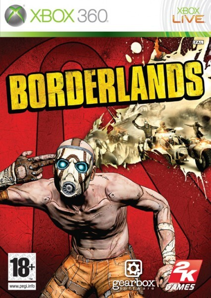
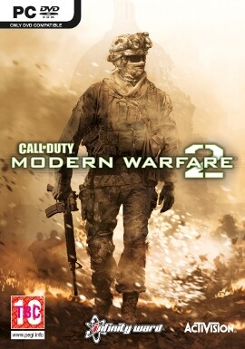
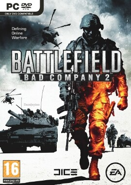

Tällä kertaa sukellan pelien maailmaan blogissani (ylläri..). Kaikki jotka on vähääkään katsonut blogia tietää, että pelaan erinäköisiä pelejä ja vieläpä FPS painotteista. Nyt ajattelin kirjoitella asiaa peleistä joita olen viime aikoina pelannut niin PC:llä kuin Xboxilla. Tämän viestin tarkoituksena olisi saada lisää porukkaa pelaamaan vaikka minun kanssani olis sinulla sitten PC tai Xbox, mutta siitä lisää lopussa.

## Borderlands *(Xbox 360)*

Ostin Borderlandsin Xboxille vasta viime perjantaina kun kaverini kehui sitä loistavaksi co-op peliksi split-screenissä. Olen tosin pelannut Borderlandsia aiemmin PC:llä, joten peli ei ole tuntematon minulle vaan tiesin mistä on kyse. Koitin peliä perjantaina ja pari tuntia sen parissa meni kuin siivillä ja olin koukussa. Kyseessä on nimittäin aivan loistava peli Xboxille ja jopa minäkin tottunut hiiren käyttäjä sain padilla panokset osumaan kohilleen.

Ja kyllä, kaveri oli oikeassa! Peli on loistava jaetulla kuvaruudulla ja se on loistava yksinpelinäkin, mutta silti kaipaa sitä kaveria siihen. Ei, en ole vielä Xbox Liven kautta pelannut muiden kanssa Borderlandsia. Lähinnä siksi en ole, koska hahmoni on vasta lvl 20+ ja haluaisin hieman parempia leluja kaverille käyttöön. Ajaminen tosin oli aluksi hieman hämmentävää, mutta siihenkin pääsi sisälle suhteellisen nopeasti.

DLC paketteja en ole ainakaan vielä ostanut Borderlandsiin, mutta kunhan pelaa ensin perusversiossa olevat läpi niin katsellaan sitten lisää roinaa peliin.

Suosittelen Borderlandsia erittäin lämpimästi niin boxille, kuin muillekkin laitealustoille. Pelissä on sitä paitsi aseita aivan TUHOTTOMASTI eli valinnan varaa on liiaksikin asti välillä kun ei millään haluaisi luopua räjähtäviä panoksia ampuvasta konekivääristä. Katsokaa alla oleva video Borderlandsista ja kommentoikaa!



## CoD MW 2 *(PC, Xbox 360)*

Tämä peli on mainittu useaan otteeseen blogissani, varsinkin ennen sen julkaisua. Joten tiedätte, että pelaan CoDyä ja olen pelannut sitä United Offensivesta lähtien. En ole parhaita pelaajia tässä pelissä, vaan on huonoja ja hyviä päiviä. Kuten jo Borderlandsin kohdalla sanoin en oikein hallitse Xboxin padin kanssa pelaamista ainakaan FPS pelien kohdalla, vaan hiiri on se väline minulle. CoDyn pelaaminen on jäänyt kuitenkin boxilla vähemmälle, koska enemmän tulee PC:llä pelattua CoDyä ja sitä ei sitten boxilla välttämättä jaksa niin paljoa.

Peli kuitenkin koukuttaa vielä niin moninpelin kanssa kuin yksinpelissäkin. Sekä SpecOps tehtävät tässä pelissä ovat loistava keksintö! Ainoita asioita mitä haukkusin tässä pelissä on dedicated servereiden puute, matchmakingin bugisuus sekä spawnit. Muuten peli on loistava. Ja kuten muissakin, tässä pieni video CoDystä.



## Battlefield: Bad Company 2 (PC)

Uusin Battlefieldi ja en voi sanoa kuin, että LOISTAVA peli on kyseessä. Tulee viemään rankasti peliaikaa CoDyltä pois. Pelasin Betaa kun se oli käynnissä ja nyt on peli julkaisussa ja sitä tulee pelattua Borderlandsin kanssa eniten seuraavien viikkojen ajan. Peliä olen pelannut vasta pari tuntia ja moninpeli on LOISTAVA, yksinpelistä en niinkään välittänyt, mutta pitää sitäkin koittaa tahkota jossain välissä eteenpäin.

Tuhoutuvat rakennukset, seinät, aidat ja kaatuvat puut! Kerrassaan mahtavaa! Tosin se tunne kun olet ikkunassa ampumassa vihollista ja seuraavaksi huomaat kun sinko tulee kohti ja jos satut selviämään niin kappas kun tuli taloon uusi ja mahtava aukko ikkunan tilalle.

Ja alla on arvostelu Battlefieldistäkin.



## Verkostoituminen

Kuten sanottua, peliseura olisi jees joskus! Eli listaanpas tähän nyt tunnuksia mitä voitte vapaasti lisätä kaverilistoille, tietysti TOIVON, että ilmottaisitte vaikka kommentilla, että olet lisännyt minut tai muuten tunnistaisit itsesi minulle.

**Steam:** markokaartinen ([Pelilista](http://steamcommunity.com/id/markokaartinen/games))\
**Xbox 360:** ZeTakes (CoD MW2, GoW2, Borderlands, L4D2, NHL10)\
**BF BC 2:** ZeTakes

PC:llä pelaamisen kanssa käytän TeamSpeakkia ja minulla on hallinnassa myös serveri sitä varten.\
IRCin kautta voi tulla kyselemään, en tiedä vielä luonko kanavaa tätä varten (riippuu tuloksista), mutta Marko @ Quakenet tiedoilla tavoitatte.

Pelaan pääasiassa silloin kun joudan, eli silloin kun en tee töitä tai ole koulussa tai muuten varattu. Yleensä yömyöhään tai sitten päiväsaikaan, riippuu täysin päivästä ja aikataulusta. Tämänkin takia jonkinlainen IRC-kanava voisi olla passeli jos porukkaa ilmaantuu.

Olen myös joskus ylläpitänyt pelipalvelimiakin, mutta nyt en ole siihen sijoittanut rahaa. Tosin jos BF BC 2 tulee halukkuutta muillakin niin siihen on ehkä innostusta alkaa säätämäänkin.\
Heittäkää ideoita peleistä!? Ehdotuksia, mitä vaan! Kommenttia tulemaan!

Ja tarkoituksenani on vain pitää hauskaa! Ei mitään muuta, tulkaa huutelemaan IRCissä, kommenteissa, sähköpostissa tai Xbox Livessä.

**See you online!!**
