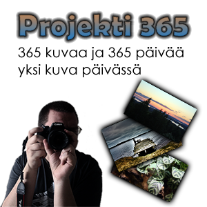

Aloitan uuden projektin ja sen nimi on Projekti 365. Tämän projektin tarkoituksena on ottaa kuva päivässä periaatteessa kuvia vuoden ajan. Eli projekti alkaa **20.10.2010** ja loppuu **19.10.2011**.

Tämän projektin kaikki kuvat tulevat Flickriin ja sinne linkki löytyy [tästä](http://www.flickr.com/photos/markokaartinen/sets/72157625075233419/). Sekä tänne sivustolle tulee oma Projekti 365 sivu sekä oma tekemäni kalenteri jossa on täysin samat kuvat kuin Flickrissä.

Halusin aloittaa tämän projektin, koska haluan kehittyä kuvaajana sekä onhan se hauska vuoden päästä katsella mitä kuvia on tullut otettua.\
Pyrin ottamaan ja julkaisemaan kuvan päivässä, mutta mikäli kuvaa ei tule jonain päivänä on syynä luultavasti laiskuus tai se etten ole kerennyt julkaisemaan mitään.

Tulen ottamaan kuvia pääasiassa Canon EOS 1000D:llä, mutta myös Canon Digital Ixus 85 IS pokkarilla ja iPhone 4:llä.

Huomenna siis julkaistaan projektin ensimmäinen kuva ja blogipostaus aiheeseen liittyen, sekä tuodaan esille Projekti 365 sivusto ja kalenteri.

**Hyvää yötä ja huomista odottelemaan!**
