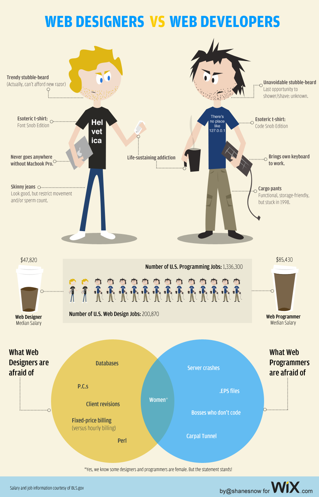

Noh [Twitter](http://twitter.com/#!/MarkoK/status/5745367308046336) ei helpottanut tätäkään hommaa. Joten pistetään tämmöinen kuva ja pohdiskellaan hieman omaa osaa tässä kuvassa. Täsmääkö vai ei? Sen näette kohta, mutta se kuva kuitenkin ensiksi.

\
*(kuvan lähde: [Six Revisions](http://sixrevisions.com/infographics/web-designers-vs-web-developers-infographic/))*

Minussahan on vähän molempaa näistä hahmoista. Tosin pääasiassa työni on tällä hetkellä webkehittäjän olemista, mutta olen tehnyt vähän molempaa hommaa.\
Aloitetaan parrasta: itselläni on leukaparta jota en tahdo leikatakaan, ehkä vähän siistiä, tosin parta kasvaa ja ainahan sitä ei jaksa leikata :D\
T-paita, niitä on monia ja yleensä tykkään pitää jonkinlaisia hauskoja paitoja (yleensä netti/nörtti aiheisia).\
Addiktio… hmm, itselläni on sekä pc, mac ja linux kone, joten ehkä tietokoneet on addiktio? Kahvi on onneksi vähemmälle jäänyt nyt.\
En tuo töihin omaa näppistä tai no… työt on kotona joten omalla näppiksellä teen töitä (lasketaanko se?). Noh… jos lähden matkalle tai pitemmäksi aikaa pois omasta asunnostani niin kyllä joku kone lähtee matkaan. Vaihtoehtoina on MacBook Pro tai miniläppäri. Tällä hetkellä mäkki vie voiton jos pitää joku koppasta mukaan.\
Käytän sopivia farkkuja :D En liian tiukkoja enkä liian löysiä, tosin tommoisia ”cargo pants” mallisia housuja voisin pitääkin.\
Palkasta en ala puhumaan, joten siirrytään sopivasti noihin pelkoihin. Noista vaihtoehdoista en oikeastaan pelkää muuta kuin palvelinten kaatumista – lähinnä siksi, koska ne tuottaa ylimääräistä työtä ja suhteellisen paljon tressiä. Ja naisten kanssahan pitää olla terve pelko koko ajan matkassa ;) Samoin se järki!

Lopuksi kiitokset tämän kuvan tekijälle, [Shane Snow](http://www.shanesnow.com/):lle!

Oletko kehittäjä tai suunnittelija? Vieläpä webbipuolella? Koitappa verrata itseäsi näihin hahmoihin!
