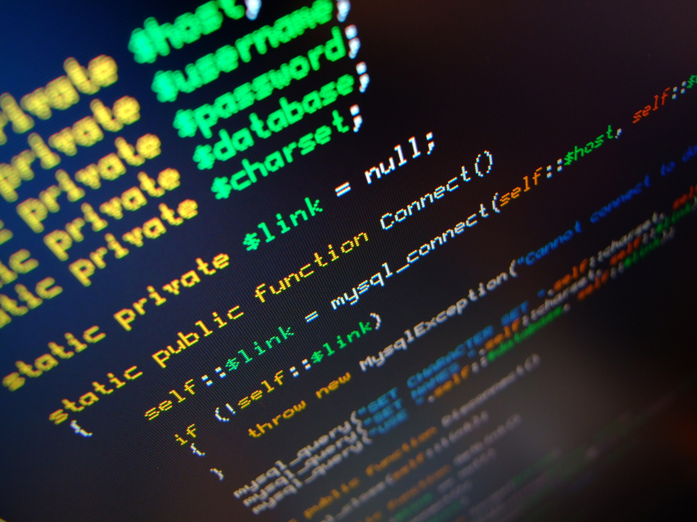
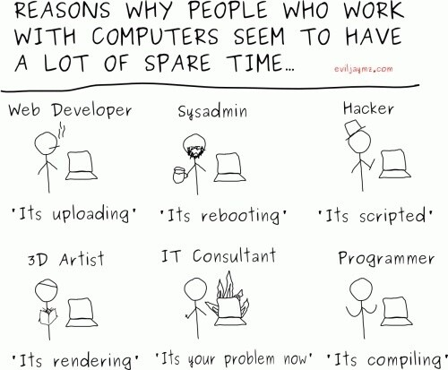

Jossain tilanteessa on herättänyt keskustelua se, että teen töitä etänä ja projektityyppisesti. Joten ajattelin hieman valoittaa miten teen töitä ja onko se tapa soveltunut minulle.\
Kerron myös millä välineillä työskentelen ja mitä yleensä teen työkseni. Uskoisin näiden asioiden kiinnostavan teitä ja voitte saada hieman kuvaa millaista olisi työskennellä projektityyppisesti.

Aluksi voisi hieman valoittaa mitä ensinnäkin teen ja keiden kanssa. CV:ssä lukee, että www-sovellusten suunnittelu, toteutus, testaus ja käyttöönotto. Tämä pitää täysin paikkansa, mutta jos valoitetaan hieman niin olen vuoden ollut kaverini Jonnen kanssa tekemässä sovelluksia yritykselle ja nimenomaan www-sovelluksia.\
Kielinä olemme käyttäneet XHTML ja CSS ulkoasuihin, PHP:llä olemme toteuttaneet lähes kaiken toiminnallisuuden, JS/Ajax kielillä olemme toteuttaneet osan palikoista sovelluksiin ja MySQL on ollut tietokantana alusta alkaen. Testi palvelimena meillä hyrrää Debian pohjalla oleva peruskone ja tuotanto puolella on myöskin Linux palvelin hyrräämässä.

Seuraavaksi siirrytään työaikaan, sillä tämä herättää hieman ihmettelyä ja mielenkiintoa välistä. Eli me olemme työskennelleet niin, että kerran viikossa on ollut palaveri yrityksen tiloissa ja olemme käyneet läpi mitä olemme tehneet ja mitä teemme seuraavalle kerralle.\
Itse työt teemme kumpikin kotonamme omilla koneilla, kommunikointi tapahtuu tietokoneen välityksellä ja olemme yleensä samaan aikaan tekemässä töitä niin tiedämme koko ajan mitä toinen tekee. Mikäli tulee kiireellisiä korjauksia tai parannuksia työn alle niin teemme ne yleensä heti alta pois.\
Se paljonko viikkoon tulee työtunteja riippuu aika paljon siitä miten paljon tulee sähköpostiin korjausehdotuksia, parannuksia ja siitä miten paljon/vähän ongelmia tulee. Joskus tulee tehtyä hyvinkin pitkää päivää ja joskus taas ei.

Itselleni on tämä työskentelytapa sopinut erittäin hyvin. On vähän vapaampaa, kun ei tarvitse 8-16 istua toimistolla päätteen ääressä vääntämässä koodia. Tietysti hieman hämärtyy se vapaa-ajan ja työn raja kun työpaikka on yhtäkuin koti, mutta en ole kokenut tätä sen isommaksi ongelmaksi. Lähinnä siksi se ei ole ongelma, koska saan käännettyä työn ”offille” ja aukaistua vaikka pelin tai elokuvan.\
Opiskelujen ohessa tämä on sinänsä haastava tapa tehdä töitä, koska jos olet päivät koulussa ja illalla pitääkin tehdä joku ominaisuus tai bugikorjaus sovellukseen niin käyhän se raskaaksi välillä.

Lopuksi voisikin kysyä seuraavaa: *Olemmeko saaneet mitään aikaan?*\
Ja jos vastaisin lyhyesti niin vastaus olisi kyllä. Mutta pitempi vastaus kiinnostaa teitä enemmän. Tällä hetkellä ensimmäinen sovelluksemme on tuotantokäytössä ja kehitämme sitä hiukan paremmaksi kokonaisuudeksi. Toisen isomman sovelluksen beta otettiin käyttöön vuoden alussa ja nyt se on lähes valmis sovellus, muutamaa ominaisuutta lukuunottamatta. Sitäkin tulemme kehittämään jatkossa.\
Eli kyseessä ei ole mitään pieniä sovelluksia mitä olemme tehneet vaan koodirivejä on useita tuhansia takana ja tietokanta kasvaa kasvamistaan.

**Kysykää ja kommentoikaa!**

Tähän loppuun pieni sarjakuva piristämään päivää (tai no tarkemmin yötä).

