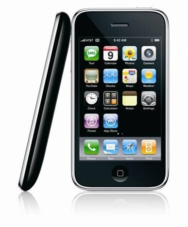
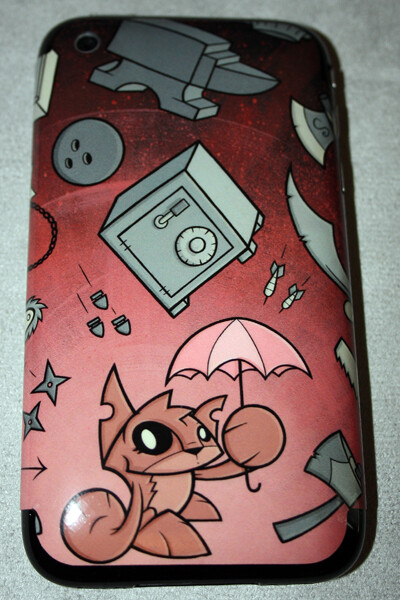
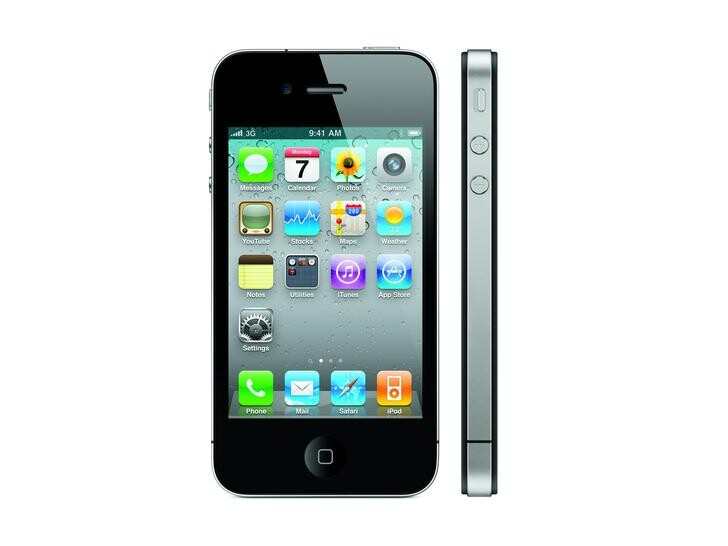

iPhonen ensimmäinen Suomeen tullut versio on ollut minulla vuoden ja neljä kuukautta. Eli omistan iPhone 3G:n 16 gigasena ja en ole katunut päivääkään sen hankkimista.

Nyt ajattelin hieman jakaa ajatuksia ja mietteitä kyseisestä luurista tältä ajalta. Todennäköistä on se, että jotain unohtuu.

**Alku**\
Alussa luuria tuli käpisteltyä todella paljon sillä olihan se minulle jotain aivan uutta ja aina käy näin, kun saa uuden lelun. Tällöin akkukesto oli todella kovilla, kun koko ajan piti jotain saada tehdä puhelimella.\
Tietenkin piti asennella kaikenlaisia appseja ja koittaa mahdollisimman paljon eri juttuja ja pelejä yms yms. Osa kävi turhiksi ja niitä poisteltiin ja tuloksena iTunesissa suhteellisen kattava lista eri appseja joita ei ole asennettuna puhelimeen.\
Mutta oli se jotain niin hienoa ja erilaista entiseen Nokian N80 puhelimeen verrattuna. Olin myyty heti alusta lähtien.

**Nykykäyttö**\

Käytän iPhonea päivittäin, siihen tulee sähköpostit (henk.koht, työ, koulu). Myös sosiaalisia medioita löytyy luurista, esimerkiksi Twitter, Facebook ja Tumblr.\
Kuten näistä appseista voi jo päätellä, ei iPhonen kanssa voi olla ilman datapakettia. Nettikäyttö kyseisellä laitteella on suunnattoman helppoa ja vaivatonta, joten satunnainen surffauskin on miellyttävää hyvän käyttöliittymän ansioista.

Puhelimeen on tietenkin tullut hankittua erilaisia ”lisäosia” kuten näytönsuojia (pakollinen!!), takakanteen ”tarra”, autolaturia, autoteline, perus usb piuhoja sekä pientä sekalaista sälää.\
Appseja on tulut hankittua x määrä ja minulle hyödyllisimmät niistä on käytössä tälläkin hetkellä.

**Ongelmat**\
iPhonen kanssa ei ole ollut ongelmia paljoa verrattuna edelliseen Nokialaiseeni. Kerran olen joutunut käyttämään luuria Sonera pisteessä ja sillonkin ongelman olisi voinut itse ratkaista, mutta en onnistunut siinä silloin. Kertaakaan en ole huoltoon joutunut tukeutumaan ja puhelin on ollut minun käytössäni koko tämän ajan, joka on loistava asia!\
Nyt uusimman softapäivityksen jälkeen puhelin on hidastunut jonkin verran ja ”lagia” on välillä.

**Sonera?!**\
Suurin osa jättää iPhonen hankkimatta Suomesta, koska operaattorina on Sonera. Tämä oli ehkä suurin kynnys itsellenikin ja osa minusta haluaa eroon Sonerasta, mutta tällä hetkellä se ei onnistu. Tosin toiveissa on, että iPhone 4 tulisi Suomeen ilman sim lukitusta, mutta epäilen suuresti tätä.\
Säästäisin todennäköisesti noin 10 euroa kuussa, jos siirtäisin liittymäni esimerkiksi Saunalahdelle, mutta sitten en voisi käyttää iPhonea. Jailbreikkaus ei sinällään ole vaihtoehto vielä, koska em. lagi on jo tarpeeksi ärsyttävä ilman sitä softaa.

**iPhone 4?**\

Tulenko vaihtamaan luurin tähän? Hieman himottaisi kyllä ja luettuani Soneran sivuja, että voin ottaa lukituksen pois 3G:stä jos otan toisen määräaikasen puhelimen sen tilalle. Tämä passaisi kyllä sinällään hyvin, koska 3G:lle olisi jo ottajakin ;) Se vaikuttaa vielä, että millä hintaa puhelinta tullaan tarjoamaan ja onko siinä sim lukkoa.\
Itseäni ei kauheammin hetkauta antenni ongelmat, mistä mediassa on ollut puhetta. Jos muovilärpäke ratkaisee ongelman niin hyvä. Tietty harmittavaa, että tämmösiä ongelmia on puhelimassa, jospa Suomeen tulisi toimiva erä.

Tämmöstä tällä kertaa, jatkan uudistuksen työstämistä alkavalla viikolla! Jos loppuviikosta saisi jotain toimivaa. Testejä tehdään koko ajan ja uutta sivua työstetään tälläkin hetkellä!
