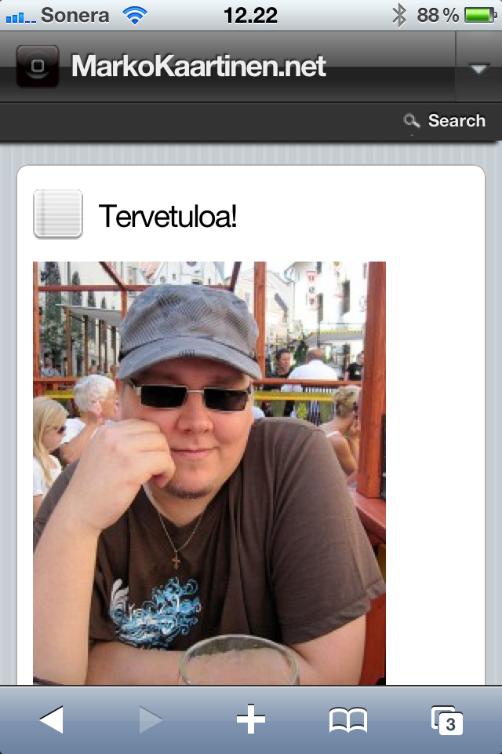
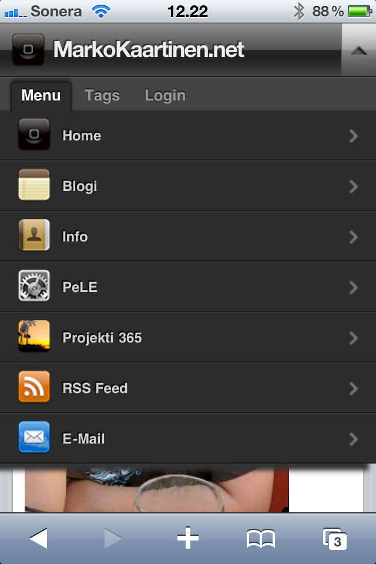
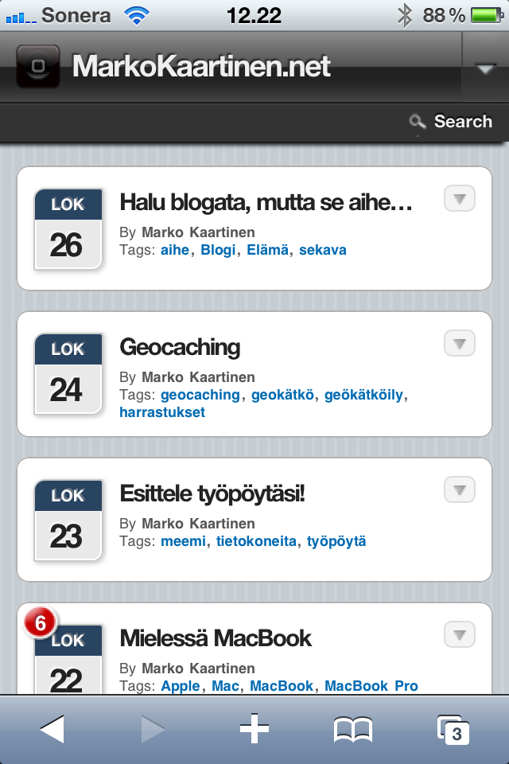
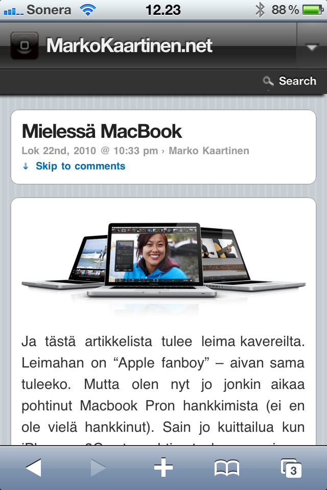
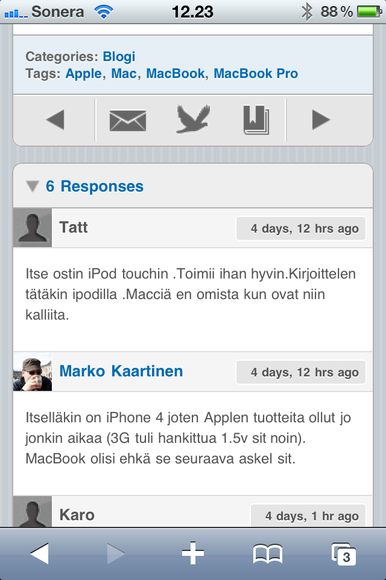

Asensin sivustolle WPtouch lisäosan helpottamaan mobiilikäyttöä. En osaa sanoa tarkalleen mitkä puhelimet tukevat tätä ominaisuutta. Lisäosan sivusto [WordPress.orgissa](http://wordpress.org/extend/plugins/wptouch/) sanoo seuraavaa:

> WPtouch automatically transforms your WordPress blog into an iPhone application-style theme, complete with ajax loading articles and effects, when viewed from an iPhone, iPod touch, Android, Opera Mini, Palm Pre, Samsung touch and BlackBerry Storm/Torch mobile devices.

Testasin tätä omalla iPhonellani ja homma pelas komiasti. Alla muutama shotti lisäosasta toiminnassa.

