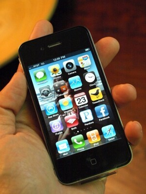
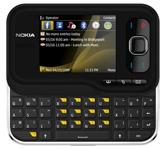

Nyt on käynyt niin ikävästi, että iPhone 4 on joutunut huollon kouriin. Tarkkasilmäiset ovat varmaan tämänkin tragedian bonganneet [Twitteristäni](http://twitter.com/MarkoK). Eli iPhone teki ikävän tempun ja puhelimen kaiutin meni rikki. Eli soittaessa ei kuulu vastapuolesta niin yhtään mitään. Muutenhan puhelin toimii normaalisti. Syytäkään tälle ilmiölle ei löytynyt, joten huoltoonhan tämä piti kiikuttaa.

Eli tässä kirjoituksessa tulen antamaan teille hieman ajatuksia tästä huoltoreissusta ja samaten vaikutelmia huollon aikana käyttämästäni [Nokia 6760 slide](http://www.nokia.fi/tuotteet/kaikki-puhelimet/nokia-6760-slide) ”älypuhelimesta”.

## Elämä ilman iPhonea (onko sitä?)

Jos aloitetaan siitä, että miten on elämä lähtenyt käyntiin ilman iPhonea. Tietysti ensin oli outo tunne kun ei ollut mitään puhelinta sen jälkeen, kun sen luurin jätti sinne huoltoon. Tälläiselle SoMe ”hullulle” iPhone oli loistopeli, joten hieman outoa on ettei puhelin piippaa Twitterin/Facebookin takia.

Sen jälkeen kun sain synkattua kalenterin ja gmailin niin tuo puhelin toimii varsin pätevästi. Pelithän oli iPhonessa myös loistokkaita ja nykyään se pelailu luurilla jää täysin nollaan. On myös vaikeaa sanoa miten esim. HTC:t toimivat kun en niitä ole päässyt käyttämään, joten itselleni iPhone on ollut hyvä puhelin. Ennen 4 versiota ollut 3G oli myös loistava puhelin ja sen jälkeen ei kauheasti ole ollut Nokian N80 ikävä.

Nyt kävi mielessä, että mitenhän hyvältä vekottimelta se iPhone tuntuu sitten kun se tulee huollosta? Sitä odotellessa voitte lukaista ajatuksia Nokia 6760 slide luurista…

## Ajatukset Nokia 6760 slide puhelimesta

Kyseessähän on siitä hauska Nokialainen, että siinä on näppis lähes täydellinen QWERTY. Ääkköset pitää taiteilla shiftin takaa ja ei ole oikein kunnon kirjoitus tuntumaa tuohon.

Kyllähän tuolla luurilla sähköpostin saa luettua, kalenteria selailtua ja kyllä olen päässyt Twitterin ja Facebookinkin katsomaan. Bloggaamista en ole edes kokeillut tuolla, pitäisiköhän? Pitäisi ainakin kokeilla saako tuolle shelli yhteyttä? Puttyä esimerkiksi?

IPhone on huollossa arviolta 3 viikkoa, joten uskon tulevani tällä hyvin toimeen sen ajan. Tietty on outoa kun on taas Nokian symbian käytössä ja ei olekaan enää kosketusnäyttöä käytössä. Näyttökin tuntuu suhteellisen pieneltä verrattuna iPhoneen. Tosin jouduin käyttämään tuota Nokia N80 pari tuntia ja sen käyttö se vasta tuskaa oli… huhhuh! Ei ole sitä luuria ikävä ei!

Toivotaan, että iPhone tulee huollosta toimivana ja sillä aikaa käyttelen tuota Nokialaista. Kertokaa minulle vinkkejä tota Nokian luuria varten, joitain sovelluksia vaikka?

**Hyvää viikonloppua ja pysyköön puhelimenne ehjänä!**
