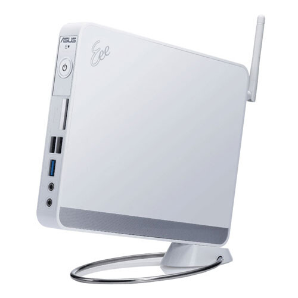

Olen moneen otteeseen pohdiskellut omaa kotipalvelinta itselleni. Tarkoituksena olisi pistää simppeli ja suhteellisen pienikokoinen palvelin, joka toimisi perus webbipalvelimena, tiedostopalvelimena ja ehkäpä jopa mediakoneena. Pääpaino olisi webissä ja tiedostoissa, tietysti jotain simppeliä voip-palvelinta voisi pyörittää myöskin. Asuksen tuotteita olen aikaisemminkin käyttänyt, tuli aikoinaan hankittua [Eee PC 901](/2008/asus-eee-pc-901-vihdoin-kasissani) miniläppäri, joka oli suhteellisen loistava vekotin.

Tuossa kuvassa on Asus EeeBox PC EB1012P, jonka speksit ovat suhteellisen mukavat ottaen huomioon, että konetta käytettäisiin pääasiassa kotipalvelimena. Onhan tuo vieläpä ihan kivan näkönenkin, ainut tuossa on se että siinä tulee mukana Windows 7 – tämä tulisi vaihtumaan joko Ubuntuun tai Debianiin.

Listaanpa täydelliset speksit tähän alle:

| Ominaisuus | Tiedot |
|---|---|
| Käyttöjärjestelmä | Aito Windows® 7 Home Premium |
| Prosessori | Intel® Atom™ Processor D510 Dual Core |
| Piirisarja | Intel® NM10 |
| Näytönohjain | Next-Generation NVIDIA® ION™(GT218-ION™) |
| Muisti | 2 GB Jopa 4 GB 1 x SO-DIMM |
| Tallennus | 250GB |
| Langaton tietoverkko | 802.11 b/g/n |
| LAN | 10/100/1000Mbps |
| I/O-portit sivulla | 1 x USB 3.0 2 x USB 2.0 1 x kuuloke 1 x mikrofoni |
| I/O-portit takana | 1 x USB 3.0 2 x USB 2.0 1 x e-SATA 1 x HDMI-Out 1 x VGA(D-Sub)-Out 1 x RJ45 LAN 1 x S/PDIF-lähtöliitäntä (audioliitäntä) 1 x sisäänrakennettu Wi-Fi-antenni |
| Virtalähde | 65 W-adapteri |
| Mitat | 222 x 178 x 26.9 cm (WxHxD) |
| Paino | 1.1 kgs |
| Väri | Musta/Valkoinen |
| Tarvikkeet | Näppäimistö Hiiri Virtajohto Takuukortti VESA-kiinnityspakkaus Tyylikäs jalusta |

Kuten näette niin tuossa on kotipalvelimelle passelisti muistia ja kiintolevytilaa. Pääasiassa tuo on pieni kokoinen ja ilmeisesti pirun hiljainenkin. Lisää muistiahan tuohon saa laitettua toiset 2 gigaa eli tulevaisuutta ajatellenkin laajennusvaraa on sekä kiintolevytilaa pystyy laajentamaan aina USB:n avulla (huomatkaa USB 3.0 portit). Mediakoneeksikin tuosta olisi sillä siinä on jopa HDMI liitäntä.

Hintaahan tälle laitteelle olisi noin 390 euroa (388,90 € verkkokaupassa), eli tuossa on suhteellisen hyvä hintalappukin. Pitää alkaa säästämään tätä vekotinta varten, jos joskus saisi hankittuakin sen.

Tämmöinen tekninen pläjäys tällä kertaa!
